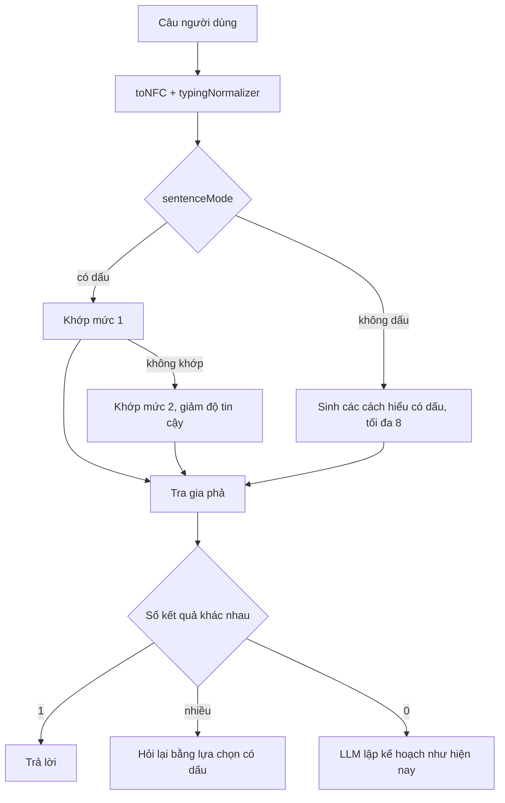
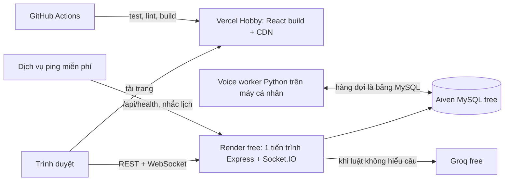

# Kế hoạch tổng thể — CAP2 (Gia Phả Việt)

Lập ngày 10/11/2026, dựa trên mã ở commit `3b550aa`. File này gom mọi kế hoạch đã bàn: cây gia phả, trợ lý AI, hiệu năng, cấu trúc mã. Việc lặt vặt còn mở vẫn ghi ở `VIEC_CHUA_LAM.md`.

Những gì chưa được kiểm chứng đều ghi rõ "cần đo" hoặc "cần xem trên trình duyệt". Chưa có load test, chưa chạy `EXPLAIN` trên DB thật, chưa ai chụp màn hình cây ở 390px và 1280px.

## 0. Ràng buộc và thứ tự ưu tiên

- **Không dùng gói trả phí.** Giữ Render free, Vercel Hobby, Aiven free, Groq free.
- **Giao diện trước, tính năng sau.** Trong từng phần cũng theo thứ tự đó.
- **Làm dần được.** Sau mỗi bước hệ thống vẫn chạy, CI vẫn xanh. Không viết lại từ đầu.
- **Ba tính năng lõi:** cây gia phả, xuất ảnh, AI hỏi quan hệ. Quỹ, time capsule, bài đăng, thanh toán, voice chỉ sửa lỗi.

### Lộ trình gộp

| Thứ tự | Giai đoạn | Loại | Thời lượng | Mục |
|---|---|---|---|---|
| 0 | Sửa gấp và dọn dẹp: đổi model Groq đã ngừng; dọn gốc dự án, viết `CLAUDE.md`; sao lưu tự động; MySQL local; bỏ token trên URL ảnh, lỗi thô, CORS, thư viện có lỗ hổng; ẩn thông tin liên hệ với người không có quyền; bỏ `console.log` | Sửa gấp | 1–1,5 tuần | G0, E7.1, H2.1, H2.3, H2.5, H3.1–H3.4, H4.6 |
| 1 | Thẻ trên cây: đẹp, dễ đọc | Giao diện | 1–1,5 tuần | A1 |
| 2 | Tương tác mượt: kéo, zoom, cây lớn; tách `FamilyTreeEditor` | Giao diện | 1,5–2 tuần | A2, E7.2 |
| 3 | Cây dễ nhìn, dễ tìm đường; điện thoại; trang chủ nhẹ; thẻ chia sẻ link; so ảnh chụp cây; khung bắt lỗi | Giao diện | 1,5 tuần | A3, E7.3, H1.1, H1.4, H1.5, H4.2, H4.4 |
| 4 | Giao diện toàn ứng dụng, đợt 1: màn hướng dẫn cho dòng họ mới, khung chờ và trạng thái trống, khả năng truy cập; kiểm thử trình duyệt; ESLint về 0 | Giao diện | 1,5–2 tuần | H1.6, H1.7, H1.8, H4.1, H4.3 |
| 5 | Giao diện toàn ứng dụng, đợt 2: bộ nút, ô nhập, hộp thoại, bảng dùng chung và màu theo biến cho các trang chính (đăng nhập, bảng điều khiển, cây, chat) | Giao diện | 2 tuần | H1.2, H1.3 |
| 6 | Chế độ tối | Giao diện | 1,5–2 tuần | H1.9 |
| 7 | Cổng AI chung: nhiều nhà cung cấp, kiểm tra model, hàng đợi, sổ hạn mức, bớt token, lưu kết quả | Nền tảng AI | 2,5–3 tuần | G-2, G-3, G-4, E7.4 |
| 8 | AI hiểu tiếng Việt có dấu | Nền tảng AI | 5–6 tuần | B, E7.5 |
| 9 | AI: lễ giỗ, lên kế hoạch, câu quan hệ còn thiếu; giao diện hạn mức; bộ đo chất lượng; Whisper qua Groq | Tính năng | 3–3,5 tuần | C, G-5, G-6 |
| 10 | Cây: bản đồ thu nhỏ, chỉ nhánh của tôi, bàn phím, xuất ảnh có ảnh đại diện, xuất PDF, chống ghi đè | Tính năng | 3–4 tuần | A4 |
| 11 | Hiệu năng không tốn tiền; kiểm tra file tải lên, CSP; log, health check, theo dõi lỗi, deploy không bước tay; `server.js` gọn, một hàm tải cây | Nền tảng | 3 tuần | D, H3.5, H3.6, H5.1–H5.4, E7.6, E7.7 |
| 12 | Tin cậy dữ liệu: lịch sử chỉnh sửa cây có hoàn tác, kiểm thử vòng GEDCOM, quy tắc mật khẩu, trang tình trạng hệ thống | Nền tảng | 2 tuần | H2.2, H2.4, H3.8, H5.5 |
| 13 | Phiên đăng nhập an toàn hơn | Nền tảng | 1 tuần | H3.7 |
| 14 | Cấu trúc lại phần còn lại: chia `manager` và `member` theo nghiệp vụ, `ensure*()` thành migration; bộ thành phần chung cho các trang còn lại | Nền tảng | 3–4 tuần | E7.8, E7.9, H1.2, H1.3 |
| 15 | Trình nhập Excel/GEDCOM có xem trước | Tính năng | 2 tuần | H6 |
| 16 | Link xem cây chỉ đọc, có hạn dùng | Tính năng | 1 tuần | H6 |
| 17 | Người dùng tự nhận mình trong cây, manager duyệt | Tính năng | 1 tuần | H6 |
| 18 | Email tổng hợp giỗ và sinh nhật hằng tuần | Tính năng | 3–4 ngày | H6 |
| 19 | Xem cây khi mất mạng | Tính năng | 1,5 tuần | H6 |

Tổng cộng khoảng 37–44 tuần cho một người, tức 9–10 tháng. Đây là ước tính thô, chưa tính thời gian thử trên trình duyệt thật và sửa lỗi phát sinh.

Ghi chú về thứ tự:

- Giai đoạn 0 đứng trước giao diện vì gồm việc AI đang hỏng, chưa có sao lưu và lộ thông tin liên hệ.
- Giai đoạn 1–6 là toàn bộ phần giao diện, làm trước theo ưu tiên đã chốt. Nếu cần rút ngắn, chế độ tối (giai đoạn 6) là việc nên lùi xuống cuối trước tiên.
- Giai đoạn 7–9 và 11 chỉ đụng Backend. Có hai người thì một người làm giao diện (1–6, 10), người kia làm 7–9 song song, rút tổng thời gian còn khoảng 5–6 tháng.
- Giai đoạn 15–19 xếp theo mức giảm công nhập liệu và mời người; đổi thứ tự không ảnh hưởng phần trước.

### Mốc kiểm tra

| Sau giai đoạn | Có gì để xem |
|---|---|
| 0 | AI chạy lại; có bản sao lưu đầu tiên; repo gọn |
| 3 | Cây mới: thẻ đẹp, kéo và zoom mượt với 2.000 người, dùng được trên điện thoại. Có bộ ảnh trước/sau |
| 6 | Toàn bộ giao diện đồng nhất, có chế độ tối |
| 9 | Trợ lý hiểu câu có dấu, trả lời lễ giỗ, lên kế hoạch; hết lượt AI thì vẫn trả lời bằng luật |
| 11 | Kết quả đo tải trước và sau trên máy cá nhân |
| 14 | Không còn file trên 400 dòng ngoài danh sách cho phép |
| 19 | Đủ năm tính năng mới |

---

## A. Cây gia phả

### Hiện trạng đọc từ mã

| # | Vấn đề | Vị trí | Hậu quả |
|---|---|---|---|
| 1 | Kéo một thẻ gọi `setPeople` cho toàn bộ danh sách ở mỗi lần chuột di chuyển, không gom theo khung hình | `FamilyTreeEditor.jsx:1827-1843` (và 5 handler tương tự ở 1926–2107) | Mỗi pixel kéo render lại cả cây và tính lại đường nối |
| 2 | Thẻ không dùng `React.memo`; mỗi lần render tạo object mới cho `size`, `highlightOptions`, `renderPerson` | `FamilyTreeEditor.jsx:3426-3500`, `TreeNodeCard.jsx`, `CoupleCard.jsx` | Có thêm `memo` cũng vô ích nếu chưa ổn định props |
| 3 | Vẽ mọi thẻ và mọi đường nối, kể cả ngoài màn hình | `FamilyTreeEditor.jsx:3389-3480` | Cây nghìn người thành vài chục nghìn phần tử DOM |
| 4 | Mỗi thẻ mang sẵn tới 5 nút thao tác, nút thu gọn, tay nắm đổi cỡ, chấm trạng thái | `TreeNodeCard.jsx` (phần `fte-cardHoverActions`) | Khoảng 10–15 phần tử cho một thẻ dù không ai rê chuột tới |
| 5 | Thẻ đặt vị trí bằng `left`/`top` | `TreeNodeCard.jsx` (`style`) | Di chuyển gây tính lại layout thay vì chỉ ghép lớp |
| 6 | Hai hệ CSS chồng nhau (`fte-` và `fte2-`); `.fte-cardName` khai báo 7 lần | `FamilyTreeEditor.css` (4.164 dòng), `FamilyTreeEditor.v2.css` (1.610 dòng) | Sửa kiểu thẻ ở một chỗ, chỗ khác đè lại |
| 7 | 123 khai báo `transition`/`box-shadow`/`filter`, có `backdrop-filter` trong vùng cây | `FamilyTreeEditor.css:1809`, `v2.css:569` | Tốn GPU khi zoom, nhất là điện thoại |
| 8 | Một component giữ 48 `useState`, 20 `useEffect` | `FamilyTreeEditor.jsx:474` | Đổi state nào cũng render lại toàn bộ |

Chưa xác nhận: zoom có gọi `setCurrentScale` ở mỗi bước lăn chuột hay không (`FamilyTreeEditor.jsx:3224-3228`). Cần xem bằng React Profiler ở bước A2.1.

### A1. Thẻ đẹp và dễ đọc (1–1,5 tuần)

Trang xem thử đã có sẵn: `Frontend/dev/tree-preview.html` và `src/dev/TreePreview.jsx`. Mọi thay đổi ở A1 xem trên trang này trước.

| Bước | Việc | File | Xong khi |
|---|---|---|---|
| A1.1 | Chụp ảnh hiện trạng ở 390×844 và 1280×800 cho 3 chế độ hiển thị, thẻ ngang và dọc, 4 chủ đề; ghi lỗi nhìn thấy | `docs/` (ảnh) | Có bộ ảnh "trước" để so |
| A1.2 | Một bộ biến cho thẻ: cỡ chữ, khoảng đệm, bo góc, bóng, màu theo giới và theo trạng thái. Lấy từ `tokens.css`, không thêm mã hex | `tokens.css`, `treeDisplayConfig.js` | Đổi một biến thì mọi thẻ đổi theo |
| A1.3 | Viết lại kiểu thẻ trong một file CSS mới, gom luật đang rải ở hai file cũ; xóa 7 chỗ khai báo trùng | Mới: `TreeCard.css`; bớt dòng ở hai file cũ | `.fte-cardName` còn đúng một khai báo |
| A1.4 | Thứ bậc thông tin trên thẻ (xem bảng dưới) | `TreeCardParts.jsx`, `TreeNodeCard.jsx`, `CoupleCard.jsx` | So ảnh trước/sau, tên không bị cắt dấu |
| A1.5 | Thanh thao tác nổi dùng chung: chỉ thẻ đang rê chuột hoặc đang chọn mới có nút | Mới: `TreeCardToolbar.jsx` | Thẻ thường còn dưới 6 phần tử DOM |
| A1.6 | Đường nối: nét 1,5px màu trầm, góc bo, nhánh chính đậm hơn; khi chọn một người thì tô đường tới tổ tiên và con cháu | `treeLines.js`, CSS đường nối | Nhìn ra nhánh chính ở mức zoom 40% |

Thứ bậc thông tin đề xuất cho thẻ (chốt sau khi xem ảnh A1.1):

| Thành phần | Đề xuất |
|---|---|
| Tên | 15–16px, đậm vừa, tối đa 2 dòng, `line-height` đủ cho dấu tiếng Việt |
| Dòng phụ | Một dòng: năm sinh – năm mất · đời thứ N. Con thứ và chi chuyển vào bảng chi tiết |
| Ảnh đại diện | Tròn 40px, viền màu theo giới; không có ảnh thì chữ cái đầu |
| Dòng chính / dâu rể | Vạch màu bên trái: đậm cho dòng chính, nhạt cho dâu rể |
| Đã mất | Nền nhạt hơn và ảnh xám nhẹ; không dùng màu đỏ |
| Thủy tổ, trưởng họ | Một huy hiệu nhỏ ở góc, không đổi cỡ thẻ |
| Trạng thái (đang chọn, đang tìm, có người đang sửa, lỗi) | Viền và quầng sáng; mỗi trạng thái một màu cố định trong biến |
| Thẻ vợ chồng | Hai nửa cùng chiều cao, nút thắt ở giữa; vợ lẽ, đã ly hôn có nét đứt |

### A2. Tương tác mượt (1,5–2 tuần)

Mục tiêu đo được: trên trang xem thử với 500 và 2.000 người, kéo thẻ và zoom đạt từ 50 khung hình/giây trên laptop tầm trung; mỗi lần React cập nhật khi kéo dưới 16 ms.

| Bước | Việc | File | Xong khi |
|---|---|---|---|
| A2.1 | Đo mốc bằng Chrome Performance và React Profiler: kéo thẻ, zoom, thu gọn nhánh, chọn người. Thêm bộ dữ liệu 500 và 2.000 người cho trang xem thử | `src/dev/TreePreview.jsx` | Có bảng số "trước" |
| A2.2 | Kéo không qua state: trong lúc kéo chỉ đổi `transform` của thẻ đang kéo bằng ref, gom theo `requestAnimationFrame`; thả chuột mới ghi vào state và lưu | Mới: `hooks/useNodeDrag.js`; bỏ 6 handler lặp trong editor | Kéo một thẻ không render lại thẻ khác |
| A2.3 | Đặt vị trí thẻ bằng `transform: translate3d` thay cho `left`/`top` | `TreeNodeCard.jsx`, `CoupleCard.jsx`, `ReferenceCard.jsx` | Không còn tính lại layout khi di chuyển |
| A2.4 | Ổn định props rồi bọc `React.memo`: truyền `node` thay cho object dựng lại; trạng thái tô sáng tính một lần thành bảng theo id | `FamilyTreeEditor.jsx`, ba file thẻ | Chọn một người chỉ render lại các thẻ liên quan |
| A2.5 | Chỉ vẽ thẻ và đường nối giao với khung nhìn cộng lề một màn hình, dựa trên trạng thái của `react-zoom-pan-pinch` | Mới: `hooks/useViewportCulling.js` | Số phần tử DOM không tăng theo số người |
| A2.6 | Mức chi tiết theo zoom, đặt bằng một class trên khung cây: dưới 35% chỉ còn tên; 35–70% tên và năm; trên 70% đầy đủ. State chỉ đổi khi vượt ngưỡng | `FamilyTreeEditor.jsx`, `TreeCard.css` | Zoom ra toàn cây vẫn đọc được tên |
| A2.7 | Dọn hiệu ứng nặng: bỏ `backdrop-filter` trong vùng cây, một kiểu bóng cho thẻ, `contain: layout paint` trên thẻ | CSS cây | Zoom trên điện thoại không giật (cần thử máy thật) |
| A2.8 | Chuyển động ngắn 120–180 ms cho rê chuột, chọn, thu gọn và mở nhánh; tôn trọng `prefers-reduced-motion` | `TreeCard.css` | Thu gọn nhánh không còn "nhảy" |

A2.2 và A2.4 chỉ làm gọn được khi logic kéo và chọn tách khỏi `FamilyTreeEditor.jsx`. Vì vậy việc tách file ở mục E đi cùng giai đoạn này: `useTreeData`, `useNodeDrag`, `useTreeSelection`, `TreeCanvas`.

### A3. Dễ nhìn, dễ tìm đường (1 tuần)

| Bước | Việc | File | Xong khi |
|---|---|---|---|
| A3.1 | Dải đời rõ hơn: nhãn "Đời N" dính mép trái khi cuộn ngang, nền xen kẽ rất nhạt | `FamilyTreeEditor.jsx` (phần lane), CSS | Biết đang ở đời nào khi zoom gần |
| A3.2 | Nút "Về tôi", "Về thủy tổ", "Vừa khít màn hình" gom một cụm; tìm người nhảy tới và nháy sáng thẻ | `TreeZoomControls.jsx`, `TreeSearchPanel.jsx` | Từ bất kỳ đâu về thẻ của mình bằng một lần bấm |
| A3.3 | Điện thoại: nút chạm tối thiểu 44px, bảng chi tiết dạng kéo từ dưới lên, `100dvh` thay `100vh`, popup 600px ở `FamilyTreeEditor.css:1420` không tràn | CSS cây, `PersonInspector.jsx` | Dùng được bằng một tay ở 390px |
| A3.4 | Trạng thái tải, trống, lỗi cho trang cây dùng component chung đã có | `UserFamilyTree.jsx`, `ManagerGenealogy.jsx` | Không còn màn hình trắng khi máy chủ đang khởi động |
| A3.5 | Chụp lại bộ ảnh "sau", so với A1.1; ghi vào `KICH_BAN_TEST_FULL.md` các bước thử tay | `docs/` | Có cặp ảnh trước/sau cho mọi chế độ |

### A4. Tính năng cây (sau giao diện, 3–4 tuần)

| Việc | Ghi chú |
|---|---|
| Bản đồ thu nhỏ ở góc | Vẽ bằng canvas từ tọa độ có sẵn, bấm để nhảy |
| Chế độ "chỉ nhánh của tôi" và đường dẫn tổ tiên phía trên | Dùng `treeFilter.js` có sẵn |
| Điều hướng bằng bàn phím | Mũi tên đi cha/con/anh chị em, Enter mở chi tiết |
| Xuất ảnh có ảnh đại diện thật | Nhúng thumbnail vào SVG, lỗi thì dùng chữ cái đầu |
| Xuất cây lớn không treo tab | Rasterize trong Web Worker, chia ô khi vượt giới hạn canvas (`treeExportMath.js:4-5`) |
| Xuất PDF thật | `pdf-lib` tải động; bỏ việc đổi ngầm PDF thành PNG ở `treeExport.js:51` |
| Chống ghi đè khi hai người sửa một người | Cột `people.version`, lệch thì trả 409 và hiện so sánh |

---

## B. AI hiểu tiếng Việt có dấu

Hướng đã chọn: **luật trên chữ có dấu + bảng từ vựng**. Phạm vi là `Backend/src/modules/chatbot`.

### Hiện trạng

| Lớp | File | Cách xử lý dấu |
|---|---|---|
| Chuẩn hóa cách gõ | `typingNormalizer.js` | Giữ dấu |
| Từ xưng hô | `kinshipTermService.js` | Giữ dấu; bảng mơ hồ mới có một mục (`ba`) |
| Nhận loại câu hỏi | `intentParserService.js` | Bỏ dấu trước rồi so khớp (34 chỗ) |
| Chuỗi quan hệ | `relationshipQueryParser.js` | Bỏ dấu toàn bộ (8 chỗ) |
| Tìm người theo tên | `memberSearchService.js` | So tên đã bỏ dấu (12 chỗ) |

Hậu quả thấy trong mã (chưa đo từng trường hợp):

- "bà" bị coi là "ba" rồi thành "cha": `relationshipQueryParser.js:76`, `intentParserService.js:20`. Bảng tra ở `relationshipQueryParser.js:5-59` dùng khóa không dấu nên cô/có/cố, chú/chủ, dì/đi, mợ/mơ, cậu/câu trùng nhau.
- Hòa/Hoa/Hóa và Hùng/Hưng cho điểm tìm tên bằng nhau, trừ ngoại lệ tên một chữ (`memberSearchService.js:57-60`).
- Mẫu câu phải viết đôi (`là ai|la ai`) trong 27 parser.
- Bộ 187 câu mẫu chưa có câu nào kiểm tra cặp chỉ khác nhau ở dấu.

### Ba mức so khớp

| Mức | So trên | Ví dụ coi là giống | Dùng khi |
|---|---|---|---|
| 1. Chính xác | Chữ có dấu đầy đủ (NFC, chữ thường) | "bà cô" = "Bà Cô" | Câu có dấu |
| 2. Bỏ thanh | Giữ ă â ê ô ơ ư đ, bỏ thanh | "giổ" = "giỗ", "Hoà" = "Hòa" | Câu có dấu nhưng sai thanh |
| 3. Bỏ hết dấu | Chữ ASCII | "ba co" = "bà cô" = "ba cô" | Chỉ khi cả câu không dấu |

Hai quy tắc cứng:

- Câu có dấu không bao giờ xuống mức 3.
- Câu không dấu chỉ được trả lời thẳng khi mọi cách hiểu cho cùng một kết quả trên gia phả; khác nhau thì hỏi lại bằng lựa chọn có dấu.

### Thành phần mới

- **`text/vietnameseText.js`**: `toNFC` (gộp dấu rời của macOS/iOS, chuẩn kiểu hoà → hòa), `stripTone`, `stripAll`, `tokenize`, `sentenceMode`, ranh giới từ theo Unicode (chuyển từ `typingNormalizer.js:11-12`).
- **`text/lexicon.js`**: bảng từ vựng viết một lần bằng chữ có dấu, gồm xưng hô (chuyển từ `KINSHIP_TERMS`), từ tự xưng, từ hỏi, từ chỉ ý định, tên sự kiện, thứ bậc. Dạng bỏ thanh, dạng không dấu và bảng mơ hồ được sinh tự động. Kèm danh sách từ dễ lẫn: có/cô/cố, đi/dì, chủ/chú, mơ/mợ, câu/cậu, cũ/cụ, ba (số)/bà/ba (bố), giờ/giò/giỗ, năm/nam, Lê/lễ.
- **`text/pattern.js`**: mẫu câu viết một lần bằng chữ có dấu, tự sinh ba biểu thức theo ba mức.

### Luồng xử lý



### Tìm tên người

| Trường hợp | Điểm |
|---|---|
| Trùng chính xác có dấu | 1,00 |
| Chỉ khác thanh | 0,93 |
| Trùng sau khi bỏ hết dấu, câu hỏi không dấu | 0,90 |
| Trùng sau khi bỏ hết dấu, câu hỏi có dấu | 0,75 |

Người dùng gõ có dấu và có đúng một người đạt 1,00 thì chọn luôn. Truy vấn SQL giữ nguyên; xếp hạng làm ở Node.

### Các bước

| Bước | Việc | File | Xong khi |
|---|---|---|---|
| B1 (3–4 ngày) | Bộ câu đo có dấu, khoảng 80 câu, 6 nhóm: cặp chỉ khác dấu, sai thanh, tên trùng khi bỏ dấu, thiếu dấu vài chữ, dấu rời, không dấu mơ hồ. Thêm người mẫu Hoa/Hòa, Hùng/Hưng | `scripts/chatbot-e2e-check.js`, `tests/fixtures` | Có số mốc từng nhóm |
| B2 (4–5 ngày) | Viết `vietnameseText`, `lexicon`, `pattern` kèm test; chưa nối vào luồng | 3 file mới, `tests/chatbot.text.test.js` | Bảng mơ hồ tự sinh có đủ các cặp dễ lẫn |
| B3 (3 ngày) | `kinshipTermService` đọc từ `lexicon`; xóa mảng `plain` viết tay | `kinshipTermService.js` | 187/187 câu cũ vẫn đúng |
| B4 (1 tuần) | Viết lại `relationshipQueryParser` trên từ có dấu; xóa phép thay `ba → cha` và bảng khóa không dấu | `relationshipQueryParser.js`, `relationshipExpressionResolver.js` | Nhóm "cặp chỉ khác dấu" đạt 100% |
| B5 (1–2 tuần) | Chuyển 27 parser sang `pattern`, mỗi parser một commit, đồng thời tách thành `intents/*.js` | `intentParserService.js` | Không còn bỏ dấu trước khi nhận ý định; file dưới 400 dòng |
| B6 (4–5 ngày) | Chấm điểm tên và quy tắc hỏi lại | `memberSearchService.js`, `clarificationService.js` | Nhóm "tên trùng khi bỏ dấu" đạt 100% |
| B7 (2–3 ngày) | Dọn các file còn tự bỏ dấu; thêm ngưỡng từng nhóm vào CI; CI cấm gọi `normalizeText(` trong thư mục parser | `ci.yml`, `CLAUDE.md` | CI đỏ khi nhóm có dấu tụt |

### Giữ an toàn

- Parser mới ở B4 và B5 nằm sau cờ `CHATBOT_ACCENT_FIRST`. Một script chạy mọi câu mẫu qua cả hai parser và in câu cho kết quả khác nhau; chỉ bật mặc định khi đã xem hết danh sách.
- Lấy câu thật bot chưa hiểu bằng `scripts/chatbot-unknown-report.js`, thêm vào bộ đo.
- Ngưỡng `--min 187` trong CI chỉ được tăng.

### Rủi ro

| Rủi ro | Cách giảm |
|---|---|
| B5 làm sai câu đang đúng vì 27 parser phụ thuộc thứ tự | Một parser một commit, chạy song song hai parser, giữ nguyên thứ tự |
| Người gõ không dấu bị hỏi lại nhiều hơn | Chỉ hỏi lại khi các cách hiểu cho kết quả khác nhau; đo tỉ lệ hỏi lại trước và sau |
| Bảng từ dễ lẫn thiếu mục | Bổ sung hằng tuần từ câu thật; thiếu thì hành vi như hiện nay |
| Tên người trùng từ xưng hô ("Cả", "Út") | Giữ quy tắc viết hoa và họ lót trong `typingNormalizer.js` |

---

## C. AI: tính năng (sau B4)

Đã thử 28 câu ngoài bộ mẫu, 20 câu trợ lý trả "chưa hiểu". Chia ba nhóm:

| Nhóm | Câu ví dụ | Cách làm |
|---|---|---|
| Kiến thức lễ, giỗ, cách gọi họ hàng | "Giỗ đầu là gì?", "Cúng giỗ cần chuẩn bị những gì?", "Anh em cọc chèo là gì?" | Kho khoảng 30 mục soạn sẵn, trả lời được khi không có Groq; câu ngoài kho mới nhờ Groq với lời nhắc riêng về phong tục. Luôn ghi chú phong tục khác nhau theo vùng |
| Lên kế hoạch sự kiện | "Lên kế hoạch giỗ ông nội", "Lập kế hoạch họp họ cuối năm" | Tìm người và ngày từ gia phả (ngày giỗ âm đổi sang dương đã có sẵn), dựng danh sách việc theo mốc lùi từ ngày tổ chức, gợi ý tạo lời nhắc. Nêu giỗ đầu/giỗ hết, người chủ trì theo lệ, số con cháu để ước lượng |
| Câu quan hệ còn thiếu | "X gọi tôi là gì?", "Tôi có họ hàng gì với X không?", "Bên ngoại tôi có những ai?", "Em dâu của bố tôi là ai?", "Chắt của cụ Thành gồm những ai?", "Giỗ ông nội còn bao nhiêu ngày nữa?" | Engine đã có `resolveKinshipChain` hiểu em dâu, anh rể, chắt; chỉ thiếu parser. Viết bằng `pattern` và `lexicon` của phần B |

"Trả lời được tất cả câu hỏi quan hệ" không cam kết được. Cam kết đo được là: câu trong bộ đo đạt ngưỡng trong CI, và câu bot chưa hiểu được gom hằng tuần để bổ sung.

Bản nháp bốn file của phần này đã viết dở nhưng so khớp theo kiểu bỏ dấu, nên chỉ dùng làm tham khảo nội dung (kho lễ giỗ, mốc kế hoạch), phần so khớp viết lại sau B4.

Việc phụ: đưa trạng thái "đang hỏi lại" vào DB thay cho bộ nhớ tiến trình (`conversationMemoryService.js:4`), vì Render free ngủ là mất.

---

## D. Hiệu năng không tốn tiền

Mục tiêu 100 người đồng thời với p95 dưới 500 ms **chưa chắc đạt** trên Render free (512 MB RAM, ngủ sau 15 phút). Các việc dưới đây giảm tải rõ rệt mà không tốn tiền; có đạt mục tiêu hay không phải đo.

| # | Điểm nghẽn | Vị trí | Cách sửa | Công |
|---|---|---|---|---|
| 1 | Member tải cây qua `/api/member/dashboard`, kèm task, thông báo và `discoverItems` lặp lại toàn bộ thành viên | `member.controller.js:663-849` | `GET /api/clans/:id/tree` chỉ trả cột để vẽ; dashboard thôi trả cây | M |
| 2 | Mỗi lần có người sửa, mọi người đang xem tải lại cả dashboard | `UserFamilyTree.jsx:61-96` | `ETag` theo `family_graph_versions`; sự kiện socket mang `person_id`, client tải phần đổi | M |
| 3 | JOIN `archived_members` bằng `OR` và `JSON_EXTRACT`, không dùng được index | `common.service.js:104-108` | Cột `people.archived_at`, điều kiện `IS NULL` | S–M |
| 4 | Không nén phản hồi | `server.js` | Bật `compression` | S |
| 5 | Socket bắt đầu bằng polling | `services/socket.js` | `transports: ["websocket"]` | S |
| 6 | Ảnh trong LONGBLOB, đọc qua RAM của Node | `media.routes.js:56-86` | Thumbnail avatar 96px lưu riêng, nén ảnh khi tải lên, hạ giới hạn dung lượng (xem E2); chưa chuyển ảnh ra dịch vụ ngoài | L |
| 7 | Máy chủ ngủ đông | Render free | Dịch vụ ping miễn phí gọi `/api/health` mỗi 10 phút trong giờ dùng; kiểm tra hạn mức giờ chạy của Render trước | S |
| 8 | Nhắc lịch chạy bằng `setInterval` trong web process | `calendar.controller.js:1103-1117` | Cùng dịch vụ ping gọi endpoint `runDueReminders` có khóa bí mật | S |
| 9 | `xlsx` có lỗ hổng mức cao, chưa có bản vá | `fund.controller.js:989` | Đổi sang `exceljs` | M |

Đo bằng k6 (miễn phí), dùng lại phần seed của `Backend/scripts/load-test-family-tree.js`, chạy trên máy cá nhân với DB local, không chạy trên DB thật. Kịch bản: 100 người xem cây; 5 người sửa và 95 người nghe; 20 người hỏi chatbot; hỗn hợp 15 phút. Ghi p95 trước và sau từng mục.

---

## E. Cấu trúc lại hệ thống và dự án (đủ dùng ở mức miễn phí)

Nguyên tắc: một máy chủ, một tiến trình, một cơ sở dữ liệu. Chỉ sắp xếp lại cho rõ ràng; không thêm thành phần hạ tầng nào.

### E1. Kiến trúc hệ thống



| Thành phần | Dùng gì | Vì sao đủ |
|---|---|---|
| Frontend | Vercel Hobby | File tĩnh, có CDN sẵn |
| Backend | Render free, một instance | Một tiến trình nên cache trong bộ nhớ và Socket.IO chạy đúng, không cần Redis |
| Cơ sở dữ liệu | Aiven MySQL free | Dữ liệu gia phả nhỏ; ảnh mới là thứ chiếm chỗ (xem E2) |
| Cache | `Map` trong tiến trình, qua một module chung | Một instance thì không cần đồng bộ |
| Hàng đợi | Bảng MySQL (voice đang làm vậy) | Lưu lượng thấp |
| Tác vụ định kỳ | Dịch vụ ping gọi endpoint có khóa bí mật | Thay cho `setInterval` không chạy khi máy chủ ngủ |
| AI | Luật + graph trước, Groq free sau | Phần lớn câu không tốn lượt gọi |
| Ảnh | Giữ trong MySQL, thêm thumbnail và nén khi tải lên | Không thêm dịch vụ; chuyển ra ngoài khi DB gần đầy |

### E2. Ngân sách tài nguyên ở mức miễn phí

Hạn mức của từng nhà cung cấp thay đổi theo thời gian; cần mở trang giá hiện hành để điền con số trước khi làm bước E7.1.

| Giới hạn | Ảnh hưởng | Cách sống chung |
|---|---|---|
| RAM Render nhỏ (khoảng 512 MB) | Tải video 50 MB vào bộ nhớ (`server.js:124-135`, `350-360`) có thể làm sập tiến trình | Hạ giới hạn tải lên: ảnh 2 MB, video và ghi âm 15 MB; nén ảnh ở trình duyệt trước khi gửi (`ImageUpload.jsx`) |
| Máy chủ ngủ khi không có truy cập | Lần mở đầu chậm, nhắc lịch không chạy, bộ nhớ hội thoại chatbot mất | Ping trong giờ dùng; trạng thái cần giữ thì lưu DB |
| Dung lượng DB nhỏ | Ảnh LONGBLOB làm đầy DB | Thumbnail 96px cho avatar; ảnh bài đăng nén còn tối đa 1600px; thêm trang admin xem dung lượng theo bảng |
| Số kết nối DB ít | Pool 10, mỗi request nhiều query tuần tự | Gộp query, cache cây theo phiên bản; kiểm tra giới hạn kết nối của Aiven trước khi tăng pool |
| Groq giới hạn lượt gọi mỗi phút | Nhiều người hỏi cùng lúc bị từ chối | Hàng đợi tối đa 2 lượt gọi đồng thời; quá tải thì trả lời bằng luật |
| Ổ đĩa Render không bền | File ghi âm ở `Backend/storage` mất khi deploy lại (`voice/backend/backendRoutes.js:47`) | Lưu ghi âm vào DB với giới hạn 15 MB, hoặc tắt tính năng trên bản deploy |

### E3. Cấu trúc thư mục toàn dự án

```
CAP2/
  CLAUDE.md                 # quy tắc cho người và AI (mục F)
  README.md
  Backend/
  Frontend/
  voice/                    # worker Python; phần route chuyển vào Backend/src/modules/voice
  database/
    migrations/             # nguồn schema duy nhất, đánh số theo ngày
    schema/init.sql         # schema đầy đủ, sinh lại từ migrations
  docs/
    KE_HOACH_TONG_THE.md    # kế hoạch (file này)
    VIEC_CHUA_LAM.md        # việc còn mở
    API_LIST.md
    KICH_BAN_TEST_FULL.md
    nhat-ky/                # các file nhật ký cũ chuyển vào đây
  .github/workflows/ci.yml
```

Dọn ở gốc dự án:

| Việc | Vị trí | Lý do |
|---|---|---|
| Xóa máy chủ Express cũ trong Frontend | `Frontend/server.js` | Không dùng; tự mở kết nối DB bằng biến môi trường |
| Xóa ảnh trùng ở gốc Frontend | `Frontend/backgroundbanner.png` (6,7 MB), `sodogiapha.png` (4 MB), `logo.png`, `logo giaphaviet.png` | Đã có bản trong `public/` |
| Đổi ảnh nền sang WebP, gộp 5 file logo trùng | `Frontend/public/` (banner 6,2 MB, sơ đồ 4 MB) | Trang chủ nhẹ hơn hàng chục lần |
| Gộp hai `vercel.json` | gốc repo và `Frontend/` | Một nguồn cấu hình |
| Chuyển script migrate lẻ vào `Backend/scripts` | `Backend/migration_people_moderation.js`, `migration_posts.js` | Gốc Backend chỉ còn `server.js`, `package.json` |
| Bỏ bản dump khỏi repo | `database/dumps/`; giữ một trong hai file `database/schema/` | Tránh hai nguồn schema và dữ liệu cũ trong git |
| Gom nhật ký | `docs/CAI_THIEN_HE_THONG.md`, `TOI_UU_AI_VA_GIA_PHA.md`, `KE_HOACH_AI_TRA_LOI.md`, `KE_HOACH_SONNET_1H.md`, `TIEP_TUC_AI_TRA_LOI.md`, `docs/report/`, `docs/overview/` | 11 file tài liệu chồng nội dung; người mới không biết đọc file nào |
| Sửa `package.json` gốc | tên `cap2-api`, chỉ có lệnh Backend | Thêm lệnh `test`, `lint` chạy cả hai phía |

### E4. Cấu trúc Backend

```
Backend/
  server.js                 # chỉ khởi động, dưới 80 dòng
  scripts/                  # migrate, seed, load test, công cụ chatbot
  tests/
  src/
    app.js                  # express, middleware, gắn routes
    config/                 # env, db, jwt, roles
    platform/               # dùng chung, không chứa nghiệp vụ
      cache.js              # Map có hạn sống; nơi duy nhất giữ cache
      realtime.js           # Socket.IO: xác thực, phòng, emit
      storage.js            # đọc/ghi media (hiện là MySQL)
      ai.js                 # Groq client + hàng đợi + giới hạn
      scheduler.js          # việc định kỳ, gọi qua endpoint
    middleware/             # auth, rate limit, validate, error
    modules/
      tree/                 # LÕI: routes, controller, service, repository, core/
      chatbot/              # LÕI
        ask/                # pipeline xử lý một câu
        intents/            # mỗi nhóm ý định: parser + handler
        text/               # vietnameseText, lexicon, pattern (phần B)
        engine/             # graph, đường quan hệ, cách gọi
        knowledge/          # lễ giỗ, mốc kế hoạch (phần C)
        llm/                # prompts, planner
      media/ auth/ account/ clan/ calendar/ events-tasks/
      fund/ posts/ memories/ billing/ site-content/ admin/ voice/
    shared/                 # validation, utils thuần
```

Ranh giới từng tầng:

| Tầng | Được làm | Không được làm |
|---|---|---|
| route | Đường dẫn, middleware, schema validate | Logic |
| controller | Đọc `req`, gọi một service, trả `res` | SQL, emit, gọi Groq |
| service | Nghiệp vụ, transaction, phân quyền; gọi `platform/` | Đụng `req`/`res` |
| repository | SQL và ánh xạ dòng | Nghiệp vụ, DDL |
| core | Hàm thuần | I/O |

Điểm cần sửa so với hiện tại:

| Hiện tại | Vị trí | Chuyển thành |
|---|---|---|
| Socket.IO, upload, 12 route cây khai báo trong `server.js` (553 dòng) | `server.js:70-278`, `288-404`, `417-492` | `platform/realtime.js`, `modules/media`, `modules/tree/tree.routes.js` |
| Module `manager` và `member` chia theo vai trò, mỗi cái chứa cây, bài đăng, sự kiện, quỹ | `modules/manager/*`, `modules/member/*` | Chia theo nghiệp vụ; vai trò chỉ là middleware trên route |
| Gộp 8 controller bằng spread | `manager.controller.js:10-19` | Mỗi route trỏ thẳng tới controller của module |
| Câu query cây chép 3 lần | `dashboard.controller.js:109`, `member.controller.js:574`, `686` | Một hàm trong `tree.repository.js` |
| Sáu `Map` cache rải rác | `authMiddleware.js:10`, `chatbotSecurity.js:6`, `conversationMemoryService.js:4`, `relationshipEngine.js:52-54`, `siteContent.service.js:97` | `platform/cache.js` |
| Khoảng 150 chỗ gọi `ensure*()` lúc xử lý request | 30 file | Migration SQL; bật `DISABLE_RUNTIME_DDL=true` và `RUN_MIGRATIONS_ON_START=true` trên Render |
| Route voice nằm ngoài Backend | `voice/backend/backendRoutes.js` (903 dòng), nạp từ `server.js:101` | `modules/voice/` |
| Đường dẫn API lẫn `/api/manager/...`, `/api/member/...`, `/api/people/...` cho cùng một việc | `manager.routes.js:67-92`, `server.js:417-492` | Giữ đường dẫn cũ làm bí danh; đường dẫn mới theo tài nguyên (`/api/clans/:id/tree`, `/api/people/:id`) |

### E5. Cấu trúc Frontend

```
Frontend/src/
  app/                      # App, routes, providers
  features/
    tree/                   # LÕI (đổi tên từ genealogy; gộp duplicates, genealogy-book)
      pages/ components/ canvas/ hooks/ model/ export/ styles/ api.js
    ai-chat/                # LÕI
    auth/ clan/ calendar/ events-tasks/ fund/ posts/ memories/
    billing/ admin/ landing/ invitations/ voice/ account/
  shared/
    components/ hooks/ utils/
  styles/                   # tokens.css, a11y.css, base.css
  services/                 # api client, socket
  layouts/
  i18n/
```

| Hiện tại | Vị trí | Chuyển thành |
|---|---|---|
| Lời gọi API gom theo vai trò | `src/api/managerService.js` (971 dòng), `memberService.js` (346) | `api.js` trong từng feature |
| Feature `manager` và `member` chia theo vai trò | `features/manager`, `features/member` | Trang về feature nghiệp vụ; phần còn lại vào `account/` |
| `App.css` 4.877 dòng, `manager.css` 4.156 dòng dùng chung cho nhiều trang | `src/app/App.css`, `features/manager/pages/manager.css` | Luật chung về `styles/base.css`; luật riêng theo file CSS của từng feature. Làm dần, mỗi lần sửa trang nào thì chuyển phần của trang đó |
| Hai hệ CSS cây (`fte-`, `fte2-`) | `FamilyTreeEditor.css`, `.v2.css` | `tree/styles/TreeCard.css`, `TreeCanvas.css`, `TreeToolbar.css`, `TreeDialogs.css` (giai đoạn A1, A3) |
| `html-to-image` không còn dùng | `Frontend/package.json` | Gỡ |

### E6. Quy ước

- Backend: `<tên>.routes.js`, `.controller.js`, `.service.js`, `.repository.js`. Đổi `chatbotController.js`, `chatbotRoutes.js` về cùng kiểu.
- Frontend: component `PascalCase.jsx`, hook `useX.js`, mỗi feature một `api.js`. Feature không import từ feature khác, chỉ từ `shared/` và `services/`.
- File mới tối đa 400 dòng, hàm tối đa 80 dòng. File cũ vượt ngưỡng nằm trong danh sách cho phép và chỉ được giảm. Kiểm bằng ESLint `max-lines` ở Frontend và một script đếm dòng trong CI cho Backend.
- Di chuyển file và đổi hành vi không nằm chung một commit.

### E7. Thứ tự cấu trúc lại

Mỗi bước là di chuyển, không đổi hành vi; test và e2e chatbot phải giữ nguyên kết quả.

| Bước | Việc | Làm cùng giai đoạn | Xong khi |
|---|---|---|---|
| E7.1 | Dọn gốc dự án theo bảng E3; viết `CLAUDE.md`; điền hạn mức miễn phí hiện hành vào E2 | Trước giai đoạn 1 (1–2 ngày) | Repo nhẹ hơn khoảng 17 MB ảnh; build và CI xanh |
| E7.2 | Tách `FamilyTreeEditor.jsx` và CSS cây | Giai đoạn 1–3 | File gốc dưới 300 dòng |
| E7.3 | Đổi tên `features/genealogy` thành `tree`, chuyển API cây về `tree/api.js` | Cuối giai đoạn 3 | Không còn import cây từ `managerService.js` |
| E7.4 | Tạo `platform/cache.js`, `platform/ai.js`; chuyển 6 `Map` cache | Đầu giai đoạn 4 | Không còn `new Map()` cấp module trong `modules/` |
| E7.5 | Tách `intentParserService.js`, rồi `chatbotController.js` | Giai đoạn 4–5 | Mỗi file dưới 400 dòng; e2e không giảm |
| E7.6 | `server.js` chỉ còn khởi động: chuyển Socket.IO, upload, route cây ra ngoài | Giai đoạn 7 | `server.js` dưới 80 dòng |
| E7.7 | Tạo `modules/tree` với repository; gỡ ba bản sao query và route trùng | Giai đoạn 7 | Một hàm tải cây duy nhất |
| E7.8 | Chia `manager` và `member` theo nghiệp vụ, cả Backend lẫn Frontend | Sau giai đoạn 7, từng module một | Không còn `manager.controller.js` gộp bằng spread |
| E7.9 | Chuyển `ensure*()` thành migration SQL | Sau giai đoạn 7 | Không còn `ALTER`/`CREATE` trong `src/modules` |

### E8. Không làm ở mức miễn phí

| Không làm | Vì sao |
|---|---|
| Redis, nhiều instance, load balancer | Một instance là đủ; thêm vào chỉ tăng thứ phải vận hành |
| Tách microservice, hàng đợi riêng | Một nhóm nhỏ, một cơ sở dữ liệu |
| Chuyển sang TypeScript, Next.js, monorepo tool | Tốn công, không giải quyết vấn đề đang có |
| Docker cho production | Render và Vercel build trực tiếp từ repo |
| Chuyển ảnh ra dịch vụ lưu trữ ngoài | Để khi DB gần đầy; lúc đó chỉ đổi `platform/storage.js` |
| Chuyển AWS | Không có bậc miễn phí lâu dài cho cấu hình này |

### E9. Tách các file lớn

| File lớn | Tách thành | Làm cùng giai đoạn |
|---|---|---|
| `FamilyTreeEditor.jsx` (4.119) | `useTreeData`, `useNodeDrag`, `useTreeSelection`, `useTreeExport`, `TreeCanvas`, `TreeDialogs`; helper dòng 43–473 về `model/` | A2 |
| `FamilyTreeEditor.css` + `.v2.css` (5.774) | `TreeCard.css`, `TreeCanvas.css`, `TreeToolbar.css`, `TreeDialogs.css` | A1, A3 |
| `intentParserService.js` (774) | `intents/*.js`, mỗi nhóm ý định một file | B5 |
| `chatbotController.js` (2.675) | `ask.controller.js`, `ask/pipeline.js`, `intents/handlers/*.js`, `chat.repository.js`; chuỗi `else if` dòng 2277–2357 thành bảng tra | C |
| `member.controller.js` (2.413) | Theo route: dashboard, profile, notifications, posts, memories; phần cây về `modules/tree` | D |
| `ClanFundPage.jsx` (2.765) | Chỉ tách cơ học khi có lỗi cần sửa | Không xếp lịch |

---

## F. Quy tắc cho người và AI làm tiếp

Nội dung đề xuất cho `CLAUDE.md` / `AGENTS.md` ở gốc repo:

```markdown
# CAP2 – Gia Phả Việt

## Trọng tâm
Cây gia phả, xuất ảnh, AI hỏi quan hệ. Giao diện trước, tính năng sau.
Module khác (fund, time-capsule, posts, billing, voice) chỉ sửa lỗi.
Không dùng dịch vụ trả phí.

## Kiến trúc
- Backend: route -> controller -> service -> repository. Controller không có SQL.
  Service không đụng req/res. core/ là hàm thuần.
- Frontend: features/<tên>/{pages,components,hooks,model,api.js}.
  Feature không import từ feature khác.
- Một máy chủ, một tiến trình, một DB. Cache, realtime, lưu file, Groq chỉ gọi qua src/platform/*.
- Không thêm Redis, hàng đợi, dịch vụ lưu trữ hay thành phần hạ tầng mới.

## Tiếng Việt trong chatbot
- Không bỏ dấu trước khi phân tích câu. Dùng text/vietnameseText, text/lexicon, text/pattern.
- Từ mới thêm vào lexicon bằng chữ có dấu; không viết tay dạng không dấu.
- Câu không dấu mà nhiều cách hiểu thì hỏi lại, không đoán.
- LLM chỉ lập kế hoạch hoặc trả lời kiến thức phong tục; quan hệ họ hàng do graph trả lời.

## Cây gia phả
- Không gọi setState trong pointermove; kéo bằng ref + requestAnimationFrame.
- Thẻ đặt vị trí bằng transform; thẻ là React.memo, props phải ổn định.
- Kiểu thẻ chỉ sửa ở TreeCard.css, màu lấy từ tokens.css.

## Quy ước
- File mới <= 400 dòng, hàm <= 80 dòng. Không làm file cũ dài thêm.
- Chuỗi giao diện qua i18n (vi.json và en.json cùng key).
- Route ghi dữ liệu phải có schema ở shared/validation/schemas.js.

## Cấm
- ALTER/CREATE TABLE trong src/. Đổi schema = thêm file ở database/migrations/.
- Thêm biến toàn cục giữ trạng thái người dùng.
- Thêm route trong server.js; gộp controller bằng spread.
- Chạy test hay script với DB thật; sửa .env.
- Hạ ngưỡng --min trong ci.yml.

## Kiểm tra trước khi xong
- Backend: cd Backend && npm test && node scripts/chatbot-e2e-check.js --min 187 --min-conversation 7
- Frontend: cd Frontend && npm run lint && npm test && npm run build
- Đổi giao diện cây: chụp ảnh 390x844 và 1280x800 trên dev/tree-preview.html.
- Việc còn mở ghi vào docs/VIEC_CHUA_LAM.md.
```

---

## G. Tối ưu toàn bộ tính năng AI và nguồn key miễn phí

Số liệu hạn mức tra ngày 10/11/2026. Hạn mức miễn phí đổi thường xuyên; trước khi làm phải xem lại trong trang quản trị của từng nhà cung cấp.

### G0. Việc gấp: model mặc định đã bị ngừng

Trang ngừng hỗ trợ của Groq ghi `llama-3.3-70b-versatile` và `llama-3.1-8b-instant` ngừng ngày 16/08/2026 với tài khoản miễn phí và developer. Mã đang lấy `llama-3.3-70b-versatile` làm mặc định (`chatbot/groqClient.js:12`). Nếu biến `GROQ_MODEL` trên Render chưa đổi thì mọi lời gọi AI đang lỗi và hệ thống lặng lẽ rơi về câu trả lời dựng bằng luật (lỗi chỉ ghi log một lần mỗi phút, `groqClient.js:37-47`). Chưa kiểm tra được trên Render.

Cách xử lý không cần sửa mã: đặt `GROQ_MODEL=openai/gpt-oss-120b` trên Render, rồi thử một tính năng sinh văn bản (ví dụ viết tiểu sử).

### G1. Các tính năng AI hiện có

| Tính năng | Vị trí | Token trả về tối đa | Ghi chú |
|---|---|---|---|
| Chatbot: lập kế hoạch câu hỏi | `chatbotAI.js:82` | 500 | Chỉ gọi khi luật không hiểu; hết giờ sau 4 giây |
| Chatbot: diễn đạt lại | `chatbotAI.js:113` | 800 | Mặc định chỉ cho câu kể kỷ niệm |
| Chatbot: đặt tiêu đề hội thoại | `chatbotAI.js:124` | 100 | Một lần mỗi hội thoại |
| Điền form sự kiện | `ai.controller.js:345` | 1.800 | Manager, admin |
| Trích gia phả từ văn bản | `ai.controller.js:558` | 2.400 | Tốn token nhất |
| Viết tiểu sử | `ai.controller.js:405` | — | |
| Soạn bài đăng | `ai.controller.js:463` | 900 | |
| Tóm tắt quỹ | `ai.controller.js:520` | — | Số liệu do server tính |
| Ghi âm thành chữ | `voice/worker/worker.py` | — | faster-whisper chạy trên máy cá nhân, không dùng Groq |

Giới hạn hiện có: chatbot 30 câu/phút/tài khoản, `/api/ai/*` 10 lần/phút/tài khoản; cả hai lưu trong bộ nhớ và không có giới hạn chung cho toàn hệ thống.

### G2. Nguồn key miễn phí

| Nhà cung cấp | Hạn mức miễn phí tìm được | Nguồn | Đánh giá |
|---|---|---|---|
| **Groq** (đang dùng) | `openai/gpt-oss-120b`, `gpt-oss-20b`, `qwen/qwen3.8-27b`: 30 lượt/phút, 1.000 lượt/ngày, 8.000 token/phút, 200.000 token/ngày. `whisper-large-v3`: 20 lượt/phút, 2.000 lượt/ngày | Trang chính thức, nhưng chưa rõ bảng đọc được là gói Free hay Developer | **Giữ làm chính.** Nhanh, API kiểu OpenAI, có cả Whisper |
| **Google Gemini** (AI Studio) | Không công bố trong tài liệu; xem trong AI Studio. Bài viết bên thứ ba: Flash-Lite khoảng 15 lượt/phút, 500 lượt/ngày; Flash mới nhất khoảng 20 lượt/ngày. Hạn mức tính theo project, tạo thêm key không tăng | Tài liệu chính thức (phần quy tắc), con số từ bên thứ ba | **Dự phòng** cho câu không chứa dữ liệu cá nhân. Gói miễn phí có thể dùng dữ liệu để cải thiện sản phẩm |
| OpenRouter | Model `:free`: 20 lượt/phút, 50 lượt/ngày khi chưa nạp tiền | Bài của OpenRouter | Dự phòng cuối, hạn mức thấp |
| Cloudflare Workers AI | Khoảng 10.000 "neuron" mỗi ngày | Bên thứ ba, chưa xác nhận | Cân nhắc sau |
| Cerebras | Không có gói miễn phí lâu dài: 5 USD dùng thử trong 30 ngày, cần thẻ | Trang chính thức | Không dùng |
| Mistral | Gói thử nghiệm yêu cầu cho phép dùng dữ liệu để huấn luyện | Bên thứ ba | Không dùng cho dữ liệu gia phả |

Cách lấy key:

- Groq: `console.groq.com` → API Keys (đã có).
- Gemini: `aistudio.google.com` → Get API key, không cần thẻ.
- OpenRouter: `openrouter.ai` → Keys.

Key chỉ đặt trong biến môi trường trên Render, không đưa vào repo. Mỗi nhà cung cấp một tài khoản: tạo nhiều tài khoản để nhân hạn mức là vi phạm điều khoản và có thể bị khóa. Muốn thêm dung lượng thì thêm nhà cung cấp dự phòng.

### G3. Có đủ dùng không

Ước tính với 200.000 token/ngày của Groq (cần xác nhận đúng là gói Free):

| Việc | Token mỗi lần (ước tính) | Số lần mỗi ngày nếu dùng riêng |
|---|---|---|
| Chatbot lập kế hoạch | khoảng 1.200 | khoảng 160 câu |
| Trích gia phả | khoảng 6.000–8.000 | khoảng 25–30 lần |
| Tiểu sử, bài đăng, tóm tắt quỹ | khoảng 1.500–2.500 | khoảng 80–130 lần |

Đủ cho một dòng họ dùng thật và cho buổi bảo vệ đồ án. Không đủ nếu 100 người cùng dùng tính năng sinh văn bản trong một ngày. Vì vậy thiết kế phải chịu được lúc hết hạn mức: chatbot trả lời bằng luật, tính năng sinh văn bản báo "hết lượt hôm nay".

### G4. Việc tối ưu

| # | Việc | File | Lợi ích |
|---|---|---|---|
| 1 | Một cổng AI chung gọi theo chuẩn OpenAI, danh sách nhà cung cấp theo thứ tự trong biến môi trường; lỗi 429 hoặc model không tồn tại thì chuyển sang nhà cung cấp kế | Mới: `platform/ai.js`; thay `groqClient.js` | Không phụ thuộc một nhà cung cấp; lần ngừng model sau không làm chết tính năng |
| 2 | Kiểm tra model khi khởi động và mỗi giờ; model không còn thì ghi cảnh báo rõ và hiện trên trang admin | `platform/ai.js`, trang admin | Không còn hỏng âm thầm như G0 |
| 3 | Chọn model theo việc: model nhỏ (`gpt-oss-20b`) cho phân loại câu hỏi và đặt tiêu đề; model lớn (`gpt-oss-120b`) cho trích gia phả, tiểu sử, bài đăng | Biến `AI_MODEL_PLAN`, `AI_MODEL_WRITE` | Nhanh hơn, để dành hạn mức cho việc cần chất lượng |
| 4 | Hàng đợi: tối đa 2 lời gọi đồng thời, đọc `retry-after` khi bị 429, ngắt mạch 60 giây khi lỗi liên tiếp | `platform/ai.js` | Không dội thêm yêu cầu khi đã hết lượt |
| 5 | Sổ hạn mức theo ngày lưu trong DB: tổng token, theo tính năng, theo dòng họ. Chia sẵn: chatbot 50%, trích gia phả 25%, còn lại 25% | Bảng `ai_usage`, migration mới | Một người không dùng hết phần của cả hệ thống; số liệu không mất khi máy chủ ngủ |
| 6 | Bớt token đầu vào: bỏ in JSON có thụt lề (`ai.controller.js:345`, `558`); lịch sử hội thoại chỉ lấy 4 lượt cuối; rút gọn lời nhắc lập kế hoạch | `ai.controller.js`, `chatbotAI.js`, `chatbotPrompts.js` | Giảm khoảng 20–30% token (cần đo) |
| 7 | Yêu cầu trả về JSON có khuôn (`response_format`) cho lập kế hoạch, form sự kiện, trích gia phả | `platform/ai.js` | Bớt lỗi phân tích và lần gọi lại |
| 8 | Lưu kết quả: kế hoạch theo câu đã chuẩn hóa; tóm tắt quỹ theo mã băm số liệu; tiểu sử theo mã băm hồ sơ | `platform/cache.js`, bảng `ai_cache` | Hỏi lại không tốn lượt |
| 9 | Đặt tiêu đề hội thoại bằng luật (lấy câu hỏi đầu, cắt 8 từ) | `chatbotController.js:391-421` | Bỏ hẳn một lời gọi mỗi hội thoại |
| 10 | Giữ lời nhắc hệ thống cố định ở đầu, phần thay đổi để cuối | Các file prompt | Groq ghi token đã lưu đệm không tính vào hạn mức |
| 11 | Ghi âm thành chữ qua Whisper của Groq khi máy cá nhân không bật worker | `modules/voice` | Voice chạy được trên bản deploy; cần kiểm tra hạn mức âm thanh miễn phí |
| 12 | Giao diện: hiện số lượt còn lại, thông báo rõ khi hết lượt hoặc AI bận, nút thử lại | `features/ai-chat`, các nút AI | Người dùng hiểu vì sao AI không trả lời |
| 13 | Bộ đo chất lượng cho từng tính năng: 20 văn bản mẫu cho trích gia phả; kiểm tra tiểu sử không thêm chi tiết ngoài hồ sơ; số trong tóm tắt quỹ khớp số server | `tests/ai.*.test.js`, `scripts/ai-eval.js` | Đổi model hay nhà cung cấp mà biết chất lượng có giảm không |

### G5. Dữ liệu cá nhân

Gia phả chứa tên, ngày sinh, quan hệ của người thật. Quy tắc định tuyến:

| Loại câu | Gửi tới đâu |
|---|---|
| Có tên người, hồ sơ, số liệu quỹ | Chỉ nhà cung cấp chính (Groq); cần đọc điều khoản dữ liệu của Groq trước khi chốt |
| Kiến thức phong tục, câu không chứa dữ liệu của họ | Được dùng nhà cung cấp dự phòng |
| Lập kế hoạch câu hỏi | Che tên riêng trước khi gửi (thay bằng "NGƯỜI_1"), ghép lại sau |

### G6. Thứ tự làm

| Bước | Việc | Thời lượng | Xong khi |
|---|---|---|---|
| G-1 | Đổi `GROQ_MODEL` trên Render (G0); xem hạn mức thật trong trang quản trị Groq và AI Studio, điền vào bảng G2 | 1 giờ | Một tính năng sinh văn bản chạy lại được |
| G-2 | `platform/ai.js`: cổng chung, kiểm tra model, hàng đợi, chọn model theo việc (việc 1–4) | 1 tuần | Tắt key Groq thì chatbot vẫn trả lời bằng luật và ghi cảnh báo rõ |
| G-3 | Sổ hạn mức, bớt token, JSON có khuôn, lưu kết quả, tiêu đề bằng luật (việc 5–10) | 1 tuần | Số token mỗi ngày giảm so với mốc; có trang xem mức dùng |
| G-4 | Nhà cung cấp dự phòng và quy tắc dữ liệu cá nhân (G5) | 3–4 ngày | Giả lập 429 ở Groq thì câu phong tục vẫn có trả lời |
| G-5 | Giao diện hạn mức và bộ đo chất lượng (việc 12–13) | 1 tuần | CI chạy bộ đo không cần gọi mạng; có lệnh chạy bộ đo thật bằng tay |
| G-6 | Whisper qua Groq (việc 11) | 3–4 ngày | Ghi âm trên bản deploy ra chữ mà không cần máy cá nhân |

G-1 làm ngay. G-2 và G-3 đi trước phần C (lễ giỗ, lên kế hoạch) vì phần đó dùng chung cổng AI.

---

## H. Các cải thiện còn lại

Những mục chưa nằm trong A–G. Xếp theo đúng ưu tiên: giao diện, rồi an toàn dữ liệu và bảo mật, rồi chất lượng và vận hành, cuối cùng là tính năng.

### H1. Giao diện toàn ứng dụng (ngoài cây)

Số liệu lấy từ `UI_TOI_UU_DE_XUAT.md` và `TONG_QUAN_DU_AN.md`; chưa ai xem lại trên trình duyệt.

| # | Việc | Căn cứ | Công |
|---|---|---|---|
| 1 | Lỗi thấy ngay trên điện thoại: `100vh` → `100dvh` (41 chỗ), ô nhập dưới 16px làm iOS tự phóng to (8 luật), popup rộng cố định tràn màn hình | `UI_TOI_UU_DE_XUAT.md` mục 4 | S |
| 2 | Một bộ nút, ô nhập, hộp thoại, bảng dùng chung; thay dần 122 kiểu nút và 95 class hộp thoại | `UI_TOI_UU_DE_XUAT.md` mục 2 | L, làm theo từng trang |
| 3 | Màu chỉ lấy từ `tokens.css`; CI cấm thêm mã hex mới | 915 màu hex | M |
| 4 | Trang chủ nhẹ: ảnh nền 6,2 MB và 4 MB sang WebP; chỉ tải biểu tượng đang dùng thay cho cả bộ Material Symbols biến thiên; bớt họ phông | `Frontend/public/`, `index.html:16-20` | S |
| 5 | Thẻ mô tả và ảnh xem trước khi chia sẻ link (hiện chỉ có `<title>`) | `Frontend/index.html:12` | S |
| 6 | Người mới vào dòng họ trống: màn hướng dẫn ba bước (thêm thủy tổ, thêm con, mời người thân) thay cho trang trắng | `UserFamilyTree.jsx`, `ManagerGenealogy.jsx` | M |
| 7 | Khung chờ (skeleton) cho danh sách dài; trạng thái trống cho 8 trang còn thiếu | `UI_TOI_UU_DE_XUAT.md` mục 7 | M |
| 8 | Khả năng truy cập: viền focus rõ, tương phản chữ vàng trên nền nâu đạt 4,5:1, đi hết luồng chính bằng bàn phím | `styles/a11y.css` | M |
| 9 | Chế độ tối | Đã có biến trong `tokens.css` | L, sau cùng |

### H2. An toàn dữ liệu

| # | Việc | Căn cứ | Công |
|---|---|---|---|
| 1 | Sao lưu tự động: GitHub Actions chạy `mysqldump` hằng ngày, mã hóa file bằng khóa trong Secrets rồi lưu làm artifact; mỗi tháng thử khôi phục một lần vào MySQL local | Repo không có script sao lưu; tài liệu ghi "sao lưu DB" làm tay trước mỗi đợt deploy | S–M |
| 2 | Lịch sử chỉnh sửa cây: bảng ghi ai sửa gì, giá trị trước và sau; nút hoàn tác cho manager | Chưa có bảng lịch sử cho `people`, `families`, `children`; hiện chỉ có kho lưu trữ khi xóa | M–L |
| 3 | Chỉ gửi thông tin liên hệ cho người có quyền: cây đang trả `phone`, `email`, `address` của mọi người cho mọi thành viên | `member.controller.js:688-690`, `dashboard.controller.js:124-126` | S–M |
| 4 | Kiểm thử vòng xuất rồi nhập GEDCOM không mất dữ liệu | `gedcom.service.js` | S |
| 5 | MySQL local cho máy cá nhân, để không ai phải trỏ `.env` vào DB thật | `docker/docker-compose.yml` chỉ có phpMyAdmin | S |

### H3. Bảo mật

| # | Việc | Căn cứ | Công |
|---|---|---|---|
| 1 | Bỏ token đăng nhập trên URL ảnh (`?token=`): URL nằm lại trong lịch sử và log. Dùng khóa truy cập riêng của ảnh (`?k=`) đã có | `media.routes.js:10-14` | S |
| 2 | Không trả `error.message` thô cho client | 15 chỗ trong `Backend/src` | S |
| 3 | Danh sách CORS lấy từ biến môi trường; bỏ nguồn `http://` | `server.js:25-38` | S |
| 4 | Cập nhật thư viện: `react-router-dom` (2 lỗi mức vừa), `xlsx` (1 lỗi mức cao, đổi `exceljs`) | `npm audit` ngày 10/11/2026 | S–M |
| 5 | Kiểm tra loại file tải lên bằng nội dung thật, không chỉ theo `mimetype` do trình duyệt gửi | `server.js:124-135` | S |
| 6 | Chính sách bảo mật nội dung (CSP) và các header bảo mật trên Vercel | `vercel.json` | S |
| 7 | Phiên đăng nhập: token 24 giờ lưu trong `localStorage`. Rút xuống vài giờ kèm làm mới phiên, hoặc chuyển sang cookie `httpOnly` | `auth.controller.js:223`; 14 chỗ đọc token ở Frontend | M–L, cân nhắc |
| 8 | Quy tắc độ mạnh mật khẩu | Chưa tìm thấy trong `shared/validation/schemas.js`; cần xem lại `auth.controller.js` | S |

Webhook SePay đã có kiểm tra khóa bí mật (`payment.controller.js:45`), không cần sửa.

### H4. Chất lượng và kiểm thử

| # | Việc | Căn cứ | Công |
|---|---|---|---|
| 1 | Kiểm thử trên trình duyệt bằng Playwright (miễn phí) cho 5 luồng: đăng nhập, xem cây, thêm người, hỏi chatbot, xuất ảnh. Chạy trong CI với MySQL trong container | Chưa có kiểm thử trình duyệt; 17 file test Frontend chỉ kiểm hàm tiện ích | M |
| 2 | So ảnh chụp cây trên `dev/tree-preview.html` để bắt lỗi giao diện khi sửa CSS | Hai hệ CSS chồng nhau dễ vỡ | S, sau A1 |
| 3 | Đưa 138 cảnh báo ESLint về 0 rồi bật `--max-warnings 0` | `TONG_QUAN_DU_AN.md` | M |
| 4 | Khung bắt lỗi (error boundary) cho từng trang, để một lỗi không làm trắng cả ứng dụng | `app/routes.jsx` | S |
| 5 | CI thêm `npm audit` mức cao và giới hạn kích thước gói Frontend | `ci.yml` | S |
| 6 | Bỏ `console.log` còn lại (18 chỗ mỗi phía), trong đó có log nội dung sự kiện cây | `treeRealtime.js:24` | S |

### H5. Vận hành

| # | Việc | Công |
|---|---|---|
| 1 | Log có cấu trúc kèm mã yêu cầu; log thời gian của request chậm hơn 1 giây | S |
| 2 | `/api/health` kiểm tra cả kết nối DB; dịch vụ ping báo qua email khi lỗi | S |
| 3 | Theo dõi lỗi Frontend và Backend bằng dịch vụ có gói miễn phí (cần kiểm tra hạn mức hiện hành trước khi chọn) | S |
| 4 | Deploy không còn bước tay: `RUN_MIGRATIONS_ON_START=true`, sao lưu tự động chạy trước; ghi quy trình vào `README.md` | S |
| 5 | Trang admin "tình trạng hệ thống": dung lượng DB theo bảng, lượt AI đã dùng, lần sao lưu gần nhất, model AI còn sống hay không | M |

### H6. Tính năng mới (giai đoạn 15–19)

| Ý tưởng | Vì sao đáng làm |
|---|---|
| Trình nhập liệu: tải Excel hoặc GEDCOM lên, xem trước, sửa lỗi rồi mới ghi | Dòng họ đã có sổ sẵn không phải gõ lại từng người |
| Link xem cây chỉ đọc, có hạn dùng, cho người thân chưa có tài khoản | Giảm rào cản mời người vào |
| Xem cây khi mất mạng (PWA lưu bản đọc) | Dùng ở nhà thờ họ, nghĩa trang sóng yếu |
| Email tổng hợp hằng tuần: giỗ và sinh nhật sắp tới | Tận dụng dữ liệu ngày giỗ đã có |
| Người dùng tự nhận "tôi là người này trong cây", manager duyệt | Giảm việc cho manager |

### H7. Xếp vào lộ trình

| Khi nào | Việc |
|---|---|
| Giai đoạn 0 | H2.1 sao lưu tự động, H2.3 ẩn thông tin liên hệ, H2.5 MySQL local, H3.1–H3.4, H4.6 |
| Giai đoạn 3 | H1.1, H1.4, H1.5, H4.2, H4.4 |
| Giai đoạn 4 | H1.6, H1.7, H1.8, H4.1, H4.3 |
| Giai đoạn 5 | H1.2, H1.3 cho các trang chính |
| Giai đoạn 6 | H1.9 chế độ tối |
| Giai đoạn 11 | H3.5, H3.6, H5.1–H5.4 |
| Giai đoạn 12 | H2.2 lịch sử chỉnh sửa, H2.4, H3.8, H5.5 |
| Giai đoạn 13 | H3.7 phiên đăng nhập |
| Giai đoạn 14 | H1.2, H1.3 cho các trang còn lại |
| Giai đoạn 15–19 | Toàn bộ H6 |

Số giai đoạn ở đây theo bảng "Lộ trình gộp" ở mục 0. Các mục A–G viết trước khi có bảng đó nên còn chỗ ghi số giai đoạn cũ; khi lệch nhau thì bảng ở mục 0 là đúng.

---

## I. Câu hỏi còn mở

| Câu hỏi | Giả định đang dùng |
|---|---|
| Một hay hai người làm? | Một người, theo đúng thứ tự lộ trình |
| Cây lớn nhất dự kiến? | 2.000 người, thiết kế chịu 5.000 |
| Thẻ ưu tiên kiểu truyền thống (nâu, vàng) hay hiện đại (sáng, phẳng)? | Giữ 4 chủ đề hiện có, chỉnh cho đồng nhất; quyết sau khi xem ảnh A1.1 |
| Người dùng chính trên điện thoại hay máy tính? | Cả hai; điện thoại chủ yếu xem, máy tính sửa |
| Có chấp nhận dịch vụ ping miễn phí để máy chủ không ngủ? | Có |
