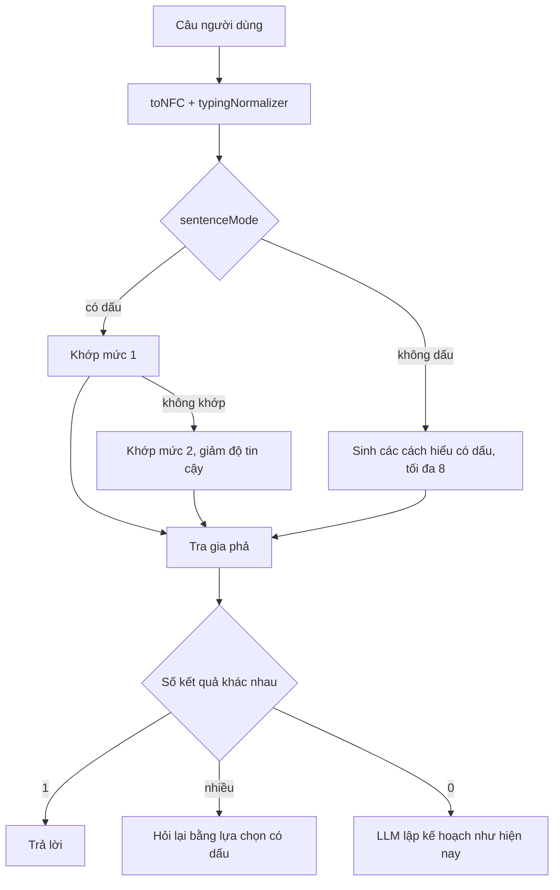
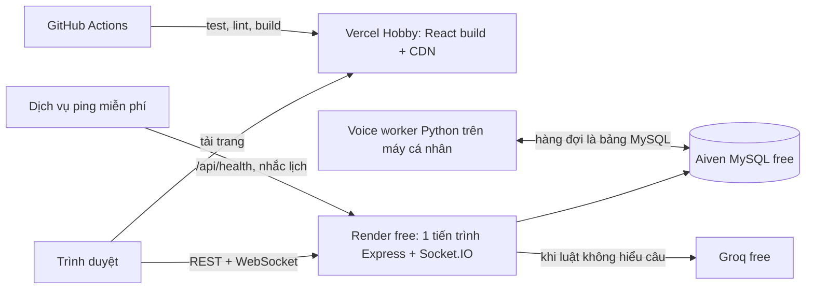
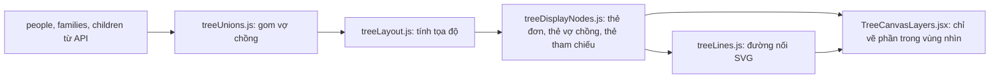
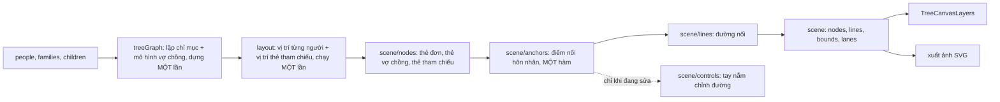
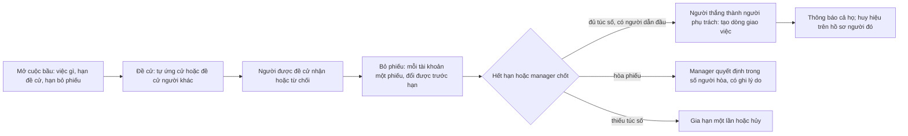

# Kế hoạch tổng thể — CAP2 (Gia Phả Việt)

Lập ngày 10/11/2026, dựa trên mã ở commit `3b550aa`. File này gom mọi kế hoạch đã bàn: cây gia phả, trợ lý AI, hiệu năng, cấu trúc mã. Việc lặt vặt còn mở vẫn ghi ở `VIEC_CHUA_LAM.md`.

**Cập nhật 14/11/2026 (commit `ad0c2a1`):** Giai đoạn 0–3 đã xong phần mã (xem `VIEC_CHUA_LAM.md`, Đợt 12–17). Việc làm tiếp đi theo thứ tự mới ở **mục J**; chi tiết từng bước ở **mục K** (giao diện cổ điển pha hiện đại) và **mục L** (AI hiểu tiếng Việt); cách giao việc cho Opus/Sonnet ở **mục M**. Luồng thứ ba thêm cùng ngày: **mục N** (vẽ và hiện cây), **mục O** (tương tác giữa mọi người trên cây), **mục P** (bầu người phụ trách công việc). Chỗ nào J–P khác các mục viết trước thì J–P đúng.

Những gì chưa được kiểm chứng đều ghi rõ "cần đo" hoặc "cần xem trên trình duyệt". Chưa có load test, chưa chạy `EXPLAIN` trên DB thật, chưa ai chụp màn hình cây ở 390px và 1280px.

## 0. Ràng buộc và thứ tự ưu tiên

- **Không dùng gói trả phí.** Giữ Render free, Vercel Hobby, Aiven free, Groq free.
- **Giao diện trước, tính năng sau.** Trong từng phần cũng theo thứ tự đó.
- **Làm dần được.** Sau mỗi bước hệ thống vẫn chạy, CI vẫn xanh. Không viết lại từ đầu.
- **Ba tính năng lõi:** cây gia phả, xuất ảnh, AI hỏi quan hệ. Quỹ, time capsule, bài đăng, thanh toán, voice chỉ sửa lỗi.

### Lộ trình gộp

| Thứ tự | Giai đoạn | Loại | Thời lượng | Mục |
|---|---|---|---|---|
| 0 | Sửa gấp và dọn dẹp: đổi model Groq đã ngừng; dọn gốc dự án, viết `CLAUDE.md`; sao lưu tự động; MySQL local; bỏ token trên URL ảnh, lỗi thô, CORS, thư viện có lỗ hổng; ẩn thông tin liên hệ với người không có quyền; bỏ `console.log` | Sửa gấp | 1–1,5 tuần | G0, E7.1, H2.1, H2.3, H2.5, H3.1–H3.4, H4.6 |
| 1 | Thẻ trên cây: đẹp, dễ đọc | Giao diện | 1–1,5 tuần | A1 |
| 2 | Tương tác mượt: kéo, zoom, cây lớn; tách `FamilyTreeEditor` | Giao diện | 1,5–2 tuần | A2, E7.2 |
| 3 | Cây dễ nhìn, dễ tìm đường; điện thoại; trang chủ nhẹ; thẻ chia sẻ link; so ảnh chụp cây; khung bắt lỗi | Giao diện | 1,5 tuần | A3, E7.3, H1.1, H1.4, H1.5, H4.2, H4.4 |
| 4 | Giao diện toàn ứng dụng, đợt 1: màn hướng dẫn cho dòng họ mới, khung chờ và trạng thái trống, khả năng truy cập; kiểm thử trình duyệt; ESLint về 0 | Giao diện | 1,5–2 tuần | H1.6, H1.7, H1.8, H4.1, H4.3 |
| 5 | Giao diện toàn ứng dụng, đợt 2: bộ nút, ô nhập, hộp thoại, bảng dùng chung và màu theo biến cho các trang chính (đăng nhập, bảng điều khiển, cây, chat) | Giao diện | 2 tuần | H1.2, H1.3 |
| 6 | Chế độ tối | Giao diện | 1,5–2 tuần | H1.9 |
| 7 | Cổng AI chung: nhiều nhà cung cấp, kiểm tra model, hàng đợi, sổ hạn mức, bớt token, lưu kết quả | Nền tảng AI | 2,5–3 tuần | G-2, G-3, G-4, E7.4 |
| 8 | AI hiểu tiếng Việt có dấu | Nền tảng AI | 5–6 tuần | B, E7.5 |
| 9 | AI: lễ giỗ, lên kế hoạch, câu quan hệ còn thiếu; giao diện hạn mức; bộ đo chất lượng; Whisper qua Groq | Tính năng | 3–3,5 tuần | C, G-5, G-6 |
| 10 | Cây: bản đồ thu nhỏ, chỉ nhánh của tôi, bàn phím, xuất ảnh có ảnh đại diện, xuất PDF, chống ghi đè | Tính năng | 3–4 tuần | A4 |
| 11 | Hiệu năng không tốn tiền; kiểm tra file tải lên, CSP; log, health check, theo dõi lỗi, deploy không bước tay; `server.js` gọn, một hàm tải cây | Nền tảng | 3 tuần | D, H3.5, H3.6, H5.1–H5.4, E7.6, E7.7 |
| 12 | Tin cậy dữ liệu: lịch sử chỉnh sửa cây có hoàn tác, kiểm thử vòng GEDCOM, quy tắc mật khẩu, trang tình trạng hệ thống | Nền tảng | 2 tuần | H2.2, H2.4, H3.8, H5.5 |
| 13 | Phiên đăng nhập an toàn hơn | Nền tảng | 1 tuần | H3.7 |
| 14 | Cấu trúc lại phần còn lại: chia `manager` và `member` theo nghiệp vụ, `ensure*()` thành migration; bộ thành phần chung cho các trang còn lại | Nền tảng | 3–4 tuần | E7.8, E7.9, H1.2, H1.3 |
| 15 | Trình nhập Excel/GEDCOM có xem trước | Tính năng | 2 tuần | H6 |
| 16 | Link xem cây chỉ đọc, có hạn dùng | Tính năng | 1 tuần | H6 |
| 17 | Người dùng tự nhận mình trong cây, manager duyệt | Tính năng | 1 tuần | H6 |
| 18 | Email tổng hợp giỗ và sinh nhật hằng tuần | Tính năng | 3–4 ngày | H6 |
| 19 | Xem cây khi mất mạng | Tính năng | 1,5 tuần | H6 |

Tổng cộng khoảng 37–44 tuần cho một người, tức 9–10 tháng. Đây là ước tính thô, chưa tính thời gian thử trên trình duyệt thật và sửa lỗi phát sinh.

Ghi chú về thứ tự:

- Giai đoạn 0 đứng trước giao diện vì gồm việc AI đang hỏng, chưa có sao lưu và lộ thông tin liên hệ.
- Giai đoạn 1–6 là toàn bộ phần giao diện, làm trước theo ưu tiên đã chốt. Nếu cần rút ngắn, chế độ tối (giai đoạn 6) là việc nên lùi xuống cuối trước tiên.
- Giai đoạn 7–9 và 11 chỉ đụng Backend. Có hai người thì một người làm giao diện (1–6, 10), người kia làm 7–9 song song, rút tổng thời gian còn khoảng 5–6 tháng.
- Giai đoạn 15–19 xếp theo mức giảm công nhập liệu và mời người; đổi thứ tự không ảnh hưởng phần trước.

### Mốc kiểm tra

| Sau giai đoạn | Có gì để xem |
|---|---|
| 0 | AI chạy lại; có bản sao lưu đầu tiên; repo gọn |
| 3 | Cây mới: thẻ đẹp, kéo và zoom mượt với 2.000 người, dùng được trên điện thoại. Có bộ ảnh trước/sau |
| 6 | Toàn bộ giao diện đồng nhất, có chế độ tối |
| 9 | Trợ lý hiểu câu có dấu, trả lời lễ giỗ, lên kế hoạch; hết lượt AI thì vẫn trả lời bằng luật |
| 11 | Kết quả đo tải trước và sau trên máy cá nhân |
| 14 | Không còn file trên 400 dòng ngoài danh sách cho phép |
| 19 | Đủ năm tính năng mới |

---

## A. Cây gia phả

### Hiện trạng đọc từ mã

| # | Vấn đề | Vị trí | Hậu quả |
|---|---|---|---|
| 1 | Kéo một thẻ gọi `setPeople` cho toàn bộ danh sách ở mỗi lần chuột di chuyển, không gom theo khung hình | `FamilyTreeEditor.jsx:1827-1843` (và 5 handler tương tự ở 1926–2107) | Mỗi pixel kéo render lại cả cây và tính lại đường nối |
| 2 | Thẻ không dùng `React.memo`; mỗi lần render tạo object mới cho `size`, `highlightOptions`, `renderPerson` | `FamilyTreeEditor.jsx:3426-3500`, `TreeNodeCard.jsx`, `CoupleCard.jsx` | Có thêm `memo` cũng vô ích nếu chưa ổn định props |
| 3 | Vẽ mọi thẻ và mọi đường nối, kể cả ngoài màn hình | `FamilyTreeEditor.jsx:3389-3480` | Cây nghìn người thành vài chục nghìn phần tử DOM |
| 4 | Mỗi thẻ mang sẵn tới 5 nút thao tác, nút thu gọn, tay nắm đổi cỡ, chấm trạng thái | `TreeNodeCard.jsx` (phần `fte-cardHoverActions`) | Khoảng 10–15 phần tử cho một thẻ dù không ai rê chuột tới |
| 5 | Thẻ đặt vị trí bằng `left`/`top` | `TreeNodeCard.jsx` (`style`) | Di chuyển gây tính lại layout thay vì chỉ ghép lớp |
| 6 | Hai hệ CSS chồng nhau (`fte-` và `fte2-`); `.fte-cardName` khai báo 7 lần | `FamilyTreeEditor.css` (4.164 dòng), `FamilyTreeEditor.v2.css` (1.610 dòng) | Sửa kiểu thẻ ở một chỗ, chỗ khác đè lại |
| 7 | 123 khai báo `transition`/`box-shadow`/`filter`, có `backdrop-filter` trong vùng cây | `FamilyTreeEditor.css:1809`, `v2.css:569` | Tốn GPU khi zoom, nhất là điện thoại |
| 8 | Một component giữ 48 `useState`, 20 `useEffect` | `FamilyTreeEditor.jsx:474` | Đổi state nào cũng render lại toàn bộ |

Chưa xác nhận: zoom có gọi `setCurrentScale` ở mỗi bước lăn chuột hay không (`FamilyTreeEditor.jsx:3224-3228`). Cần xem bằng React Profiler ở bước A2.1.

### A1. Thẻ đẹp và dễ đọc (1–1,5 tuần)

Trang xem thử đã có sẵn: `Frontend/dev/tree-preview.html` và `src/dev/TreePreview.jsx`. Mọi thay đổi ở A1 xem trên trang này trước.

| Bước | Việc | File | Xong khi |
|---|---|---|---|
| A1.1 | Chụp ảnh hiện trạng ở 390×844 và 1280×800 cho 3 chế độ hiển thị, thẻ ngang và dọc, 4 chủ đề; ghi lỗi nhìn thấy | `docs/` (ảnh) | Có bộ ảnh "trước" để so |
| A1.2 | Một bộ biến cho thẻ: cỡ chữ, khoảng đệm, bo góc, bóng, màu theo giới và theo trạng thái. Lấy từ `tokens.css`, không thêm mã hex | `tokens.css`, `treeDisplayConfig.js` | Đổi một biến thì mọi thẻ đổi theo |
| A1.3 | Viết lại kiểu thẻ trong một file CSS mới, gom luật đang rải ở hai file cũ; xóa 7 chỗ khai báo trùng | Mới: `TreeCard.css`; bớt dòng ở hai file cũ | `.fte-cardName` còn đúng một khai báo |
| A1.4 | Thứ bậc thông tin trên thẻ (xem bảng dưới) | `TreeCardParts.jsx`, `TreeNodeCard.jsx`, `CoupleCard.jsx` | So ảnh trước/sau, tên không bị cắt dấu |
| A1.5 | Thanh thao tác nổi dùng chung: chỉ thẻ đang rê chuột hoặc đang chọn mới có nút | Mới: `TreeCardToolbar.jsx` | Thẻ thường còn dưới 6 phần tử DOM |
| A1.6 | Đường nối: nét 1,5px màu trầm, góc bo, nhánh chính đậm hơn; khi chọn một người thì tô đường tới tổ tiên và con cháu | `treeLines.js`, CSS đường nối | Nhìn ra nhánh chính ở mức zoom 40% |

Thứ bậc thông tin đề xuất cho thẻ (chốt sau khi xem ảnh A1.1):

| Thành phần | Đề xuất |
|---|---|
| Tên | 15–16px, đậm vừa, tối đa 2 dòng, `line-height` đủ cho dấu tiếng Việt |
| Dòng phụ | Một dòng: năm sinh – năm mất · đời thứ N. Con thứ và chi chuyển vào bảng chi tiết |
| Ảnh đại diện | Tròn 40px, viền màu theo giới; không có ảnh thì chữ cái đầu |
| Dòng chính / dâu rể | Vạch màu bên trái: đậm cho dòng chính, nhạt cho dâu rể |
| Đã mất | Nền nhạt hơn và ảnh xám nhẹ; không dùng màu đỏ |
| Thủy tổ, trưởng họ | Một huy hiệu nhỏ ở góc, không đổi cỡ thẻ |
| Trạng thái (đang chọn, đang tìm, có người đang sửa, lỗi) | Viền và quầng sáng; mỗi trạng thái một màu cố định trong biến |
| Thẻ vợ chồng | Hai nửa cùng chiều cao, nút thắt ở giữa; vợ lẽ, đã ly hôn có nét đứt |

### A2. Tương tác mượt (1,5–2 tuần)

Mục tiêu đo được: trên trang xem thử với 500 và 2.000 người, kéo thẻ và zoom đạt từ 50 khung hình/giây trên laptop tầm trung; mỗi lần React cập nhật khi kéo dưới 16 ms.

| Bước | Việc | File | Xong khi |
|---|---|---|---|
| A2.1 | Đo mốc bằng Chrome Performance và React Profiler: kéo thẻ, zoom, thu gọn nhánh, chọn người. Thêm bộ dữ liệu 500 và 2.000 người cho trang xem thử | `src/dev/TreePreview.jsx` | Có bảng số "trước" |
| A2.2 | Kéo không qua state: trong lúc kéo chỉ đổi `transform` của thẻ đang kéo bằng ref, gom theo `requestAnimationFrame`; thả chuột mới ghi vào state và lưu | Mới: `hooks/useNodeDrag.js`; bỏ 6 handler lặp trong editor | Kéo một thẻ không render lại thẻ khác |
| A2.3 | Đặt vị trí thẻ bằng `transform: translate3d` thay cho `left`/`top` | `TreeNodeCard.jsx`, `CoupleCard.jsx`, `ReferenceCard.jsx` | Không còn tính lại layout khi di chuyển |
| A2.4 | Ổn định props rồi bọc `React.memo`: truyền `node` thay cho object dựng lại; trạng thái tô sáng tính một lần thành bảng theo id | `FamilyTreeEditor.jsx`, ba file thẻ | Chọn một người chỉ render lại các thẻ liên quan |
| A2.5 | Chỉ vẽ thẻ và đường nối giao với khung nhìn cộng lề một màn hình, dựa trên trạng thái của `react-zoom-pan-pinch` | Mới: `hooks/useViewportCulling.js` | Số phần tử DOM không tăng theo số người |
| A2.6 | Mức chi tiết theo zoom, đặt bằng một class trên khung cây: dưới 35% chỉ còn tên; 35–70% tên và năm; trên 70% đầy đủ. State chỉ đổi khi vượt ngưỡng | `FamilyTreeEditor.jsx`, `TreeCard.css` | Zoom ra toàn cây vẫn đọc được tên |
| A2.7 | Dọn hiệu ứng nặng: bỏ `backdrop-filter` trong vùng cây, một kiểu bóng cho thẻ, `contain: layout paint` trên thẻ | CSS cây | Zoom trên điện thoại không giật (cần thử máy thật) |
| A2.8 | Chuyển động ngắn 120–180 ms cho rê chuột, chọn, thu gọn và mở nhánh; tôn trọng `prefers-reduced-motion` | `TreeCard.css` | Thu gọn nhánh không còn "nhảy" |

A2.2 và A2.4 chỉ làm gọn được khi logic kéo và chọn tách khỏi `FamilyTreeEditor.jsx`. Vì vậy việc tách file ở mục E đi cùng giai đoạn này: `useTreeData`, `useNodeDrag`, `useTreeSelection`, `TreeCanvas`.

### A3. Dễ nhìn, dễ tìm đường (1 tuần)

| Bước | Việc | File | Xong khi |
|---|---|---|---|
| A3.1 | Dải đời rõ hơn: nhãn "Đời N" dính mép trái khi cuộn ngang, nền xen kẽ rất nhạt | `FamilyTreeEditor.jsx` (phần lane), CSS | Biết đang ở đời nào khi zoom gần |
| A3.2 | Nút "Về tôi", "Về thủy tổ", "Vừa khít màn hình" gom một cụm; tìm người nhảy tới và nháy sáng thẻ | `TreeZoomControls.jsx`, `TreeSearchPanel.jsx` | Từ bất kỳ đâu về thẻ của mình bằng một lần bấm |
| A3.3 | Điện thoại: nút chạm tối thiểu 44px, bảng chi tiết dạng kéo từ dưới lên, `100dvh` thay `100vh`, popup 600px ở `FamilyTreeEditor.css:1420` không tràn | CSS cây, `PersonInspector.jsx` | Dùng được bằng một tay ở 390px |
| A3.4 | Trạng thái tải, trống, lỗi cho trang cây dùng component chung đã có | `UserFamilyTree.jsx`, `ManagerGenealogy.jsx` | Không còn màn hình trắng khi máy chủ đang khởi động |
| A3.5 | Chụp lại bộ ảnh "sau", so với A1.1; ghi vào `KICH_BAN_TEST_FULL.md` các bước thử tay | `docs/` | Có cặp ảnh trước/sau cho mọi chế độ |

### A4. Tính năng cây (sau giao diện, 3–4 tuần)

| Việc | Ghi chú |
|---|---|
| Bản đồ thu nhỏ ở góc | Vẽ bằng canvas từ tọa độ có sẵn, bấm để nhảy |
| Chế độ "chỉ nhánh của tôi" và đường dẫn tổ tiên phía trên | Dùng `treeFilter.js` có sẵn |
| Điều hướng bằng bàn phím | Mũi tên đi cha/con/anh chị em, Enter mở chi tiết |
| Xuất ảnh có ảnh đại diện thật | Nhúng thumbnail vào SVG, lỗi thì dùng chữ cái đầu |
| Xuất cây lớn không treo tab | Rasterize trong Web Worker, chia ô khi vượt giới hạn canvas (`treeExportMath.js:4-5`) |
| Xuất PDF thật | `pdf-lib` tải động; bỏ việc đổi ngầm PDF thành PNG ở `treeExport.js:51` |
| Chống ghi đè khi hai người sửa một người | Cột `people.version`, lệch thì trả 409 và hiện so sánh |

---

## B. AI hiểu tiếng Việt có dấu

Hướng đã chọn: **luật trên chữ có dấu + bảng từ vựng**. Phạm vi là `Backend/src/modules/chatbot`.

### Hiện trạng

| Lớp | File | Cách xử lý dấu |
|---|---|---|
| Chuẩn hóa cách gõ | `typingNormalizer.js` | Giữ dấu |
| Từ xưng hô | `kinshipTermService.js` | Giữ dấu; bảng mơ hồ mới có một mục (`ba`) |
| Nhận loại câu hỏi | `intentParserService.js` | Bỏ dấu trước rồi so khớp (34 chỗ) |
| Chuỗi quan hệ | `relationshipQueryParser.js` | Bỏ dấu toàn bộ (8 chỗ) |
| Tìm người theo tên | `memberSearchService.js` | So tên đã bỏ dấu (12 chỗ) |

Hậu quả thấy trong mã (chưa đo từng trường hợp):

- "bà" bị coi là "ba" rồi thành "cha": `relationshipQueryParser.js:76`, `intentParserService.js:20`. Bảng tra ở `relationshipQueryParser.js:5-59` dùng khóa không dấu nên cô/có/cố, chú/chủ, dì/đi, mợ/mơ, cậu/câu trùng nhau.
- Hòa/Hoa/Hóa và Hùng/Hưng cho điểm tìm tên bằng nhau, trừ ngoại lệ tên một chữ (`memberSearchService.js:57-60`).
- Mẫu câu phải viết đôi (`là ai|la ai`) trong 27 parser.
- Bộ 187 câu mẫu chưa có câu nào kiểm tra cặp chỉ khác nhau ở dấu.

### Ba mức so khớp

| Mức | So trên | Ví dụ coi là giống | Dùng khi |
|---|---|---|---|
| 1. Chính xác | Chữ có dấu đầy đủ (NFC, chữ thường) | "bà cô" = "Bà Cô" | Câu có dấu |
| 2. Bỏ thanh | Giữ ă â ê ô ơ ư đ, bỏ thanh | "giổ" = "giỗ", "Hoà" = "Hòa" | Câu có dấu nhưng sai thanh |
| 3. Bỏ hết dấu | Chữ ASCII | "ba co" = "bà cô" = "ba cô" | Chỉ khi cả câu không dấu |

Hai quy tắc cứng:

- Câu có dấu không bao giờ xuống mức 3.
- Câu không dấu chỉ được trả lời thẳng khi mọi cách hiểu cho cùng một kết quả trên gia phả; khác nhau thì hỏi lại bằng lựa chọn có dấu.

### Thành phần mới

- **`text/vietnameseText.js`**: `toNFC` (gộp dấu rời của macOS/iOS, chuẩn kiểu hoà → hòa), `stripTone`, `stripAll`, `tokenize`, `sentenceMode`, ranh giới từ theo Unicode (chuyển từ `typingNormalizer.js:11-12`).
- **`text/lexicon.js`**: bảng từ vựng viết một lần bằng chữ có dấu, gồm xưng hô (chuyển từ `KINSHIP_TERMS`), từ tự xưng, từ hỏi, từ chỉ ý định, tên sự kiện, thứ bậc. Dạng bỏ thanh, dạng không dấu và bảng mơ hồ được sinh tự động. Kèm danh sách từ dễ lẫn: có/cô/cố, đi/dì, chủ/chú, mơ/mợ, câu/cậu, cũ/cụ, ba (số)/bà/ba (bố), giờ/giò/giỗ, năm/nam, Lê/lễ.
- **`text/pattern.js`**: mẫu câu viết một lần bằng chữ có dấu, tự sinh ba biểu thức theo ba mức.

### Luồng xử lý



### Tìm tên người

| Trường hợp | Điểm |
|---|---|
| Trùng chính xác có dấu | 1,00 |
| Chỉ khác thanh | 0,93 |
| Trùng sau khi bỏ hết dấu, câu hỏi không dấu | 0,90 |
| Trùng sau khi bỏ hết dấu, câu hỏi có dấu | 0,75 |

Người dùng gõ có dấu và có đúng một người đạt 1,00 thì chọn luôn. Truy vấn SQL giữ nguyên; xếp hạng làm ở Node.

### Các bước

Bảng dưới là bản tóm tắt ban đầu. Bản chi tiết để làm theo (API từng file, thứ tự commit, ngưỡng đo, các bước mới L10–L17) nằm ở **mục L**.

| Bước | Việc | File | Xong khi |
|---|---|---|---|
| B1 (3–4 ngày) | Bộ câu đo có dấu, khoảng 80 câu, 6 nhóm: cặp chỉ khác dấu, sai thanh, tên trùng khi bỏ dấu, thiếu dấu vài chữ, dấu rời, không dấu mơ hồ. Thêm người mẫu Hoa/Hòa, Hùng/Hưng | `scripts/chatbot-e2e-check.js`, `tests/fixtures` | Có số mốc từng nhóm |
| B2 (4–5 ngày) | Viết `vietnameseText`, `lexicon`, `pattern` kèm test; chưa nối vào luồng | 3 file mới, `tests/chatbot.text.test.js` | Bảng mơ hồ tự sinh có đủ các cặp dễ lẫn |
| B3 (3 ngày) | `kinshipTermService` đọc từ `lexicon`; xóa mảng `plain` viết tay | `kinshipTermService.js` | 187/187 câu cũ vẫn đúng |
| B4 (1 tuần) | Viết lại `relationshipQueryParser` trên từ có dấu; xóa phép thay `ba → cha` và bảng khóa không dấu | `relationshipQueryParser.js`, `relationshipExpressionResolver.js` | Nhóm "cặp chỉ khác dấu" đạt 100% |
| B5 (1–2 tuần) | Chuyển 27 parser sang `pattern`, mỗi parser một commit, đồng thời tách thành `intents/*.js` | `intentParserService.js` | Không còn bỏ dấu trước khi nhận ý định; file dưới 400 dòng |
| B6 (4–5 ngày) | Chấm điểm tên và quy tắc hỏi lại | `memberSearchService.js`, `clarificationService.js` | Nhóm "tên trùng khi bỏ dấu" đạt 100% |
| B7 (2–3 ngày) | Dọn các file còn tự bỏ dấu; thêm ngưỡng từng nhóm vào CI; CI cấm gọi `normalizeText(` trong thư mục parser | `ci.yml`, `CLAUDE.md` | CI đỏ khi nhóm có dấu tụt |

### Giữ an toàn

- Parser mới ở B4 và B5 nằm sau cờ `CHATBOT_ACCENT_FIRST`. Một script chạy mọi câu mẫu qua cả hai parser và in câu cho kết quả khác nhau; chỉ bật mặc định khi đã xem hết danh sách.
- Lấy câu thật bot chưa hiểu bằng `scripts/chatbot-unknown-report.js`, thêm vào bộ đo.
- Ngưỡng `--min 187` trong CI chỉ được tăng.

### Rủi ro

| Rủi ro | Cách giảm |
|---|---|
| B5 làm sai câu đang đúng vì 27 parser phụ thuộc thứ tự | Một parser một commit, chạy song song hai parser, giữ nguyên thứ tự |
| Người gõ không dấu bị hỏi lại nhiều hơn | Chỉ hỏi lại khi các cách hiểu cho kết quả khác nhau; đo tỉ lệ hỏi lại trước và sau |
| Bảng từ dễ lẫn thiếu mục | Bổ sung hằng tuần từ câu thật; thiếu thì hành vi như hiện nay |
| Tên người trùng từ xưng hô ("Cả", "Út") | Giữ quy tắc viết hoa và họ lót trong `typingNormalizer.js` |

---

## C. AI: tính năng (sau B4)

Đã thử 28 câu ngoài bộ mẫu, 20 câu trợ lý trả "chưa hiểu". Chia ba nhóm:

| Nhóm | Câu ví dụ | Cách làm |
|---|---|---|
| Kiến thức lễ, giỗ, cách gọi họ hàng | "Giỗ đầu là gì?", "Cúng giỗ cần chuẩn bị những gì?", "Anh em cọc chèo là gì?" | Kho khoảng 30 mục soạn sẵn, trả lời được khi không có Groq; câu ngoài kho mới nhờ Groq với lời nhắc riêng về phong tục. Luôn ghi chú phong tục khác nhau theo vùng |
| Lên kế hoạch sự kiện | "Lên kế hoạch giỗ ông nội", "Lập kế hoạch họp họ cuối năm" | Tìm người và ngày từ gia phả (ngày giỗ âm đổi sang dương đã có sẵn), dựng danh sách việc theo mốc lùi từ ngày tổ chức, gợi ý tạo lời nhắc. Nêu giỗ đầu/giỗ hết, người chủ trì theo lệ, số con cháu để ước lượng |
| Câu quan hệ còn thiếu | "X gọi tôi là gì?", "Tôi có họ hàng gì với X không?", "Bên ngoại tôi có những ai?", "Em dâu của bố tôi là ai?", "Chắt của cụ Thành gồm những ai?", "Giỗ ông nội còn bao nhiêu ngày nữa?" | Engine đã có `resolveKinshipChain` hiểu em dâu, anh rể, chắt; chỉ thiếu parser. Viết bằng `pattern` và `lexicon` của phần B |

"Trả lời được tất cả câu hỏi quan hệ" không cam kết được. Cam kết đo được là: câu trong bộ đo đạt ngưỡng trong CI, và câu bot chưa hiểu được gom hằng tuần để bổ sung.

Bản nháp bốn file của phần này đã viết dở nhưng so khớp theo kiểu bỏ dấu, nên chỉ dùng làm tham khảo nội dung (kho lễ giỗ, mốc kế hoạch), phần so khớp viết lại sau B4.

Việc phụ: đưa trạng thái "đang hỏi lại" vào DB thay cho bộ nhớ tiến trình (`conversationMemoryService.js:4`), vì Render free ngủ là mất.

---

## D. Hiệu năng không tốn tiền

Mục tiêu 100 người đồng thời với p95 dưới 500 ms **chưa chắc đạt** trên Render free (512 MB RAM, ngủ sau 15 phút). Các việc dưới đây giảm tải rõ rệt mà không tốn tiền; có đạt mục tiêu hay không phải đo.

| # | Điểm nghẽn | Vị trí | Cách sửa | Công |
|---|---|---|---|---|
| 1 | Member tải cây qua `/api/member/dashboard`, kèm task, thông báo và `discoverItems` lặp lại toàn bộ thành viên | `member.controller.js:663-849` | `GET /api/clans/:id/tree` chỉ trả cột để vẽ; dashboard thôi trả cây | M |
| 2 | Mỗi lần có người sửa, mọi người đang xem tải lại cả dashboard | `UserFamilyTree.jsx:61-96` | `ETag` theo `family_graph_versions`; sự kiện socket mang `person_id`, client tải phần đổi | M |
| 3 | JOIN `archived_members` bằng `OR` và `JSON_EXTRACT`, không dùng được index | `common.service.js:104-108` | Cột `people.archived_at`, điều kiện `IS NULL` | S–M |
| 4 | Không nén phản hồi | `server.js` | Bật `compression` | S |
| 5 | Socket bắt đầu bằng polling | `services/socket.js` | `transports: ["websocket"]` | S |
| 6 | Ảnh trong LONGBLOB, đọc qua RAM của Node | `media.routes.js:56-86` | Thumbnail avatar 96px lưu riêng, nén ảnh khi tải lên, hạ giới hạn dung lượng (xem E2); chưa chuyển ảnh ra dịch vụ ngoài | L |
| 7 | Máy chủ ngủ đông | Render free | Dịch vụ ping miễn phí gọi `/api/health` mỗi 10 phút trong giờ dùng; kiểm tra hạn mức giờ chạy của Render trước | S |
| 8 | Nhắc lịch chạy bằng `setInterval` trong web process | `calendar.controller.js:1103-1117` | Cùng dịch vụ ping gọi endpoint `runDueReminders` có khóa bí mật | S |
| 9 | `xlsx` có lỗ hổng mức cao, chưa có bản vá | `fund.controller.js:989` | Đổi sang `exceljs` | M |

Đo bằng k6 (miễn phí), dùng lại phần seed của `Backend/scripts/load-test-family-tree.js`, chạy trên máy cá nhân với DB local, không chạy trên DB thật. Kịch bản: 100 người xem cây; 5 người sửa và 95 người nghe; 20 người hỏi chatbot; hỗn hợp 15 phút. Ghi p95 trước và sau từng mục.

---

## E. Cấu trúc lại hệ thống và dự án (đủ dùng ở mức miễn phí)

Nguyên tắc: một máy chủ, một tiến trình, một cơ sở dữ liệu. Chỉ sắp xếp lại cho rõ ràng; không thêm thành phần hạ tầng nào.

### E1. Kiến trúc hệ thống



| Thành phần | Dùng gì | Vì sao đủ |
|---|---|---|
| Frontend | Vercel Hobby | File tĩnh, có CDN sẵn |
| Backend | Render free, một instance | Một tiến trình nên cache trong bộ nhớ và Socket.IO chạy đúng, không cần Redis |
| Cơ sở dữ liệu | Aiven MySQL free | Dữ liệu gia phả nhỏ; ảnh mới là thứ chiếm chỗ (xem E2) |
| Cache | `Map` trong tiến trình, qua một module chung | Một instance thì không cần đồng bộ |
| Hàng đợi | Bảng MySQL (voice đang làm vậy) | Lưu lượng thấp |
| Tác vụ định kỳ | Dịch vụ ping gọi endpoint có khóa bí mật | Thay cho `setInterval` không chạy khi máy chủ ngủ |
| AI | Luật + graph trước, Groq free sau | Phần lớn câu không tốn lượt gọi |
| Ảnh | Giữ trong MySQL, thêm thumbnail và nén khi tải lên | Không thêm dịch vụ; chuyển ra ngoài khi DB gần đầy |

### E2. Ngân sách tài nguyên ở mức miễn phí

Hạn mức của từng nhà cung cấp thay đổi theo thời gian; cần mở trang giá hiện hành để điền con số trước khi làm bước E7.1.

| Giới hạn | Ảnh hưởng | Cách sống chung |
|---|---|---|
| RAM Render nhỏ (khoảng 512 MB) | Tải video 50 MB vào bộ nhớ (`server.js:124-135`, `350-360`) có thể làm sập tiến trình | Hạ giới hạn tải lên: ảnh 2 MB, video và ghi âm 15 MB; nén ảnh ở trình duyệt trước khi gửi (`ImageUpload.jsx`) |
| Máy chủ ngủ khi không có truy cập | Lần mở đầu chậm, nhắc lịch không chạy, bộ nhớ hội thoại chatbot mất | Ping trong giờ dùng; trạng thái cần giữ thì lưu DB |
| Dung lượng DB nhỏ | Ảnh LONGBLOB làm đầy DB | Thumbnail 96px cho avatar; ảnh bài đăng nén còn tối đa 1600px; thêm trang admin xem dung lượng theo bảng |
| Số kết nối DB ít | Pool 10, mỗi request nhiều query tuần tự | Gộp query, cache cây theo phiên bản; kiểm tra giới hạn kết nối của Aiven trước khi tăng pool |
| Groq giới hạn lượt gọi mỗi phút | Nhiều người hỏi cùng lúc bị từ chối | Hàng đợi tối đa 2 lượt gọi đồng thời; quá tải thì trả lời bằng luật |
| Ổ đĩa Render không bền | File ghi âm ở `Backend/storage` mất khi deploy lại (`voice/backend/backendRoutes.js:47`) | Lưu ghi âm vào DB với giới hạn 15 MB, hoặc tắt tính năng trên bản deploy |

### E3. Cấu trúc thư mục toàn dự án

```
CAP2/
  CLAUDE.md                 # quy tắc cho người và AI (mục F)
  README.md
  Backend/
  Frontend/
  voice/                    # worker Python; phần route chuyển vào Backend/src/modules/voice
  database/
    migrations/             # nguồn schema duy nhất, đánh số theo ngày
    schema/init.sql         # schema đầy đủ, sinh lại từ migrations
  docs/
    KE_HOACH_TONG_THE.md    # kế hoạch (file này)
    VIEC_CHUA_LAM.md        # việc còn mở
    API_LIST.md
    KICH_BAN_TEST_FULL.md
    nhat-ky/                # các file nhật ký cũ chuyển vào đây
  .github/workflows/ci.yml
```

Dọn ở gốc dự án:

| Việc | Vị trí | Lý do |
|---|---|---|
| Xóa máy chủ Express cũ trong Frontend | `Frontend/server.js` | Không dùng; tự mở kết nối DB bằng biến môi trường |
| Xóa ảnh trùng ở gốc Frontend | `Frontend/backgroundbanner.png` (6,7 MB), `sodogiapha.png` (4 MB), `logo.png`, `logo giaphaviet.png` | Đã có bản trong `public/` |
| Đổi ảnh nền sang WebP, gộp 5 file logo trùng | `Frontend/public/` (banner 6,2 MB, sơ đồ 4 MB) | Trang chủ nhẹ hơn hàng chục lần |
| Gộp hai `vercel.json` | gốc repo và `Frontend/` | Một nguồn cấu hình |
| Chuyển script migrate lẻ vào `Backend/scripts` | `Backend/migration_people_moderation.js`, `migration_posts.js` | Gốc Backend chỉ còn `server.js`, `package.json` |
| Bỏ bản dump khỏi repo | `database/dumps/`; giữ một trong hai file `database/schema/` | Tránh hai nguồn schema và dữ liệu cũ trong git |
| Gom nhật ký | `docs/CAI_THIEN_HE_THONG.md`, `TOI_UU_AI_VA_GIA_PHA.md`, `KE_HOACH_AI_TRA_LOI.md`, `KE_HOACH_SONNET_1H.md`, `TIEP_TUC_AI_TRA_LOI.md`, `docs/report/`, `docs/overview/` | 11 file tài liệu chồng nội dung; người mới không biết đọc file nào |
| Sửa `package.json` gốc | tên `cap2-api`, chỉ có lệnh Backend | Thêm lệnh `test`, `lint` chạy cả hai phía |

### E4. Cấu trúc Backend

```
Backend/
  server.js                 # chỉ khởi động, dưới 80 dòng
  scripts/                  # migrate, seed, load test, công cụ chatbot
  tests/
  src/
    app.js                  # express, middleware, gắn routes
    config/                 # env, db, jwt, roles
    platform/               # dùng chung, không chứa nghiệp vụ
      cache.js              # Map có hạn sống; nơi duy nhất giữ cache
      realtime.js           # Socket.IO: xác thực, phòng, emit
      storage.js            # đọc/ghi media (hiện là MySQL)
      ai.js                 # Groq client + hàng đợi + giới hạn
      scheduler.js          # việc định kỳ, gọi qua endpoint
    middleware/             # auth, rate limit, validate, error
    modules/
      tree/                 # LÕI: routes, controller, service, repository, core/
      chatbot/              # LÕI
        ask/                # pipeline xử lý một câu
        intents/            # mỗi nhóm ý định: parser + handler
        text/               # vietnameseText, lexicon, pattern (phần B)
        engine/             # graph, đường quan hệ, cách gọi
        knowledge/          # lễ giỗ, mốc kế hoạch (phần C)
        llm/                # prompts, planner
      media/ auth/ account/ clan/ calendar/ events-tasks/
      fund/ posts/ memories/ billing/ site-content/ admin/ voice/
    shared/                 # validation, utils thuần
```

Ranh giới từng tầng:

| Tầng | Được làm | Không được làm |
|---|---|---|
| route | Đường dẫn, middleware, schema validate | Logic |
| controller | Đọc `req`, gọi một service, trả `res` | SQL, emit, gọi Groq |
| service | Nghiệp vụ, transaction, phân quyền; gọi `platform/` | Đụng `req`/`res` |
| repository | SQL và ánh xạ dòng | Nghiệp vụ, DDL |
| core | Hàm thuần | I/O |

Điểm cần sửa so với hiện tại:

| Hiện tại | Vị trí | Chuyển thành |
|---|---|---|
| Socket.IO, upload, 12 route cây khai báo trong `server.js` (553 dòng) | `server.js:70-278`, `288-404`, `417-492` | `platform/realtime.js`, `modules/media`, `modules/tree/tree.routes.js` |
| Module `manager` và `member` chia theo vai trò, mỗi cái chứa cây, bài đăng, sự kiện, quỹ | `modules/manager/*`, `modules/member/*` | Chia theo nghiệp vụ; vai trò chỉ là middleware trên route |
| Gộp 8 controller bằng spread | `manager.controller.js:10-19` | Mỗi route trỏ thẳng tới controller của module |
| Câu query cây chép 3 lần | `dashboard.controller.js:109`, `member.controller.js:574`, `686` | Một hàm trong `tree.repository.js` |
| Sáu `Map` cache rải rác | `authMiddleware.js:10`, `chatbotSecurity.js:6`, `conversationMemoryService.js:4`, `relationshipEngine.js:52-54`, `siteContent.service.js:97` | `platform/cache.js` |
| Khoảng 150 chỗ gọi `ensure*()` lúc xử lý request | 30 file | Migration SQL; bật `DISABLE_RUNTIME_DDL=true` và `RUN_MIGRATIONS_ON_START=true` trên Render |
| Route voice nằm ngoài Backend | `voice/backend/backendRoutes.js` (903 dòng), nạp từ `server.js:101` | `modules/voice/` |
| Đường dẫn API lẫn `/api/manager/...`, `/api/member/...`, `/api/people/...` cho cùng một việc | `manager.routes.js:67-92`, `server.js:417-492` | Giữ đường dẫn cũ làm bí danh; đường dẫn mới theo tài nguyên (`/api/clans/:id/tree`, `/api/people/:id`) |

### E5. Cấu trúc Frontend

```
Frontend/src/
  app/                      # App, routes, providers
  features/
    tree/                   # LÕI (đổi tên từ genealogy; gộp duplicates, genealogy-book)
      pages/ components/ canvas/ hooks/ model/ export/ styles/ api.js
    ai-chat/                # LÕI
    auth/ clan/ calendar/ events-tasks/ fund/ posts/ memories/
    billing/ admin/ landing/ invitations/ voice/ account/
  shared/
    components/ hooks/ utils/
  styles/                   # tokens.css, a11y.css, base.css
  services/                 # api client, socket
  layouts/
  i18n/
```

| Hiện tại | Vị trí | Chuyển thành |
|---|---|---|
| Lời gọi API gom theo vai trò | `src/api/managerService.js` (971 dòng), `memberService.js` (346) | `api.js` trong từng feature |
| Feature `manager` và `member` chia theo vai trò | `features/manager`, `features/member` | Trang về feature nghiệp vụ; phần còn lại vào `account/` |
| `App.css` 4.877 dòng, `manager.css` 4.156 dòng dùng chung cho nhiều trang | `src/app/App.css`, `features/manager/pages/manager.css` | Luật chung về `styles/base.css`; luật riêng theo file CSS của từng feature. Làm dần, mỗi lần sửa trang nào thì chuyển phần của trang đó |
| Hai hệ CSS cây (`fte-`, `fte2-`) | `FamilyTreeEditor.css`, `.v2.css` | `tree/styles/TreeCard.css`, `TreeCanvas.css`, `TreeToolbar.css`, `TreeDialogs.css` (giai đoạn A1, A3) |
| `html-to-image` không còn dùng | `Frontend/package.json` | Gỡ |

### E6. Quy ước

- Backend: `<tên>.routes.js`, `.controller.js`, `.service.js`, `.repository.js`. Đổi `chatbotController.js`, `chatbotRoutes.js` về cùng kiểu.
- Frontend: component `PascalCase.jsx`, hook `useX.js`, mỗi feature một `api.js`. Feature không import từ feature khác, chỉ từ `shared/` và `services/`.
- File mới tối đa 400 dòng, hàm tối đa 80 dòng. File cũ vượt ngưỡng nằm trong danh sách cho phép và chỉ được giảm. Kiểm bằng ESLint `max-lines` ở Frontend và một script đếm dòng trong CI cho Backend.
- Di chuyển file và đổi hành vi không nằm chung một commit.

### E7. Thứ tự cấu trúc lại

Mỗi bước là di chuyển, không đổi hành vi; test và e2e chatbot phải giữ nguyên kết quả.

| Bước | Việc | Làm cùng giai đoạn | Xong khi |
|---|---|---|---|
| E7.1 | Dọn gốc dự án theo bảng E3; viết `CLAUDE.md`; điền hạn mức miễn phí hiện hành vào E2 | Trước giai đoạn 1 (1–2 ngày) | Repo nhẹ hơn khoảng 17 MB ảnh; build và CI xanh |
| E7.2 | Tách `FamilyTreeEditor.jsx` và CSS cây | Giai đoạn 1–3 | File gốc dưới 300 dòng |
| E7.3 | Đổi tên `features/genealogy` thành `tree`, chuyển API cây về `tree/api.js` | Cuối giai đoạn 3 | Không còn import cây từ `managerService.js` |
| E7.4 | Tạo `platform/cache.js`, `platform/ai.js`; chuyển 6 `Map` cache | Đầu giai đoạn 4 | Không còn `new Map()` cấp module trong `modules/` |
| E7.5 | Tách `intentParserService.js`, rồi `chatbotController.js` | Giai đoạn 4–5 | Mỗi file dưới 400 dòng; e2e không giảm |
| E7.6 | `server.js` chỉ còn khởi động: chuyển Socket.IO, upload, route cây ra ngoài | Giai đoạn 7 | `server.js` dưới 80 dòng |
| E7.7 | Tạo `modules/tree` với repository; gỡ ba bản sao query và route trùng | Giai đoạn 7 | Một hàm tải cây duy nhất |
| E7.8 | Chia `manager` và `member` theo nghiệp vụ, cả Backend lẫn Frontend | Sau giai đoạn 7, từng module một | Không còn `manager.controller.js` gộp bằng spread |
| E7.9 | Chuyển `ensure*()` thành migration SQL | Sau giai đoạn 7 | Không còn `ALTER`/`CREATE` trong `src/modules` |

### E8. Không làm ở mức miễn phí

| Không làm | Vì sao |
|---|---|
| Redis, nhiều instance, load balancer | Một instance là đủ; thêm vào chỉ tăng thứ phải vận hành |
| Tách microservice, hàng đợi riêng | Một nhóm nhỏ, một cơ sở dữ liệu |
| Chuyển sang TypeScript, Next.js, monorepo tool | Tốn công, không giải quyết vấn đề đang có |
| Docker cho production | Render và Vercel build trực tiếp từ repo |
| Chuyển ảnh ra dịch vụ lưu trữ ngoài | Để khi DB gần đầy; lúc đó chỉ đổi `platform/storage.js` |
| Chuyển AWS | Không có bậc miễn phí lâu dài cho cấu hình này |

### E9. Tách các file lớn

| File lớn | Tách thành | Làm cùng giai đoạn |
|---|---|---|
| `FamilyTreeEditor.jsx` (4.119) | `useTreeData`, `useNodeDrag`, `useTreeSelection`, `useTreeExport`, `TreeCanvas`, `TreeDialogs`; helper dòng 43–473 về `model/` | A2 |
| `FamilyTreeEditor.css` + `.v2.css` (5.774) | `TreeCard.css`, `TreeCanvas.css`, `TreeToolbar.css`, `TreeDialogs.css` | A1, A3 |
| `intentParserService.js` (774) | `intents/*.js`, mỗi nhóm ý định một file | B5 |
| `chatbotController.js` (2.675) | `ask.controller.js`, `ask/pipeline.js`, `intents/handlers/*.js`, `chat.repository.js`; chuỗi `else if` dòng 2277–2357 thành bảng tra | C |
| `member.controller.js` (2.413) | Theo route: dashboard, profile, notifications, posts, memories; phần cây về `modules/tree` | D |
| `ClanFundPage.jsx` (2.765) | Chỉ tách cơ học khi có lỗi cần sửa | Không xếp lịch |

---

## F. Quy tắc cho người và AI làm tiếp

Nội dung đề xuất cho `CLAUDE.md` / `AGENTS.md` ở gốc repo:

```markdown
# CAP2 – Gia Phả Việt

## Trọng tâm
Cây gia phả, xuất ảnh, AI hỏi quan hệ. Giao diện trước, tính năng sau.
Module khác (fund, time-capsule, posts, billing, voice) chỉ sửa lỗi.
Không dùng dịch vụ trả phí.

## Kiến trúc
- Backend: route -> controller -> service -> repository. Controller không có SQL.
  Service không đụng req/res. core/ là hàm thuần.
- Frontend: features/<tên>/{pages,components,hooks,model,api.js}.
  Feature không import từ feature khác.
- Một máy chủ, một tiến trình, một DB. Cache, realtime, lưu file, Groq chỉ gọi qua src/platform/*.
- Không thêm Redis, hàng đợi, dịch vụ lưu trữ hay thành phần hạ tầng mới.

## Tiếng Việt trong chatbot
- Không bỏ dấu trước khi phân tích câu. Dùng text/vietnameseText, text/lexicon, text/pattern.
- Từ mới thêm vào lexicon bằng chữ có dấu; không viết tay dạng không dấu.
- Câu không dấu mà nhiều cách hiểu thì hỏi lại, không đoán.
- LLM chỉ lập kế hoạch hoặc trả lời kiến thức phong tục; quan hệ họ hàng do graph trả lời.

## Cây gia phả
- Không gọi setState trong pointermove; kéo bằng ref + requestAnimationFrame.
- Thẻ đặt vị trí bằng transform; thẻ là React.memo, props phải ổn định.
- Kiểu thẻ chỉ sửa ở TreeCard.css, màu lấy từ tokens.css.

## Quy ước
- File mới <= 400 dòng, hàm <= 80 dòng. Không làm file cũ dài thêm.
- Chuỗi giao diện qua i18n (vi.json và en.json cùng key).
- Route ghi dữ liệu phải có schema ở shared/validation/schemas.js.

## Cấm
- ALTER/CREATE TABLE trong src/. Đổi schema = thêm file ở database/migrations/.
- Thêm biến toàn cục giữ trạng thái người dùng.
- Thêm route trong server.js; gộp controller bằng spread.
- Chạy test hay script với DB thật; sửa .env.
- Hạ ngưỡng --min trong ci.yml.

## Kiểm tra trước khi xong
- Backend: cd Backend && npm test && node scripts/chatbot-e2e-check.js --min 187 --min-conversation 7
- Frontend: cd Frontend && npm run lint && npm test && npm run build
- Đổi giao diện cây: chụp ảnh 390x844 và 1280x800 trên dev/tree-preview.html.
- Việc còn mở ghi vào docs/VIEC_CHUA_LAM.md.
```

---

## G. Tối ưu toàn bộ tính năng AI và nguồn key miễn phí

Số liệu hạn mức tra ngày 10/11/2026. Hạn mức miễn phí đổi thường xuyên; trước khi làm phải xem lại trong trang quản trị của từng nhà cung cấp.

### G0. Việc gấp: model mặc định đã bị ngừng

Trang ngừng hỗ trợ của Groq ghi `llama-3.3-70b-versatile` và `llama-3.1-8b-instant` ngừng ngày 16/08/2026 với tài khoản miễn phí và developer. Mã đang lấy `llama-3.3-70b-versatile` làm mặc định (`chatbot/groqClient.js:12`). Nếu biến `GROQ_MODEL` trên Render chưa đổi thì mọi lời gọi AI đang lỗi và hệ thống lặng lẽ rơi về câu trả lời dựng bằng luật (lỗi chỉ ghi log một lần mỗi phút, `groqClient.js:37-47`). Chưa kiểm tra được trên Render.

Cách xử lý không cần sửa mã: đặt `GROQ_MODEL=openai/gpt-oss-120b` trên Render, rồi thử một tính năng sinh văn bản (ví dụ viết tiểu sử).

### G1. Các tính năng AI hiện có

| Tính năng | Vị trí | Token trả về tối đa | Ghi chú |
|---|---|---|---|
| Chatbot: lập kế hoạch câu hỏi | `chatbotAI.js:82` | 500 | Chỉ gọi khi luật không hiểu; hết giờ sau 4 giây |
| Chatbot: diễn đạt lại | `chatbotAI.js:113` | 800 | Mặc định chỉ cho câu kể kỷ niệm |
| Chatbot: đặt tiêu đề hội thoại | `chatbotAI.js:124` | 100 | Một lần mỗi hội thoại |
| Điền form sự kiện | `ai.controller.js:345` | 1.800 | Manager, admin |
| Trích gia phả từ văn bản | `ai.controller.js:558` | 2.400 | Tốn token nhất |
| Viết tiểu sử | `ai.controller.js:405` | — | |
| Soạn bài đăng | `ai.controller.js:463` | 900 | |
| Tóm tắt quỹ | `ai.controller.js:520` | — | Số liệu do server tính |
| Ghi âm thành chữ | `voice/worker/worker.py` | — | faster-whisper chạy trên máy cá nhân, không dùng Groq |

Giới hạn hiện có: chatbot 30 câu/phút/tài khoản, `/api/ai/*` 10 lần/phút/tài khoản; cả hai lưu trong bộ nhớ và không có giới hạn chung cho toàn hệ thống.

### G2. Nguồn key miễn phí

| Nhà cung cấp | Hạn mức miễn phí tìm được | Nguồn | Đánh giá |
|---|---|---|---|
| **Groq** (đang dùng) | `openai/gpt-oss-120b`, `gpt-oss-20b`, `qwen/qwen3.8-27b`: 30 lượt/phút, 1.000 lượt/ngày, 8.000 token/phút, 200.000 token/ngày. `whisper-large-v3`: 20 lượt/phút, 2.000 lượt/ngày | Trang chính thức, nhưng chưa rõ bảng đọc được là gói Free hay Developer | **Giữ làm chính.** Nhanh, API kiểu OpenAI, có cả Whisper |
| **Google Gemini** (AI Studio) | Không công bố trong tài liệu; xem trong AI Studio. Bài viết bên thứ ba: Flash-Lite khoảng 15 lượt/phút, 500 lượt/ngày; Flash mới nhất khoảng 20 lượt/ngày. Hạn mức tính theo project, tạo thêm key không tăng | Tài liệu chính thức (phần quy tắc), con số từ bên thứ ba | **Dự phòng** cho câu không chứa dữ liệu cá nhân. Gói miễn phí có thể dùng dữ liệu để cải thiện sản phẩm |
| OpenRouter | Model `:free`: 20 lượt/phút, 50 lượt/ngày khi chưa nạp tiền | Bài của OpenRouter | Dự phòng cuối, hạn mức thấp |
| Cloudflare Workers AI | Khoảng 10.000 "neuron" mỗi ngày | Bên thứ ba, chưa xác nhận | Cân nhắc sau |
| Cerebras | Không có gói miễn phí lâu dài: 5 USD dùng thử trong 30 ngày, cần thẻ | Trang chính thức | Không dùng |
| Mistral | Gói thử nghiệm yêu cầu cho phép dùng dữ liệu để huấn luyện | Bên thứ ba | Không dùng cho dữ liệu gia phả |

Cách lấy key:

- Groq: `console.groq.com` → API Keys (đã có).
- Gemini: `aistudio.google.com` → Get API key, không cần thẻ.
- OpenRouter: `openrouter.ai` → Keys.

Key chỉ đặt trong biến môi trường trên Render, không đưa vào repo. Mỗi nhà cung cấp một tài khoản: tạo nhiều tài khoản để nhân hạn mức là vi phạm điều khoản và có thể bị khóa. Muốn thêm dung lượng thì thêm nhà cung cấp dự phòng.

### G3. Có đủ dùng không

Ước tính với 200.000 token/ngày của Groq (cần xác nhận đúng là gói Free):

| Việc | Token mỗi lần (ước tính) | Số lần mỗi ngày nếu dùng riêng |
|---|---|---|
| Chatbot lập kế hoạch | khoảng 1.200 | khoảng 160 câu |
| Trích gia phả | khoảng 6.000–8.000 | khoảng 25–30 lần |
| Tiểu sử, bài đăng, tóm tắt quỹ | khoảng 1.500–2.500 | khoảng 80–130 lần |

Đủ cho một dòng họ dùng thật và cho buổi bảo vệ đồ án. Không đủ nếu 100 người cùng dùng tính năng sinh văn bản trong một ngày. Vì vậy thiết kế phải chịu được lúc hết hạn mức: chatbot trả lời bằng luật, tính năng sinh văn bản báo "hết lượt hôm nay".

### G4. Việc tối ưu

| # | Việc | File | Lợi ích |
|---|---|---|---|
| 1 | Một cổng AI chung gọi theo chuẩn OpenAI, danh sách nhà cung cấp theo thứ tự trong biến môi trường; lỗi 429 hoặc model không tồn tại thì chuyển sang nhà cung cấp kế | Mới: `platform/ai.js`; thay `groqClient.js` | Không phụ thuộc một nhà cung cấp; lần ngừng model sau không làm chết tính năng |
| 2 | Kiểm tra model khi khởi động và mỗi giờ; model không còn thì ghi cảnh báo rõ và hiện trên trang admin | `platform/ai.js`, trang admin | Không còn hỏng âm thầm như G0 |
| 3 | Chọn model theo việc: model nhỏ (`gpt-oss-20b`) cho phân loại câu hỏi và đặt tiêu đề; model lớn (`gpt-oss-120b`) cho trích gia phả, tiểu sử, bài đăng | Biến `AI_MODEL_PLAN`, `AI_MODEL_WRITE` | Nhanh hơn, để dành hạn mức cho việc cần chất lượng |
| 4 | Hàng đợi: tối đa 2 lời gọi đồng thời, đọc `retry-after` khi bị 429, ngắt mạch 60 giây khi lỗi liên tiếp | `platform/ai.js` | Không dội thêm yêu cầu khi đã hết lượt |
| 5 | Sổ hạn mức theo ngày lưu trong DB: tổng token, theo tính năng, theo dòng họ. Chia sẵn: chatbot 50%, trích gia phả 25%, còn lại 25% | Bảng `ai_usage`, migration mới | Một người không dùng hết phần của cả hệ thống; số liệu không mất khi máy chủ ngủ |
| 6 | Bớt token đầu vào: bỏ in JSON có thụt lề (`ai.controller.js:345`, `558`); lịch sử hội thoại chỉ lấy 4 lượt cuối; rút gọn lời nhắc lập kế hoạch | `ai.controller.js`, `chatbotAI.js`, `chatbotPrompts.js` | Giảm khoảng 20–30% token (cần đo) |
| 7 | Yêu cầu trả về JSON có khuôn (`response_format`) cho lập kế hoạch, form sự kiện, trích gia phả | `platform/ai.js` | Bớt lỗi phân tích và lần gọi lại |
| 8 | Lưu kết quả: kế hoạch theo câu đã chuẩn hóa; tóm tắt quỹ theo mã băm số liệu; tiểu sử theo mã băm hồ sơ | `platform/cache.js`, bảng `ai_cache` | Hỏi lại không tốn lượt |
| 9 | Đặt tiêu đề hội thoại bằng luật (lấy câu hỏi đầu, cắt 8 từ) | `chatbotController.js:391-421` | Bỏ hẳn một lời gọi mỗi hội thoại |
| 10 | Giữ lời nhắc hệ thống cố định ở đầu, phần thay đổi để cuối | Các file prompt | Groq ghi token đã lưu đệm không tính vào hạn mức |
| 11 | Ghi âm thành chữ qua Whisper của Groq khi máy cá nhân không bật worker | `modules/voice` | Voice chạy được trên bản deploy; cần kiểm tra hạn mức âm thanh miễn phí |
| 12 | Giao diện: hiện số lượt còn lại, thông báo rõ khi hết lượt hoặc AI bận, nút thử lại | `features/ai-chat`, các nút AI | Người dùng hiểu vì sao AI không trả lời |
| 13 | Bộ đo chất lượng cho từng tính năng: 20 văn bản mẫu cho trích gia phả; kiểm tra tiểu sử không thêm chi tiết ngoài hồ sơ; số trong tóm tắt quỹ khớp số server | `tests/ai.*.test.js`, `scripts/ai-eval.js` | Đổi model hay nhà cung cấp mà biết chất lượng có giảm không |

### G5. Dữ liệu cá nhân

Gia phả chứa tên, ngày sinh, quan hệ của người thật. Quy tắc định tuyến:

| Loại câu | Gửi tới đâu |
|---|---|
| Có tên người, hồ sơ, số liệu quỹ | Chỉ nhà cung cấp chính (Groq); cần đọc điều khoản dữ liệu của Groq trước khi chốt |
| Kiến thức phong tục, câu không chứa dữ liệu của họ | Được dùng nhà cung cấp dự phòng |
| Lập kế hoạch câu hỏi | Che tên riêng trước khi gửi (thay bằng "NGƯỜI_1"), ghép lại sau |

### G6. Thứ tự làm

| Bước | Việc | Thời lượng | Xong khi |
|---|---|---|---|
| G-1 | Đổi `GROQ_MODEL` trên Render (G0); xem hạn mức thật trong trang quản trị Groq và AI Studio, điền vào bảng G2 | 1 giờ | Một tính năng sinh văn bản chạy lại được |
| G-2 | `platform/ai.js`: cổng chung, kiểm tra model, hàng đợi, chọn model theo việc (việc 1–4) | 1 tuần | Tắt key Groq thì chatbot vẫn trả lời bằng luật và ghi cảnh báo rõ |
| G-3 | Sổ hạn mức, bớt token, JSON có khuôn, lưu kết quả, tiêu đề bằng luật (việc 5–10) | 1 tuần | Số token mỗi ngày giảm so với mốc; có trang xem mức dùng |
| G-4 | Nhà cung cấp dự phòng và quy tắc dữ liệu cá nhân (G5) | 3–4 ngày | Giả lập 429 ở Groq thì câu phong tục vẫn có trả lời |
| G-5 | Giao diện hạn mức và bộ đo chất lượng (việc 12–13) | 1 tuần | CI chạy bộ đo không cần gọi mạng; có lệnh chạy bộ đo thật bằng tay |
| G-6 | Whisper qua Groq (việc 11) | 3–4 ngày | Ghi âm trên bản deploy ra chữ mà không cần máy cá nhân |

G-1 làm ngay. G-2 và G-3 đi trước phần C (lễ giỗ, lên kế hoạch) vì phần đó dùng chung cổng AI.

---

## H. Các cải thiện còn lại

Những mục chưa nằm trong A–G. Xếp theo đúng ưu tiên: giao diện, rồi an toàn dữ liệu và bảo mật, rồi chất lượng và vận hành, cuối cùng là tính năng.

### H1. Giao diện toàn ứng dụng (ngoài cây)

Số liệu lấy từ `UI_TOI_UU_DE_XUAT.md` và `TONG_QUAN_DU_AN.md`; chưa ai xem lại trên trình duyệt.

| # | Việc | Căn cứ | Công |
|---|---|---|---|
| 1 | Lỗi thấy ngay trên điện thoại: `100vh` → `100dvh` (41 chỗ), ô nhập dưới 16px làm iOS tự phóng to (8 luật), popup rộng cố định tràn màn hình | `UI_TOI_UU_DE_XUAT.md` mục 4 | S |
| 2 | Một bộ nút, ô nhập, hộp thoại, bảng dùng chung; thay dần 122 kiểu nút và 95 class hộp thoại | `UI_TOI_UU_DE_XUAT.md` mục 2 | L, làm theo từng trang |
| 3 | Màu chỉ lấy từ `tokens.css`; CI cấm thêm mã hex mới | 915 màu hex | M |
| 4 | Trang chủ nhẹ: ảnh nền 6,2 MB và 4 MB sang WebP; chỉ tải biểu tượng đang dùng thay cho cả bộ Material Symbols biến thiên; bớt họ phông | `Frontend/public/`, `index.html:16-20` | S |
| 5 | Thẻ mô tả và ảnh xem trước khi chia sẻ link (hiện chỉ có `<title>`) | `Frontend/index.html:12` | S |
| 6 | Người mới vào dòng họ trống: màn hướng dẫn ba bước (thêm thủy tổ, thêm con, mời người thân) thay cho trang trắng | `UserFamilyTree.jsx`, `ManagerGenealogy.jsx` | M |
| 7 | Khung chờ (skeleton) cho danh sách dài; trạng thái trống cho 8 trang còn thiếu | `UI_TOI_UU_DE_XUAT.md` mục 7 | M |
| 8 | Khả năng truy cập: viền focus rõ, tương phản chữ vàng trên nền nâu đạt 4,5:1, đi hết luồng chính bằng bàn phím | `styles/a11y.css` | M |
| 9 | Chế độ tối | Đã có biến trong `tokens.css` | L, sau cùng |

### H2. An toàn dữ liệu

| # | Việc | Căn cứ | Công |
|---|---|---|---|
| 1 | Sao lưu tự động: GitHub Actions chạy `mysqldump` hằng ngày, mã hóa file bằng khóa trong Secrets rồi lưu làm artifact; mỗi tháng thử khôi phục một lần vào MySQL local | Repo không có script sao lưu; tài liệu ghi "sao lưu DB" làm tay trước mỗi đợt deploy | S–M |
| 2 | Lịch sử chỉnh sửa cây: bảng ghi ai sửa gì, giá trị trước và sau; nút hoàn tác cho manager | Chưa có bảng lịch sử cho `people`, `families`, `children`; hiện chỉ có kho lưu trữ khi xóa | M–L |
| 3 | Chỉ gửi thông tin liên hệ cho người có quyền: cây đang trả `phone`, `email`, `address` của mọi người cho mọi thành viên | `member.controller.js:688-690`, `dashboard.controller.js:124-126` | S–M |
| 4 | Kiểm thử vòng xuất rồi nhập GEDCOM không mất dữ liệu | `gedcom.service.js` | S |
| 5 | MySQL local cho máy cá nhân, để không ai phải trỏ `.env` vào DB thật | `docker/docker-compose.yml` chỉ có phpMyAdmin | S |

### H3. Bảo mật

| # | Việc | Căn cứ | Công |
|---|---|---|---|
| 1 | Bỏ token đăng nhập trên URL ảnh (`?token=`): URL nằm lại trong lịch sử và log. Dùng khóa truy cập riêng của ảnh (`?k=`) đã có | `media.routes.js:10-14` | S |
| 2 | Không trả `error.message` thô cho client | 15 chỗ trong `Backend/src` | S |
| 3 | Danh sách CORS lấy từ biến môi trường; bỏ nguồn `http://` | `server.js:25-38` | S |
| 4 | Cập nhật thư viện: `react-router-dom` (2 lỗi mức vừa), `xlsx` (1 lỗi mức cao, đổi `exceljs`) | `npm audit` ngày 10/11/2026 | S–M |
| 5 | Kiểm tra loại file tải lên bằng nội dung thật, không chỉ theo `mimetype` do trình duyệt gửi | `server.js:124-135` | S |
| 6 | Chính sách bảo mật nội dung (CSP) và các header bảo mật trên Vercel | `vercel.json` | S |
| 7 | Phiên đăng nhập: token 24 giờ lưu trong `localStorage`. Rút xuống vài giờ kèm làm mới phiên, hoặc chuyển sang cookie `httpOnly` | `auth.controller.js:223`; 14 chỗ đọc token ở Frontend | M–L, cân nhắc |
| 8 | Quy tắc độ mạnh mật khẩu | Chưa tìm thấy trong `shared/validation/schemas.js`; cần xem lại `auth.controller.js` | S |

Webhook SePay đã có kiểm tra khóa bí mật (`payment.controller.js:45`), không cần sửa.

### H4. Chất lượng và kiểm thử

| # | Việc | Căn cứ | Công |
|---|---|---|---|
| 1 | Kiểm thử trên trình duyệt bằng Playwright (miễn phí) cho 5 luồng: đăng nhập, xem cây, thêm người, hỏi chatbot, xuất ảnh. Chạy trong CI với MySQL trong container | Chưa có kiểm thử trình duyệt; 17 file test Frontend chỉ kiểm hàm tiện ích | M |
| 2 | So ảnh chụp cây trên `dev/tree-preview.html` để bắt lỗi giao diện khi sửa CSS | Hai hệ CSS chồng nhau dễ vỡ | S, sau A1 |
| 3 | Đưa 138 cảnh báo ESLint về 0 rồi bật `--max-warnings 0` | `TONG_QUAN_DU_AN.md` | M |
| 4 | Khung bắt lỗi (error boundary) cho từng trang, để một lỗi không làm trắng cả ứng dụng | `app/routes.jsx` | S |
| 5 | CI thêm `npm audit` mức cao và giới hạn kích thước gói Frontend | `ci.yml` | S |
| 6 | Bỏ `console.log` còn lại (18 chỗ mỗi phía), trong đó có log nội dung sự kiện cây | `treeRealtime.js:24` | S |

### H5. Vận hành

| # | Việc | Công |
|---|---|---|
| 1 | Log có cấu trúc kèm mã yêu cầu; log thời gian của request chậm hơn 1 giây | S |
| 2 | `/api/health` kiểm tra cả kết nối DB; dịch vụ ping báo qua email khi lỗi | S |
| 3 | Theo dõi lỗi Frontend và Backend bằng dịch vụ có gói miễn phí (cần kiểm tra hạn mức hiện hành trước khi chọn) | S |
| 4 | Deploy không còn bước tay: `RUN_MIGRATIONS_ON_START=true`, sao lưu tự động chạy trước; ghi quy trình vào `README.md` | S |
| 5 | Trang admin "tình trạng hệ thống": dung lượng DB theo bảng, lượt AI đã dùng, lần sao lưu gần nhất, model AI còn sống hay không | M |

### H6. Tính năng mới (giai đoạn 15–19)

| Ý tưởng | Vì sao đáng làm |
|---|---|
| Trình nhập liệu: tải Excel hoặc GEDCOM lên, xem trước, sửa lỗi rồi mới ghi | Dòng họ đã có sổ sẵn không phải gõ lại từng người |
| Link xem cây chỉ đọc, có hạn dùng, cho người thân chưa có tài khoản | Giảm rào cản mời người vào |
| Xem cây khi mất mạng (PWA lưu bản đọc) | Dùng ở nhà thờ họ, nghĩa trang sóng yếu |
| Email tổng hợp hằng tuần: giỗ và sinh nhật sắp tới | Tận dụng dữ liệu ngày giỗ đã có |
| Người dùng tự nhận "tôi là người này trong cây", manager duyệt | Giảm việc cho manager |

### H7. Xếp vào lộ trình

| Khi nào | Việc |
|---|---|
| Giai đoạn 0 | H2.1 sao lưu tự động, H2.3 ẩn thông tin liên hệ, H2.5 MySQL local, H3.1–H3.4, H4.6 |
| Giai đoạn 3 | H1.1, H1.4, H1.5, H4.2, H4.4 |
| Giai đoạn 4 | H1.6, H1.7, H1.8, H4.1, H4.3 |
| Giai đoạn 5 | H1.2, H1.3 cho các trang chính |
| Giai đoạn 6 | H1.9 chế độ tối |
| Giai đoạn 11 | H3.5, H3.6, H5.1–H5.4 |
| Giai đoạn 12 | H2.2 lịch sử chỉnh sửa, H2.4, H3.8, H5.5 |
| Giai đoạn 13 | H3.7 phiên đăng nhập |
| Giai đoạn 14 | H1.2, H1.3 cho các trang còn lại |
| Giai đoạn 15–19 | Toàn bộ H6 |

Số giai đoạn ở đây theo bảng "Lộ trình gộp" ở mục 0. Các mục A–G viết trước khi có bảng đó nên còn chỗ ghi số giai đoạn cũ; khi lệch nhau thì bảng ở mục 0 là đúng.

---

## I. Câu hỏi còn mở

| Câu hỏi | Giả định đang dùng |
|---|---|
| Một hay hai người làm? | Một người, theo đúng thứ tự lộ trình |
| Cây lớn nhất dự kiến? | 2.000 người, thiết kế chịu 5.000 |
| Thẻ ưu tiên kiểu truyền thống (nâu, vàng) hay hiện đại (sáng, phẳng)? | **Đã chốt 14/11:** cổ điển pha hiện đại. Nền, chữ tiêu đề, khung giữ nét truyền thống; nút bấm và phần tương tác với thông tin theo kiểu hiện đại (mục K) |
| Người dùng chính trên điện thoại hay máy tính? | Cả hai; điện thoại chủ yếu xem, máy tính sửa |
| Có chấp nhận dịch vụ ping miễn phí để máy chủ không ngủ? | Có |
| Chữ điều khiển (nút, ô nhập, bảng) dùng Manrope không chân, tiêu đề dùng Noto Serif? | Có; chốt sau khi xem trang `dev/ui-preview.html` ở bước K2 |
| Cho LLM khôi phục dấu khi luật không sinh được cách hiểu nào (L16)? | Chưa; chỉ làm khi nhóm đồng ý sửa câu "LLM chỉ lập kế hoạch…" trong `CLAUDE.md` |
| Nhớ cách xưng hô theo vùng (Bắc/Trung/Nam) cho từng tài khoản hay cả dòng họ? | Từng tài khoản (L12) |

---

## J. Lộ trình tiếp theo (từ 14/11/2026)

Hai luồng không đụng chung file, nên một người làm xen kẽ hoặc hai agent làm song song đều được:

- **Luồng UI** chỉ sửa `Frontend/`.
- **Luồng AI** chỉ sửa `Backend/src/modules/chatbot/`, `Backend/tests/`, `Backend/scripts/`, `database/migrations/` (riêng L10 có một phần nhỏ ở `Frontend/src/features/ai-chat`).

Ưu tiên của người dùng (14/11): giao diện cổ điển pha hiện đại ở nút bấm và chỗ tương tác với thông tin; dồn sức nhiều cho AI hiểu tiếng Việt. Vì vậy phần B cũ được kéo lên trước cổng AI chung (giai đoạn 7 cũ): B chỉ là luật, không cần gọi LLM nên không phụ thuộc `platform/ai.js`.

| Đợt | Luồng UI | Luồng AI | Thời lượng (một người) | Mốc xem được |
|---|---|---|---|---|
| 18 | K1–K3: biến ngữ nghĩa, bộ điều khiển `ui-*`, trang xem thử | L1: tách bộ đo, thêm bộ câu có dấu, lấy số mốc | 1,5 tuần | Trang `dev/ui-preview.html`; bảng số mốc từng nhóm câu |
| 19 | K4: đăng nhập, đăng ký, ba layout | L2–L5: `vietnameseText`, `lexicon`, `pattern`; `kinshipTermService` đọc lexicon | 2 tuần | Nút và ô nhập mới ở trang đầu; bảng từ mơ hồ tự sinh |
| 20 | K5: cây (thanh công cụ, hộp thoại, bảng chi tiết người) | L6: parser quan hệ trên chữ có dấu, sau cờ | 1,5 tuần | "bà tôi" khác "ba tôi"; nhóm "cặp chỉ khác dấu" 100% |
| 21 | K6: chat AI (thẻ trả lời, chip hỏi lại, ô nhập) | L7–L8: tách và chuyển 27 parser | 2,5 tuần | Không còn bỏ dấu trước khi nhận ý định |
| 22 | K7: tương tác với thông tin (thẻ người, bảng, toast, khung chờ) | L9–L10: chấm điểm tên, hỏi lại có nhớ | 2 tuần | Hòa khác Hoa; hỏi lại bằng chip có dấu |
| 23 | K8: màn hướng dẫn, trạng thái trống, a11y (giai đoạn 4 cũ) | L11–L13: lỗi gõ, phương ngữ, ngữ cảnh hội thoại | 2,5 tuần | Bộ đo tiếng Việt đạt ngưỡng ở bảng L0 |
| 24 | K9: khóa lại bằng CI (cấm hex mới, cấm class nút mới), ESLint về 0 | L14–L15: dọn, bật cờ mặc định, CI theo nhóm; câu quan hệ còn thiếu | 1,5 tuần | CI đỏ khi nhóm có dấu tụt |
| 25 trở đi | K10 chế độ tối; các trang còn lại | Giai đoạn 7 cũ (cổng AI chung, G-2..G-4), rồi C (lễ giỗ, lên kế hoạch), L16–L17 | theo bảng mục 0 | |

Sau đợt 24 quay lại bảng "Lộ trình gộp" ở mục 0, từ giai đoạn 7; giai đoạn 4, 5, 8 coi như đã làm trong các đợt trên. E7.2 (tách `FamilyTreeEditor.jsx`) làm kèm K5, commit riêng chỉ di chuyển.

---

## K. Giao diện: cổ điển pha hiện đại

### K0. Nguyên tắc

| Lớp | Giữ nét cổ điển | Làm theo kiểu hiện đại |
|---|---|---|
| Nền và khung | Nền giấy kem, nâu đỏ, vàng đồng; viền mảnh hai nét ở khung lớn; hoa văn chỉ ở đầu trang và thẻ thủy tổ | Không thêm hoa văn vào vùng có điều khiển; bóng đổ nhẹ một kiểu |
| Chữ | Tiêu đề và tên người: Noto Serif (đủ dấu tiếng Việt) | Nút, nhãn, ô nhập, bảng, chip: Manrope; số liệu dùng `tabular-nums` |
| Nút bấm | Màu nâu đỏ và vàng đồng của thương hiệu | Hình phẳng, bo 10px, ba cỡ cố định, đủ 6 trạng thái (thường, rê, nhấn, focus, vô hiệu, đang chạy), phản hồi 120–180 ms |
| Thông tin | Thẻ thông tin trình bày như trang sổ: tiêu đề serif, gạch vàng mảnh dưới tiêu đề | Tương tác: mở rộng tại chỗ, tab, sửa tại chỗ có lưu/hủy rõ, sao chép một chạm, tooltip, khung chờ, toast xác nhận, bảng trượt từ dưới lên trên điện thoại |

Quy tắc cứng:

- Màu chỉ lấy từ `styles/tokens.css`. Mã hex mới chỉ được thêm trong `tokens.css`.
- Thành phần mới dùng class tiền tố `ui-`; không tạo thêm class nút/hộp thoại riêng cho từng trang.
- Vùng chạm tối thiểu 40px (44px khi `pointer: coarse`); ô nhập từ 16px trên điện thoại.
- Chuyển động qua biến `--ui-motion`; tắt khi `prefers-reduced-motion`.
- Phông: bỏ Cinzel, Cinzel Decorative, Merriweather nếu sau khi xem trang thử không còn chỗ dùng (cần kiểm trên trình duyệt: Cinzel có thể thiếu chữ tiếng Việt có dấu).
- Module fund, time-capsule, posts, billing, voice: chỉ đổi class nút sang `ui-btn` khi có lỗi cần sửa ở đó; không sắp xếp lại bố cục.
- Cây gia phả giữ biến `--t-*`, `--tc-*`, `--tl-*`; thanh công cụ và hộp thoại quanh cây dùng `ui-*`.

### K1–K3. Nền móng (đợt 18)

| Bước | Việc | File | Xong khi | Ai |
|---|---|---|---|---|
| K1 | Lớp biến ngữ nghĩa trỏ vào `--color-*` có sẵn: `--surface`, `--surface-raised`, `--surface-sunken`, `--text`, `--text-muted`, `--border`, `--border-strong`, `--accent`, `--accent-hover`, `--accent-ink`, `--gold`, `--overlay`, bốn màu trạng thái × (nền, viền, chữ), `--font-display`, `--font-ui`, `--ui-h-sm/md/lg` (36/42/48px), `--ui-radius`, `--ui-ring`, `--ui-motion` | `styles/tokens.css` | Không đổi giao diện (so CSS build trước/sau); test `tests/tokens.test.js` kiểm mọi biến ngữ nghĩa có giá trị | Sonnet |
| K2 | Bộ điều khiển: `Button`, `IconButton`, `Field` (nhãn, gợi ý, lỗi) + `Input`/`Select`/`Textarea`, `Chip`, `Badge`, `Tabs`, `Tooltip`, `Skeleton`, `Toast` + `useToast`, `Modal` (dựng trên `useDismissable` có sẵn; `ConfirmDialog` chuyển sang dùng `Modal`) | Mới: `shared/components/ui/*.jsx`, `styles/ui/*.css` (mỗi file ≤ 400 dòng), i18n cho nhãn mặc định | Mỗi thành phần có đủ trạng thái; đi được bằng bàn phím; test hàm thuần (ghép class, id nhãn) | Opus (thiết kế), Sonnet (viết nốt) |
| K3 | Trang xem thử mọi thành phần ở mọi trạng thái, sáng và 390/1280px; script chụp ảnh dùng lại `dev/tree-shots.sh` và `tree-shots-compare.mjs` | Mới: `Frontend/dev/ui-preview.html`, `src/dev/UiPreview.jsx`, `dev/ui-shots.sh`; ảnh mẫu `docs/anh/ui-K3/` | Người dùng xem ảnh và duyệt kiểu nút trước khi sang K4 | Sonnet |

Biến thể nút (chốt ở K3 sau khi xem ảnh):

| Biến thể | Dùng cho | Kiểu |
|---|---|---|
| `ui-btn--primary` | Hành động chính của trang, mỗi vùng một nút | Nền nâu đỏ, chữ kem, vạch vàng đồng 1px ở đáy |
| `ui-btn--secondary` | Hành động phụ | Nền kem, viền vàng đồng, chữ nâu mực |
| `ui-btn--ghost` | Hành động trong hàng, trong thẻ | Không nền, rê chuột hiện nền nhạt |
| `ui-btn--danger` | Xóa, thu hồi | Viền và chữ đỏ; nền đỏ chỉ ở hộp thoại xác nhận |
| `ui-btn--gold` | Nâng cấp, lời mời nổi bật | Nền vàng đồng, chữ nâu mực |

Trạng thái: rê sáng lên một bậc, nhấn lún 1px, focus viền `--ui-ring`, vô hiệu mờ 55% và không đổi con trỏ thành cấm, đang chạy có vòng quay kèm `aria-busy` và giữ nguyên chiều rộng.

### K4–K8. Áp vào từng trang (đợt 19–23)

Mỗi trang một commit; trước và sau đều chụp 390×844 và 1280×800, lưu ở `docs/anh/ui-K<n>/`. Class cũ của trang đó xóa trong cùng commit; file CSS của trang chỉ được ngắn đi.

| Bước | Trang | File chính | Việc riêng | Xong khi |
|---|---|---|---|---|
| K4 | Đăng nhập, đăng ký, đăng ký dòng họ; thanh bên và đầu trang của ba layout | `features/auth/pages/*`, `layouts/*` | Sửa xung đột `.btn-primary` khai báo hai lần trong `App.css` (đổi tên bản màu tím trước, commit riêng); bỏ `background-attachment: fixed` trên điện thoại | Không còn `.btn-login`, `.btn-premium*` ở các trang này |
| K5 | Cây: thanh công cụ, cụm zoom, hộp thoại thêm/sửa người, `PersonInspector`, bảng tìm kiếm, hộp thoại xuất ảnh | `features/tree/components/*`, `features/tree/styles/*` | Làm kèm E7.2: tách `TreeDialogs`, `TreeToolbar` khỏi `FamilyTreeEditor.jsx` (commit chỉ di chuyển, rồi mới đổi kiểu); bảng chi tiết trên điện thoại vuốt xuống để đóng | Bộ ảnh `tree-shots.sh` chỉ khác ở thanh công cụ và hộp thoại; `FamilyTreeEditor.css` + `.v2.css` giảm dòng |
| K6 | Chat AI | `features/ai-chat/components/*`, `AIChat.css` (982 dòng, tách thành 3 file) | Thẻ trả lời quan hệ kiểu trang sổ; chip gợi ý và chip hỏi lại dùng `ui-chip`; ô nhập ≥ 16px; nút "Xem trên cây", "Sao chép", 👍/👎 là `ui-btn--ghost`; khung chờ khi đang trả lời | Phần giao diện của L10 chạy được |
| K7 | Tương tác với thông tin, dùng chung | `shared/components/ui/InfoCard.jsx`, `PersonHoverCard.jsx`, `DataTable.jsx`; `ProfileDrawer`, bảng điều khiển thành viên và quản lý | Thẻ thông tin có dòng nhãn–giá trị, sao chép, sửa tại chỗ; rê tên người hiện thẻ tóm tắt (tên, năm, đời, nút mở hồ sơ); bảng cuộn ngang trong khung, trên điện thoại thành danh sách thẻ; toast thay cho các `alert` còn lại | Thông tin liên hệ vẫn chỉ hiện cho người có quyền (`contactPrivacy.js`) |
| K8 | Giai đoạn 4 cũ: màn hướng dẫn ba bước cho dòng họ trống (H1.6), khung chờ và trạng thái trống còn thiếu (H1.7), tương phản và bàn phím (H1.8) | `UserFamilyTree.jsx`, `ManagerGenealogy.jsx`, các trang thiếu trạng thái | Chữ vàng trên nền nâu đạt 4,5:1 | Đi hết luồng đăng nhập → cây → hỏi AI bằng bàn phím |

### K9–K10. Khóa lại và chế độ tối

| Bước | Việc | File | Xong khi |
|---|---|---|---|
| K9 | Script đếm mã hex và class `*btn*`/`*modal*` theo file, so với số mốc ghi trong repo; số chỉ được giảm. ESLint cảnh báo về 0 rồi bật `--max-warnings 0` (H4.3) | Mới: `Frontend/dev/check-css-budget.mjs`, `dev/css-budget.json`; `ci.yml` | CI đỏ khi thêm mã hex ngoài `tokens.css` hoặc thêm class nút mới |
| K10 | Chế độ tối: ghi đè lớp biến ngữ nghĩa trong `:root[data-theme="dark"]`; nút đổi ở đầu trang; in và xuất ảnh ép nền sáng | `tokens.css`, layout | Làm sau cùng, khi các trang chính đã dùng biến ngữ nghĩa |

---

## L. AI hiểu tiếng Việt: kế hoạch chi tiết

**Trạng thái 15/11:** đã làm L1, L2, L3, L5, L9 và phần sai thanh/sót dấu của L11 (chưa commit); bộ đo có dấu 62/90 → 96/96, bộ cũ 199/199. Chưa làm L4, L6–L8, L10, L12–L17. Chi tiết: `VIEC_CHUA_LAM.md`, Đợt 19.

Thay cho bảng bước ở mục B (B1–B7 ứng với L1–L9, L14). Phần "Ba mức so khớp", "Luồng xử lý", "Tìm tên người", "Rủi ro" ở mục B vẫn đúng.

### L0. Hiện trạng và đích

Đếm ở commit `ad0c2a1`, thư mục `Backend/src/modules/chatbot` (43 file, 10.063 dòng), chưa có thư mục `text/`:

| File | Dòng | Chỗ bỏ dấu | Ghi chú |
|---|---|---|---|
| `intentParserService.js` | 782 | 34 | 27 parser chạy theo thứ tự ở hàm `parse()` dòng 732 |
| `memberSearchService.js` | 284 | 12 | `normalizeText` ở đây được 3 file khác import |
| `chatbotController.js` | 2.692 | 6 | Gọi `normalizeTyping` ở dòng 2103, parser quan hệ ở 1588 và 1652 |
| `clarificationService.js` | 120 | 5 | So lựa chọn của người dùng trên chữ không dấu |
| `relationshipQueryParser.js` | 240 | 1 (bỏ dấu cả câu) | Bảng `TERM_EDGE_MAP` khóa không dấu; dòng 76 đổi `bo`/`ba` thành `cha` |
| `kinshipTermService.js` | 228 | 1 | Đã làm trên chữ có dấu; còn mảng `plain` viết tay và bảng mơ hồ một mục |
| `typingNormalizer.js` | 307 | 1 | Giữ dấu; chứa bảng viết tắt, thứ bậc, ranh giới từ Unicode |

Bộ đo hiện có: `scripts/chatbot-e2e-check.js` (700 dòng, 199 câu, 21 nhóm; nhóm "Không dấu" 4 câu, "Gõ thực tế" 25, "Phương ngữ & teencode" 30). CI: `--min 199 --min-conversation 7`.

Đích đo được (ngưỡng đưa vào CI ở L14):

| Nhóm câu | Số câu dự kiến | Ngưỡng |
|---|---|---|
| Cặp chỉ khác dấu (bà/ba, cô/cố/có, chú/chủ, dì/đi, mợ/mơ, cậu/câu, cụ/cũ) | 20 | 100% |
| Tên trùng khi bỏ dấu (Hòa/Hoa/Hóa, Hùng/Hưng, Lê/Lễ, Nam/Năm) | 15 | 100% |
| Dấu rời (NFD) và hai kiểu đặt dấu (hoà/hòa, thuỷ/thủy) | 10 | 100% |
| Sai thanh (giổ/giỗ, cháu/chaú, hỏi–ngã) | 15 | ≥ 90% |
| Thiếu dấu vài chữ ("ông noi tôi", "vợ của chu Hùng") | 15 | ≥ 85% |
| Không dấu mơ hồ ("ba toi", "ba co toi", "co Hoa") | 15 | 100% trả lời đúng hoặc hỏi lại; 0 câu trả lời sai |
| Lỗi gõ, Telex chưa chuyển, chính tả vùng miền (L11) | 20 | ≥ 80% |
| Ngữ cảnh hội thoại có dấu (L13) | 10 lượt | ≥ 9 |
| 199 câu cũ | 199 | 199 |

Thêm hai số theo dõi (không chặn CI): tỉ lệ câu bị hỏi lại và tỉ lệ `intent = unknown` trên toàn bộ đo, in ở cuối mỗi lần chạy.

Quy tắc bổ sung cho mục B (câu trộn có dấu và không dấu):

- Từ mang dấu: chỉ khớp mức 1 rồi mức 2.
- Từ không mang dấu nằm trong câu có dấu: hiểu đúng như chữ đã gõ nếu đó là từ hợp lệ ở dạng không dấu (anh, em, con, cha, ba, ai, bao…). Chỉ khi dạng không dấu **không** phải là một từ trong lexicon ("noi", "ngoai", "chau", "vo", "chu") mới mở mức 3 cho riêng từ đó, và hạ độ tin cậy.
- Tên người không bao giờ đi qua bảng lỗi chính tả hay Telex; chỉ đi qua ba mức so khớp.

### L1. Bộ câu đo có dấu (3–4 ngày)

| # | Việc | File |
|---|---|---|
| 1 | Commit chỉ di chuyển: tách `chatbot-e2e-check.js` thành dữ liệu mẫu, DB giả, danh sách câu, phần chạy. Lệnh và kết quả 199/199 giữ nguyên | Mới: `scripts/chatbot-e2e/people.js`, `mockDb.js`, `cases.js`, `runner.js`; file gốc còn phần đọc tham số |
| 2 | Thêm người mẫu vào dòng họ thử: Đinh Thị Hoa, Đinh Thị Hòa, Đinh Văn Hóa; Đinh Văn Hưng (đã có hai Đinh Văn Hùng); Lê Thị Lễ; Đinh Văn Nam, Đinh Văn Năm; một người tên gọi "Út", một người "Cả"; một bà cô và một bà cố khác người để "ba co toi" có hai đáp án | `scripts/chatbot-e2e/people.js` |
| 3 | Viết các nhóm câu ở bảng L0 (trừ hai nhóm của L11, L13). Mỗi câu: nhóm, câu hỏi, chuỗi phải có, chuỗi cấm có, hoặc `expect: 'clarify'` kèm các lựa chọn phải xuất hiện | Mới: `scripts/chatbot-e2e/casesAccent.js` |
| 4 | Tham số `--suite accent`, `--min-group "<tên nhóm>=<số>"`, in tỉ lệ hỏi lại và unknown | `runner.js` |
| 5 | Chạy, ghi số mốc từng nhóm vào `VIEC_CHUA_LAM.md`. CI chưa đặt ngưỡng cho nhóm mới | `docs/VIEC_CHUA_LAM.md` |

Câu mẫu để người viết bộ đo hiểu ý từng nhóm:

| Nhóm | Câu | Mong đợi |
|---|---|---|
| Cặp chỉ khác dấu | "Bà tôi là ai?" / "Ba tôi là ai?" | Bà nội và bà ngoại / cha |
| Cặp chỉ khác dấu | "Cô tôi tên gì?" / "Cố tôi tên gì?" | Em gái của cha / cụ |
| Tên trùng | "Hòa sinh năm nào?" | Đinh Thị Hòa, không hỏi lại, không nhắc Hoa |
| Tên trùng | "Hoa sinh nam nao" (không dấu) | Hỏi lại với ba lựa chọn Hoa, Hòa, Hóa |
| Dấu rời | "Ông nội tôi là ai?" gõ dạng NFD | Như câu NFC |
| Sai thanh | "Giổ ông nội ngày nào?" | Ngày giỗ ông nội |
| Thiếu dấu vài chữ | "Ông noi tôi là ai?" | Ông nội |
| Không dấu mơ hồ | "ba toi la ai" | Cha và bà khác người nên hỏi lại: "ba (bố)" hay "bà" |
| Không dấu, không mơ hồ | "ong noi toi la ai" | Trả lời thẳng |

### L2–L4. Ba thành phần văn bản (4–5 ngày, chưa nối vào luồng)

Tất cả là hàm thuần, không I/O, đặt ở `Backend/src/modules/chatbot/text/`. Test ở `Backend/tests/chatbot.text.*.test.js`.

**L2 — `text/vietnameseText.js`**

| Hàm | Làm gì |
|---|---|
| `toNFC(s)` | `normalize('NFC')`; đưa hai kiểu đặt dấu về một kiểu (oà/òa, oé/óe, uỷ/ủy); đổi các ký tự dấu rời còn sót |
| `stripTone(s)` | Bỏ 5 thanh (huyền, sắc, hỏi, ngã, nặng); giữ ă â ê ô ơ ư đ |
| `stripAll(s)` | Về ASCII; đây là nơi duy nhất trong chatbot được bỏ hết dấu |
| `tokenize(s)` | Mảng `{ text, lower, noTone, plain, start, end, capitalised, hasMark }`; ranh giới từ theo Unicode (chuyển `B`/`E` từ `typingNormalizer.js:11-12`) |
| `sentenceMode(tokens)` | `'accented'` khi có ít nhất một từ mang dấu, ngược lại `'plain'` |
| `sameAt(a, b)` | Trả mức khớp cao nhất giữa hai chuỗi: 1, 2, 3 hoặc 0 |

Test bắt buộc: chuỗi NFD và NFC cho cùng kết quả; "hoà" = "hòa" ở mức 1; "giổ" = "giỗ" ở mức 2, khác ở mức 1; "bà" khác "ba" ở mức 1 và 2, bằng ở mức 3; `đ`/`Đ`; chuỗi rỗng và `null`.

**L3 — `text/lexicon/`** (chia file để mỗi file ≤ 400 dòng)

| File | Nội dung |
|---|---|
| `kinship.js` | Chuyển từ `KINSHIP_TERMS` (bỏ `plain`) và `TERM_EDGE_MAP`: mỗi mục `{ id, forms: [chữ có dấu], edges?, labels?, qualifiers?, categories?, region? }`. Bổ sung mục còn thiếu cạnh: ông, bà, cụ, kỵ, dượng, chắt, chị dâu, em dâu, anh rể, em rể |
| `words.js` | Từ tự xưng (tôi, mình, tui, tớ, em, con, cháu), từ hỏi (là ai, tên gì, bao nhiêu, mấy, khi nào, ở đâu…), từ nối (của, với, và), tiền tố gọi người (ông, bà, anh, chị, cụ), thứ bậc (cả, hai, ba, tư, út…), tên sự kiện (giỗ, sinh nhật, họp họ, mừng thọ, tảo mộ…) |
| `confusables.js` | Từ ngoài nhóm xưng hô trùng dạng không dấu với từ trong lexicon: có, cố, đi, chủ, mơ, câu, cũ, năm/nam, giờ/giò, lễ/Lê, ba (số). Dùng để biết một từ không dấu có cách đọc "vô hại" |
| `index.js` | Dựng bảng tra từ các file trên: `byExact`, `byNoTone`, `byPlain`, `ambiguousPlain` (tự sinh: mọi dạng không dấu ứng với từ hai mục trở lên), `validPlainWords` (từ có dạng có dấu trùng dạng không dấu). Hàm `longestMatch(tokens, i, { groups, level })` và `readings(tokens, { max: 8 })` trả các cách đọc có dấu của một câu không dấu |

Xong khi: test xác nhận `ambiguousPlain` tự có đủ `ba`, `co`, `cu`, `chu`, `di`, `mo`, `cau`, `bac`; không có dạng không dấu nào được viết tay trong thư mục (test quét mã nguồn: mọi chuỗi trong `forms` của mục có dấu phải khác `stripAll` của chính nó, trừ từ vốn không dấu).

**L4 — `text/pattern.js`**

- `pattern(source)` nhận nguồn biểu thức chính quy viết bằng chữ có dấu, kèm chỗ chèn nhóm từ vựng dạng `{self}`, `{kin}`, `{ask:who}`. Trả `{ exact, noTone, plain, match(text, mode) }`.
- Sinh `noTone` và `plain` bằng cách đổi từng chữ cái thành lớp ký tự của các biến thể; bỏ qua chuỗi thoát (`\s`, `\p{L}`), tên nhóm bắt và lượng từ. Ranh giới từ dùng cặp nhìn trước/sau theo Unicode, không dùng `\b`.
- `match()` trả `{ groups, level, confidence }`: câu có dấu thử `exact` rồi `noTone` (độ tin cậy × 0,9); câu không dấu dùng `plain` và gắn cờ `plainMatch` để nơi gọi kiểm tra mơ hồ.

Xong khi: mẫu `"{kin} của {self} là ai"` khớp "bà của tôi là ai" (mức 1), "bà của tôi lả ai" (mức 2), "ba cua toi la ai" (mức 3, `plainMatch`), và không khớp "ba của tôi là ai" với nghĩa "bà".

### L5. `kinshipTermService` đọc từ lexicon (3 ngày)

- Xóa `KINSHIP_TERMS`, mảng `plain`, `AMBIGUOUS_PLAIN`, `stripDiacritics` cục bộ; giữ nguyên các hàm xuất ra (`splitKinshipTerms`, `matchKinshipLabel`, `plainTermToKey`, `getKinshipTerm`) để nơi gọi không đổi.
- Xong khi: e2e 199/199; `tests/chatbot.kinshipTerms.test.js` không sửa mà vẫn qua; câu "co toi" (không dấu) nay trả về hai khả năng cô/cố thay vì một.

### L6. Parser quan hệ trên chữ có dấu (1 tuần)

| # | Việc |
|---|---|
| 1 | Viết `text/relationshipParser.js` mới: tách từ bằng `tokenize`, khớp cụm dài nhất bằng `lexicon.longestMatch`, lấy `edges` từ lexicon. Không còn phép thay `ba → cha`; "ba" trong câu có dấu là cha, "bà" là bà |
| 2 | Câu không dấu: lấy `lexicon.readings()` (tối đa 8), phân tích từng cách đọc, trả `{ readings: [...] }`. `relationshipExpressionResolver` chạy từng cách đọc trên graph; các cách đọc cho cùng tập người thì trả lời, khác nhau thì trả cấu trúc hỏi lại gồm nhãn có dấu của từng cách đọc |
| 3 | Cờ `CHATBOT_ACCENT_FIRST` (mặc định tắt) chọn parser mới ở `chatbotController.js:1588` và `:1652`; file cũ giữ nguyên tới L14 |
| 4 | Script so hai parser trên toàn bộ câu của bộ đo, in câu cho kết quả khác nhau kèm hai kết quả | 
| 5 | CI chạy bộ đo hai lần: cờ tắt (`--min 199`) và cờ bật (in số, chưa chặn) |

File: mới `text/relationshipParser.js`, `scripts/chatbot-parser-diff.js`; sửa `relationshipExpressionResolver.js`, hai chỗ gọi trong controller, `ci.yml`. Test: `tests/chatbot.relationshipParser.test.js` chạy cho cả hai parser.

Xong khi: bật cờ thì nhóm "cặp chỉ khác dấu" và "dấu rời" đạt 100%, 199 câu cũ không giảm; danh sách khác biệt đã được xem từng dòng và ghi vào `VIEC_CHUA_LAM.md`.

### L7–L8. Tách và chuyển 27 parser ý định (2–2,5 tuần)

**L7 (1–2 ngày, chỉ di chuyển):** tách `intentParserService.js` thành `intents/` mà không đổi một ký tự logic; `intentParserService.js` còn hàm `parse()` và mảng thứ tự.

| File mới | Parser chuyển vào (giữ đúng thứ tự gọi hiện tại trong `parse()`) |
|---|---|
| `intents/identity.js` | `parseSelfIdentity`, `parseClanInfo`, `parseClanHistory`, `parseGeneralChat` |
| `intents/events.js` | `parsePersonAnniversary`, `parseEventsUpcoming`, `parseEventLookup`, `parseMemoriesStories` |
| `intents/family.js` | `parseChildStatus`, `parseChildren`, `parseSpouse`, `parseParents` |
| `intents/kinship.js` | `parseCompareRelationship`, `parseCallTermQuestion`, `parseKinshipCallTerm`, `parseRelationshipToCurrentUser`, `parseKinshipLookup`, `parseNearestRelatives` |
| `intents/stats.js` | `parseDescendantCount`, `parseAgeRanking`, `parseGenerationRanking`, `parseStatsCount`, `parseSameGeneration`, `parseAncestors`, `parseGeneration` |
| `intents/person.js` | `parsePersonExists`, `parsePersonInfo` |
| `intents/shared.js` | `stripQuestionNoise`, `normalizeSynonyms`, `makeNameAlternatives`, `cleanExtractedPersonName`, các hằng dùng chung |

**L8 (mỗi parser một commit, theo đúng thứ tự trong `parse()`):** với từng parser:

1. Viết thêm 3–5 câu có dấu, sai thanh và không dấu cho ý định đó vào `casesAccent.js` nếu chưa có.
2. Thay `normalizeText(...)` + biểu thức không dấu bằng `pattern(...)` viết có dấu; các mẫu viết đôi (`là ai|la ai`) rút còn một.
3. Phần lấy tên người từ câu: cắt theo vị trí `start`/`end` của token trên câu gốc, không cắt trên chuỗi đã bỏ dấu.
4. Parser mới chạy khi `CHATBOT_ACCENT_FIRST` bật; bản cũ giữ trong `intents/legacy/` tới L14.
5. Chạy `npm test`, bộ đo hai chế độ cờ, `chatbot-parser-diff.js`; ghi số vào thông điệp commit.

Thứ tự 27 parser không được đổi trong L8. Parser nào khi chuyển làm câu cũ sai mà không sửa được trong nửa ngày thì để lại bản cũ cho parser đó, ghi vào `VIEC_CHUA_LAM.md`, làm tiếp parser sau.

Xong khi: bật cờ thì thư mục `intents/` (trừ `legacy/`) không còn gọi `normalizeText(`; mỗi file ≤ 400 dòng; 199 câu cũ giữ nguyên ở cả hai chế độ.

### L9. Tìm tên người (4–5 ngày)

- `memberSearchService.scorePerson` chấm theo bảng điểm ở mục B (1,00 / 0,93 / 0,90 / 0,75) bằng `sameAt`; tham số mới là `sentenceMode` của câu hỏi. Truy vấn SQL giữ nguyên, xếp hạng ở Node.
- Câu có dấu và đúng một người đạt 1,00: chọn luôn. Nhiều người cùng điểm cao nhất: hỏi lại, lựa chọn ghi tên có dấu kèm năm sinh và đời.
- Tên trùng từ xưng hô hoặc từ thường ("Cả", "Út", "Ba", "Nam", "Lễ"): giữ quy tắc viết hoa và họ lót của `typingNormalizer`; thêm quy tắc "đứng sau tiền tố gọi người (ông, bà, anh, chị, cụ) thì ưu tiên là tên".
- `normalizeText` chuyển về `text/vietnameseText.stripAll`; `memberSearchService` xuất lại tên cũ để các file khác chưa phải sửa.
- Tách hàm chấm điểm ra `text/nameMatch.js` (hàm thuần) để `memberSearchService.js` không dài thêm.

Xong khi: nhóm "tên trùng khi bỏ dấu" 100%; `tests/chatbot.memberSearch.test.js` có thêm ca Hòa/Hoa/Hóa, Hùng/Hưng ở cả ba mức.

### L10. Hỏi lại có dấu và có nhớ (1 tuần, có phần Frontend)

| # | Việc | File |
|---|---|---|
| 1 | Một dạng dữ liệu hỏi lại chung cho ba nguồn (từ mơ hồ, tên trùng, thứ bậc Nam/Bắc): `{ kind, question, options: [{ id, label, hint }] }`; `label` luôn có dấu | `clarificationService.js` |
| 2 | Người dùng trả lời bằng số thứ tự, bằng chữ có dấu, hoặc bấm chip; so khớp lựa chọn bằng `sameAt`, bỏ `normalizeText` cục bộ | `clarificationService.js` |
| 3 | Lưu câu đang chờ trả lời vào DB thay cho `Map` trong tiến trình (Render ngủ là mất) | Migration mới: bảng `chatbot_pending_clarifications` (account_id, conversation_id, payload JSON, expires_at); `conversationMemoryService.js` qua repository |
| 4 | Nhớ lựa chọn: trong cùng hội thoại không hỏi lại cùng một từ; lựa chọn về cách xưng hô vùng miền lưu theo tài khoản | Migration: bảng `chatbot_preferences` (account_id, key, value); đọc ở đầu luồng hỏi |
| 5 | Chip hỏi lại trong chat dùng `ui-chip` (K6), hiện `hint` (năm sinh, đời), bấm là gửi `clarificationChoice` như hiện nay | `features/ai-chat/components/*`, i18n vi/en |

Không thêm route ghi dữ liệu mới (dùng `POST /api/chatbot/ask` có sẵn); nếu phải thêm thì có schema ở `shared/validation/schemas.js`. Migration chạy trên MySQL local, không chạy trên DB thật.

Xong khi: nhóm "không dấu mơ hồ" đạt ngưỡng; khởi động lại tiến trình giữa câu hỏi lại và câu trả lời mà vẫn tiếp tục được (test với DB giả).

### L11. Lỗi gõ và chính tả (1 tuần)

Chỉ áp cho từ trong lexicon, không áp cho tên người. Mỗi loại một bảng dữ liệu trong `text/lexicon/typos.js`, một hàm trong `text/repair.js`, chạy sau `toNFC` và trước khi khớp mẫu; mỗi lần sửa hạ độ tin cậy và ghi vào `meta.repairs` để bộ đo kiểm được.

| Loại | Ví dụ | Cách xử lý |
|---|---|---|
| Telex/VNI chưa chuyển | "oong nooij", "ba2 noi65" | Giải mã thử; chỉ nhận khi kết quả là từ trong lexicon |
| Lẫn phụ âm theo vùng | l/n ("ông lội"), s/x, ch/tr, d/gi/r, v/d | Bảng cặp thay thế; nhận khi đúng một từ lexicon khớp |
| Lẫn âm cuối | n/ng, c/t ("bát" / "bác") | Như trên |
| Viết tắt, teencode | ko, k, dc, j, z, ng (người), a/e (anh/em) | Chuyển bảng `ABBREVIATIONS` từ `typingNormalizer.js` vào lexicon (commit di chuyển riêng) |
| Dính chữ, thừa khoảng trắng | "ôngnội", "ông  nội" | Tách theo từ điển khi cả hai nửa là từ lexicon |

Xong khi: nhóm "lỗi gõ" ≥ 80%; 30 câu "Phương ngữ & teencode" và 25 câu "Gõ thực tế" cũ giữ nguyên; `typingNormalizer.js` ngắn đi.

### L12. Phương ngữ ba miền (3–4 ngày)

- Mỗi mục xưng hô trong lexicon có `region`: Bắc (bố, u, thầy, bầm, mợ = mẹ), Trung (ba, bọ, mạ, mệ, ôn, o, ả, eng), Nam (ba, tía, má, cố, ông sơ, anh hai, dượng).
- Từ cùng chữ khác nghĩa theo vùng ("mợ", "anh hai", "cô ba") sinh hai cách đọc; khác kết quả thì hỏi lại một lần rồi nhớ theo tài khoản (L10 việc 4).
- Gộp `regionalKinshipProfile.js` và phần vùng miền của `typingNormalizer.js` về lexicon.

Xong khi: thêm 15 câu phương ngữ có dấu vào bộ đo, đạt ≥ 85%; cùng tài khoản hỏi lần hai không bị hỏi lại.

### L13. Ngữ cảnh hội thoại (4–5 ngày)

- `coreferenceResolver.js` và `conversationFlowService.js` dùng `pattern`: đại từ (ông ấy, bà ấy, cụ ấy, anh ấy, chị ấy, người đó, họ), câu nối ("thế còn…", "còn vợ thì sao", "vậy con của ông ấy").
- Phân biệt "bà ấy" với "ba ấy", "cô ấy" với "cố ấy" theo giới tính và đời của người vừa nhắc; không khớp thì hỏi lại.
- Thêm 10 lượt hội thoại có dấu vào bộ đo hội thoại; nâng `--min-conversation`.

### L14. Dọn và khóa bằng CI (2–3 ngày)

1. Bật `CHATBOT_ACCENT_FIRST` mặc định sau khi danh sách khác biệt của `chatbot-parser-diff.js` đã được người dùng xem.
2. Một commit riêng xóa `relationshipQueryParser.js` cũ, `intents/legacy/`, cờ, và script so sánh.
3. `ci.yml`: thêm `--suite accent` với `--min-group` theo bảng L0; nâng `--min` lên tổng số câu mới. Ngưỡng chỉ được tăng.
4. Script CI cấm `normalize('NFD')`, `normalizeText(`, `stripDiacritics(` trong `modules/chatbot` ngoài `text/vietnameseText.js`.
5. Cập nhật `CLAUDE.md`: bỏ các chú thích "chưa có; viết ở phần B".

### L15. Câu quan hệ còn thiếu (1 tuần, là nhóm 3 của mục C)

Viết bằng `pattern` và lexicon, mỗi loại câu một parser trong `intents/kinship.js` hoặc file mới nếu vượt 400 dòng:

| Câu | Engine đã có |
|---|---|
| "X gọi tôi là gì?" | `describeKinship` chiều ngược |
| "Tôi có họ hàng gì với X không?" | Đường đi ngắn nhất trên graph |
| "Bên ngoại tôi có những ai?", "Bên nội…" | Lọc theo nhánh cha/mẹ |
| "Em dâu của bố tôi là ai?", "Anh rể tôi…" | `resolveKinshipChain` (cạnh dâu rể thêm ở L3) |
| "Chắt của cụ Thành gồm những ai?" | Con cháu theo độ sâu |
| "Giỗ ông nội còn bao nhiêu ngày nữa?" | Ngày giỗ âm đổi sang dương đã có |

Mỗi loại thêm ít nhất 5 câu (có dấu, không dấu, phương ngữ) vào bộ đo.

### L16. LLM khôi phục dấu (tùy chọn, sau cổng AI chung G-2, cần nhóm đồng ý)

Chỉ chạy khi câu không dấu mà luật không sinh được cách đọc nào. LLM chỉ được thêm dấu; kết quả bị bỏ nếu `stripAll(kết quả)` khác `stripAll(câu gốc)`. Câu đã thêm dấu đi lại qua luật như câu người dùng gõ; quan hệ họ hàng vẫn do graph trả lời. Tên riêng được che trước khi gửi (mục G5). Hết lượt hoặc lỗi thì hành vi như hiện nay.

### L17. Vòng cải tiến hằng tuần (làm mãi)

- Chạy `scripts/chatbot-unknown-report.js` và lấy các câu bị 👎 trên DB local đã nạp bản sao lưu; không chạy trên DB thật.
- Mỗi câu lấy được: thêm vào bộ đo đúng nhóm (đã che tên thật), thêm từ còn thiếu vào lexicon bằng chữ có dấu.
- Ghi ba số vào `VIEC_CHUA_LAM.md`: tổng đúng, tỉ lệ hỏi lại, tỉ lệ unknown.

---

## M. Giao việc cho Opus hoặc Sonnet

Mỗi phiên làm việc nhận đúng một bước (ví dụ "L6" hoặc "K4 trang đăng nhập") và làm theo trình tự:

1. Đọc `CLAUDE.md`, bước tương ứng ở mục K hoặc L, và phần "Còn mở" mới nhất trong `VIEC_CHUA_LAM.md`.
2. Chạy bộ kiểm tra trước khi sửa để có số mốc (lệnh ở `CLAUDE.md`, mục "Kiểm tra trước khi xong").
3. Làm; commit di chuyển file tách khỏi commit đổi hành vi; mỗi commit ghi mã bước ở đầu (`L8 (5/27): parseChildren sang pattern`).
4. Chạy lại bộ kiểm tra. Bước giao diện: chụp ảnh 390×844 và 1280×800, so với ảnh mẫu.
5. Ghi vào `VIEC_CHUA_LAM.md` một mục "Đợt N": đã xong gì, số đo trước/sau, chưa kiểm gì, còn mở gì.

| Loại việc | Model hợp | Bước |
|---|---|---|
| Thiết kế có nhiều lựa chọn, dễ sai ngầm | Opus | K2 (thiết kế thành phần), L3 `index.js`, L4, L6, L9, L11 |
| Lặp theo mẫu đã có, di chuyển file, viết câu đo | Sonnet | K1, K3, K4–K8 từng trang, L1, L2, L5, L7, L8 từng parser, L10, L12–L15 |
| Cần người xem bằng mắt | Người dùng | Duyệt ảnh K3 trước K4; xem danh sách khác biệt trước L14; thử điện thoại thật |

Điều kiện dừng và hỏi lại người dùng: số câu đúng của 199 câu cũ giảm mà không sửa được; cần migration trên DB thật; cần thêm thư viện hay dịch vụ mới; ảnh chụp khác ảnh mẫu ở chỗ không nằm trong bước đang làm.

Bảng model cho luồng thứ ba (mục N, O, P):

| Loại việc | Model hợp | Bước |
|---|---|---|
| Thuật toán, dễ sai ngầm | Opus | R4–R7 của N10, N4, P2 (`core/tally.js` và luật chốt), P3 (quyền và phiếu kín) |
| Theo mẫu, di chuyển file, màn hình | Sonnet | R1–R3, R8, R9, N6–N9, O1–O5, P1, P4–P7 |

---

## N. Vẽ và hiện cây

### N0. Hiện trạng (commit `ad0c2a1`)

Đường đi của dữ liệu khi vẽ, tất cả chạy ở trình duyệt trên luồng chính:



| File | Dòng | Ghi chú |
|---|---|---|
| `utils/tree-editor/treeLayout.js` | 373 | `autoLayoutTree`, `mergeManualAndAutoLayout` (trộn vị trí kéo tay với tự sắp) |
| `utils/tree-editor/treeDisplayNodes.js` | 958 | `buildDisplayTree`, `buildDisplayTreeLines`; vượt ngưỡng 400 dòng |
| `utils/tree-editor/treeLines.js` | 623 | **Mã chết**: không file nào import (đường nối thật do `buildDisplayTreeLines` trong `treeDisplayNodes.js` dựng) |
| `utils/tree-editor/treeUnions.js` | 198 | Nhiều vợ/chồng, con nuôi, con riêng |
| `components/FamilyTreeEditor.jsx` | 3.774 | Vẫn giữ phần lớn state; E7.2 còn mở |
| `utils/tree-editor/treeDisplayConfig.js` | 100 | `TREE_LINE_CONFIG` còn màu hex viết trong JS |

Đã có từ giai đoạn 1–3: thẻ memo, đặt vị trí bằng transform, chỉ vẽ vùng nhìn (2.000 người còn khoảng 1.800 phần tử DOM), mức chi tiết theo zoom, kéo thẻ bằng ref.

Còn mở, lấy từ `VIEC_CHUA_LAM.md` Đợt 14–17:

- Kéo thẻ thì đường nối mờ đi chứ chưa đi theo thẻ.
- Thu gọn và mở nhánh còn "nhảy", chưa có hoạt ảnh vị trí.
- Mở cây lớn vẫn vẽ hết một lần trước khi biết vùng nhìn.
- Chưa có test nào khóa kết quả tự sắp xếp, nên sửa thuật toán là sửa mù.
- Chưa đo thời gian tính layout riêng (mới đo commit của React).

Không chuyển sang canvas hay WebGL: DOM đã được giới hạn theo vùng nhìn, và thẻ DOM giữ được chữ sắc nét, focus bàn phím, trình đọc màn hình.

### N1–N9. Các bước

**Sửa ngày 14/11 sau khi đọc kỹ mã:** N2, N3 và nửa đầu N5 trong bảng dưới được thay bằng mục **N10 (viết lại lõi vẽ, R1–R9)**. N1 vẫn làm trước tiên; N4, N6–N9 làm sau N10 và dựa trên `model/` mới.

| Bước | Việc | File | Xong khi |
|---|---|---|---|
| N1 (2–3 ngày) | Khóa hành vi hiện tại: 6 dòng họ mẫu (một nhánh thẳng; nhiều vợ; con nuôi và con riêng; người không có cha mẹ; 500 người; 2.000 người) và test chụp tọa độ. Thêm test bất biến: không hai thẻ chồng nhau, con ở đời dưới cha mẹ, anh chị em theo thứ tự sinh, vợ chồng nằm cạnh nhau. Đo thời gian từng khâu B–E ở sơ đồ trên bằng `dev/tree-perf.mjs` | Mới: `Frontend/tests/fixtures/treeSamples.js`, `tests/treeLayout.invariants.test.js`, `tests/treeLayout.snapshot.test.js` | Có bảng mili giây từng khâu cho 500 và 2.000 người; bất biến nào đang sai thì ghi lại, chưa sửa |
| N2 (3–4 ngày, chỉ di chuyển) | Tách hai file vượt ngưỡng theo khâu: `model/displayTree/` (dựng thẻ đơn, thẻ vợ chồng, thẻ tham chiếu, mỗi loại một file) và `model/lines/` (đường vợ chồng, đường cha mẹ–con, định tuyến). Chuyển cả `utils/tree-editor/` về `features/tree/model/` | `features/tree/model/**` | Test N1 không đổi một tọa độ; không file nào trên 400 dòng |
| N3 (1–1,5 tuần) | Thuật toán sắp xếp gọn hơn: cha mẹ căn giữa trên các con; nén khoảng trống giữa hai nhánh kề nhau theo đường bao (kiểu Reingold–Tilford mở rộng cho cụm vợ chồng); cụm nhiều vợ không đẩy lệch con; vị trí kéo tay vẫn được giữ qua `mergeManualAndAutoLayout`. Nằm sau lựa chọn "Sắp xếp gọn" trong menu công cụ, mặc định tắt tới khi người dùng xem ảnh | `model/layout/compactLayout.js` (mới), `treeLayout.js` giữ nguyên làm bản cũ | Mọi bất biến N1 đúng; bề ngang cây 2.000 người giảm so với mốc (ghi số); bộ ảnh `tree-shots.sh` cho cả hai kiểu |
| N4 (4–5 ngày) | Tính layout và đường nối trong Web Worker khi cây trên 500 người; kết quả nhớ theo phiên bản cây (`family_graph_versions`) và trạng thái thu gọn; trong lúc chờ hiện khung chờ của cây | `features/tree/workers/layout.worker.js`, `hooks/useTreeLayout.js` | Mở cây 2.000 người: luồng chính không bị chặn quá 50 ms (đo bằng Performance); cây dưới 500 người chạy như cũ |
| N5 (4–5 ngày) | Đường nối: mỗi gia đình một `path` (thanh ngang chung rồi rẽ xuống từng con) thay cho nhiều đoạn rời; góc bo; đường đi theo thẻ khi kéo (cập nhật thuộc tính `d` của các path liên quan bằng ref trong `requestAnimationFrame`, không qua state); màu chuyển từ `TREE_LINE_CONFIG` sang biến `--tl-*` | `model/lines/*`, `hooks/useNodeDrag.js`, `styles/TreeLines.css` | Kéo thẻ: đường nối bám theo, không render lại thẻ khác; số phần tử SVG giảm (ghi số); không còn mã hex trong `treeDisplayConfig.js` |
| N6 (3–4 ngày) | Hoạt ảnh thu gọn và mở nhánh: ghi vị trí trước, đặt vị trí sau, chạy chuyển tiếp transform 150 ms rồi gỡ; tắt khi đang kéo thẻ và khi bật giảm chuyển động | `hooks/useTreeCollapseMotion.js`, `styles/TreeCard.css` | Thu gọn nhánh không còn nhảy; kéo thẻ ngay sau đó không giật |
| N7 (2–3 ngày) | Lần vẽ đầu: tính vùng nhìn ban đầu từ kích thước khung và vị trí thẻ của người xem trước khi dựng thẻ, để cây lớn không vẽ hết một lần | `hooks/useTreeViewport.js` | Mở cây 2.000 người: lần dựng đầu dưới 2.500 phần tử DOM |
| N8 (1 tuần) | Bản đồ thu nhỏ vẽ bằng canvas từ tọa độ có sẵn, bấm hoặc kéo để nhảy (A4); nút "Chỉ nhánh của tôi" dùng `treeFilter.js` | `components/TreeMinimap.jsx` | Ở 390px bản đồ thu nhỏ ẩn mặc định, mở bằng một nút |
| N9 (1–1,5 tuần, tính năng) | Hai kiểu xem thêm, chỉ đọc: cây ngang (đời chạy từ trái sang phải) và phả đồ quạt tổ tiên của một người. Dùng lại `model/` và xuất ảnh SVG | `model/layout/horizontalLayout.js`, `components/AncestorFan.jsx` | Làm sau khi N3–N5 ổn; xuất ảnh được cả hai kiểu |

Thứ tự bắt buộc: N1 trước mọi bước khác; N2 trước N3–N5. N5 và N6 đụng cùng chỗ với kéo thẻ nên không làm song song.

Mỗi bước đổi hình ảnh cây đều chụp 390×844 và 1280×800 bằng `Frontend/dev/tree-shots.sh` và chạy `tree-perf.mjs` với 500 và 2.000 người, ghi số trước/sau vào `VIEC_CHUA_LAM.md`.

### N10. Viết lại lõi vẽ cây (thay N2, N3, nửa đầu N5)

**Trạng thái 15/11:** R1–R8 đã làm (chưa commit), kết quả vẽ trùng mã cũ; còn R9 và ba câu hỏi cuối mục. Chi tiết và chỗ khác kế hoạch: `VIEC_CHUA_LAM.md`, Đợt 19.

#### Vì sao mã đang rườm rà (đọc ở commit `ad0c2a1`)

| # | Vấn đề | Vị trí | Hậu quả |
|---|---|---|---|
| 1 | Cả file `treeLines.js` (623 dòng) không còn ai dùng; nó chứa bản sao cũ của `roundedElbow`, `spreadOf`, `averageOf`, `routeNumber` | `utils/tree-editor/treeLines.js` | Người đọc tưởng có hai cách vẽ đường nối |
| 2 | Hằng `USE_LOCAL_DRAFT_LAYOUT = false` giữ lại 6 nhánh không bao giờ chạy, kèm state `displayNodePositions` và tham số `allowNodePositions` | `FamilyTreeEditor.jsx:65`, `:140-186`, `:465`, `:925`; `treeDisplayNodes.js:146` | State và tham số thừa đi xuyên qua hàm dựng thẻ |
| 3 | Mỗi lần dữ liệu đổi, thuật toán sắp xếp chạy 2 lần (`mergeManualAndAutoLayout` và `computeReferencePlacements` đều gọi `autoLayoutTree`) và mô hình vợ chồng `buildUnionModel` dựng 3 lần | `FamilyTreeEditor.jsx:816`, `:920`; `treeDisplayNodes.js:172` | Tốn gấp đôi thời gian tính; ba bản mô hình có thể lệch nhau |
| 4 | Một hàm `buildDisplayTree` dài 300 dòng làm bốn việc: dựng thẻ, tính điểm nối hôn nhân, dựng thẻ tham chiếu, xếp lại theo hàng cho xuất ảnh. Phần điểm nối bị chép lần hai trong `buildDisplayTree.recomputeAnchors` (hàm gắn làm thuộc tính của hàm khác) | `treeDisplayNodes.js:143-475` | Vượt ngưỡng 80 dòng/hàm gần 4 lần; sửa điểm nối phải sửa hai nơi |
| 5 | `buildDisplayTreeLines` dài 350 dòng: nhánh "trục dọc" và nhánh "trục ngang" gần như chép nhau; đường vẽ và "tay nắm chỉnh đường" (`route-control`) trộn chung một mảng, mỗi người con sinh 2 đối tượng | `treeDisplayNodes.js:611-958` | Mảng đường nối to gấp đôi cần thiết; lớp vẽ phải lọc lại theo `type` |
| 6 | Mỗi gia đình có tới 6 + 2N thông số chỉnh đường bằng tay (`baseX`, `baseY`, `trunkX`, `parentBranchY`, `parentAnchorX/Y`, `childX:<id>`, `childY:<id>`), kèm khóa dự phòng tên cũ (`directX`, `childJoinY`, `parentBranchX`, `trunkY`) | `treeDisplayNodes.js:536-545`, `:688-844`; lưu ở `tree_layout_settings` | Đây là nguồn phức tạp lớn nhất của phần đường nối |
| 7 | Đổi cỡ từng thẻ (`cardSizes`) có tay nắm, state, lưu DB, nhưng cấu hình đặt cỡ nhỏ nhất bằng cỡ lớn nhất (240×100) nên kéo có thể không đổi được gì (cần kiểm trên trình duyệt) | `treeDisplayConfig.js` (`TREE_CARD_CONFIG`), `treeStorage.js:25`, `FamilyTreeEditor.jsx:2668` | Đường ống dữ liệu cho một tính năng gần như không hoạt động |
| 8 | Hằng số đi qua ba lớp đổi tên: `treeDisplayConfig` → `treeConstants` (`X_GAP = HORIZONTAL_GAP = SIBLING_GAP`) → `treeDisplayNodes` (`SINGLE_CARD_WIDTH = WEB_CARD_WIDTH`) | ba file trên | Một con số có 3–4 tên |
| 9 | Ba hệ tọa độ chồng nhau: vị trí từng người (`tree_x`, `tree_y` trong DB), vị trí thẻ (thẻ vợ chồng suy ra từ hai người), và độ lệch khi hiển thị (`renderOffset`) | `FamilyTreeEditor.jsx:898-930` | Kéo một thẻ vợ chồng phải ghi ngược lại cho hai người |
| 10 | `FamilyTreeEditor.jsx` 3.774 dòng với 47 `useState`, 53 `useCallback`, 35 `useMemo`, 19 `useEffect`; phần vẽ nằm lẫn với thêm/sửa người, quyền, nhập bằng AI, lưu bố cục | `components/FamilyTreeEditor.jsx` | Không thử riêng phần vẽ được |

Điều đang tốt, nên giữ: thuật toán sắp xếp trong `autoLayoutTree` đã là kiểu đường bao theo từng đời (gần Reingold–Tilford), có xử lý nhiều vợ và thẻ tham chiếu. Vì vậy **không viết thuật toán mới** như N3 từng ghi; chỉ sửa khi test bất biến ở N1 chỉ ra chỗ sai.

#### Quyết định: viết lại lõi vẽ, không viết lại cả trình sửa cây

| Phương án | Đánh giá |
|---|---|
| Chỉ dọn tại chỗ | Rẻ nhất, nhưng hai hàm 300–350 dòng và ba hệ tọa độ vẫn còn |
| **Viết lại lõi vẽ thành `model/` thuần, chạy song song bản cũ rồi thay** (chọn) | Khoảng 1.500 dòng đang dùng (layout, unions, display nodes, lines) là hàm thuần, thử bằng test được; viết lại còn ước chừng 900–1.000 dòng, mỗi file dưới 200 dòng |
| Viết lại toàn bộ `FamilyTreeEditor.jsx` | Không chọn: file này còn chứa thêm/sửa/xóa người, quyền, khóa sửa, realtime, nhập bằng AI, lưu bố cục và chưa có test giao diện; viết lại dễ làm mất tính năng. Tách dần theo E7.2 sau khi lõi vẽ đã gọn |

#### Thiết kế đích



| File mới (`features/tree/model/`) | Việc | Thay cho |
|---|---|---|
| `config.js` | Một nơi cho mọi kích thước và khoảng cách; không còn tên trùng | `treeConstants.js`, phần hằng trong `treeDisplayConfig.js` và `treeDisplayNodes.js` |
| `geometry.js` | `centerX`, `rightX`, `clamp`, `roundedElbow`… | Các hàm chép lặp ở hai file |
| `treeGraph.js` | Chỉ mục người, gia đình, con; gọi `buildUnionModel` một lần | Ba lần dựng mô hình |
| `layout/autoLayout.js`, `layout/mergeManual.js` | Thuật toán hiện tại, trả `{ positions, references }` trong một lần chạy | `treeLayout.js` |
| `scene/nodes.js` | Dựng ba loại thẻ, mỗi loại một hàm ngắn | 1/3 đầu của `buildDisplayTree` |
| `scene/anchors.js` | Điểm nối hôn nhân; dùng cho cả màn hình và xuất ảnh | Phần giữa `buildDisplayTree` và `recomputeAnchors` |
| `scene/lines.js` | Một hàm `routeFamily(anchor, children, axis)` dùng cho cả trục ngang và dọc bằng cách hoán đổi trục; mỗi gia đình trả một đường thân và một đường cho mỗi con | `buildDisplayTreeLines` |
| `scene/controls.js` | Tay nắm chỉnh đường, chỉ dựng cho gia đình đang chọn khi có quyền sửa | Các đối tượng `route-control` trộn trong mảng đường |
| `scene/packRows.js` | Xếp lại theo hàng cho xuất ảnh tổng quan | Nhánh `packRows` trong `buildDisplayTree` |
| `scene/buildScene.js` | Gọi các bước theo thứ tự; trả `{ nodes, lines, bounds, lanes, nodeByPersonId }` | Chuỗi `useMemo` ở `FamilyTreeEditor.jsx:898-1067` |
| `hooks/useTreeScene.js` | Nhớ kết quả theo dữ liệu, trạng thái thu gọn, kiểu thẻ, đường đã chỉnh | Như trên |

#### Các bước

| Bước | Việc | Loại commit | Xong khi |
|---|---|---|---|
| R1 (2–3 ngày) | Là N1: dòng họ mẫu, test chụp tọa độ thẻ và chuỗi `d` của đường nối từ mã **hiện tại**, test bất biến, bảng thời gian từng khâu | Thêm test | Có lưới an toàn; ghi các bất biến đang sai |
| R2 (1 ngày) | Xóa mã chết: `treeLines.js`, các nhánh `USE_LOCAL_DRAFT_LAYOUT`, `displayNodePositions`, `allowNodePositions`, `BLOOD_LINE_COLORS`, các hàm xuất không ai gọi. Trước khi xóa từng thứ, tìm lại trong `src`, `tests`, `dev` | Chỉ xóa | Test R1 và bộ ảnh `tree-shots.sh` không đổi; giảm khoảng 700 dòng |
| R3 (1–2 ngày) | `config.js` và `geometry.js`; các file cũ import từ đây, bỏ ba lớp đổi tên | Chỉ di chuyển | Test R1 không đổi |
| R4 (2–3 ngày) | `treeGraph.js` + `layout/`: một lần chạy trả cả vị trí người lẫn vị trí thẻ tham chiếu | Đổi cấu trúc, giữ kết quả | Tọa độ trùng từng số với R1; thời gian khâu sắp xếp giảm khoảng một nửa (ghi số) |
| R5 (3–4 ngày) | `scene/nodes.js`, `scene/anchors.js`, `scene/packRows.js` | Đổi cấu trúc, giữ kết quả | Thẻ và điểm nối trùng R1 cho cả màn hình và xuất ảnh |
| R6 (4–5 ngày) | `scene/lines.js` và `scene/controls.js`. Nếu người dùng đồng ý bỏ hoặc giản lược chỉnh đường bằng tay (câu hỏi bên dưới) thì làm theo phương án gọn | Đổi cấu trúc; hình có thể đổi nhẹ ở chỗ gộp đường | Chuỗi `d` trùng R1, hoặc khác biệt đã được xem trên ảnh; số phần tử SVG giảm (ghi số) |
| R7 (2–3 ngày) | `buildScene.js`, `useTreeScene.js`; `FamilyTreeEditor.jsx` và `treeExport.js` dùng scene mới sau một cờ ở trang xem thử (`?scene=new`) | Đổi hành vi sau cờ | Bộ ảnh hai chế độ cờ lệch 0% (hoặc đúng các khác biệt đã duyệt ở R6); `tree-perf.mjs` không chậm hơn |
| R8 (1 ngày) | Bật mặc định; xóa `treeLayout.js`, `treeDisplayNodes.js`, `treeConstants.js` cũ và cờ | Chỉ xóa | Không file nào trong `model/` trên 200 dòng, không hàm nào trên 80 dòng |
| R9 (2–3 ngày) | Nửa sau của N5: đường nối bám theo thẻ khi kéo (cập nhật `d` bằng ref trong `requestAnimationFrame`); màu đường lấy từ `--tl-*` | Đổi hành vi | Kéo thẻ: đường bám theo, không render lại thẻ khác |

Tổng khoảng 3,5–4,5 tuần, làm trong đợt 19–21 của mục J. `FamilyTreeEditor.jsx` dự kiến giảm khoảng 300–400 dòng nhờ R2 và R7; phần còn lại thuộc E7.2.

#### Ba câu cần người dùng quyết trước R6

| Câu hỏi | Nếu bỏ thì gọn được gì | Đề xuất |
|---|---|---|
| Có giữ việc **kéo chỉnh từng đường nối bằng tay** không? | Bỏ hẳn: phần đường nối còn khoảng 100 dòng, bỏ được state và lưu `line_routes` | Giữ một thông số cho mỗi gia đình (độ cao thanh ngang), bỏ các thông số còn lại. Đường đã chỉnh trước đây ở các thông số bị bỏ sẽ về mặc định |
| Có giữ việc **đổi cỡ từng thẻ** không? | Bỏ được tay nắm, state `cardSizes`, phần lưu | Bỏ, vì cấu hình hiện tại đã khóa cỡ; kiểm trên trình duyệt trước khi xóa |
| Vị trí lưu theo **từng người** hay theo **từng thẻ**? | Lưu theo thẻ thì hết bước suy thẻ vợ chồng từ hai người, nhưng cần migration cho `people.tree_x/tree_y` | Giữ lưu theo người ở đợt này (không đụng DB); xem lại sau R8 |

---

## O. Tương tác giữa mọi người trên cây

Đã có: danh sách người đang xem và đang sửa qua socket (`family_tree_online_users`, `family_tree_editing_users`), sự kiện `tree_updated`, khóa sửa tạm cho thành viên, duyệt thay đổi chờ (`PendingApprovals`), bình luận và thích ở bài đăng, chuông thông báo.

Chưa có: trao đổi gắn với một người trên cây, dấu vết ai làm gì, cách để thành viên thường góp phần mà không cần quyền sửa.

| Bước | Việc | Dữ liệu và file | Xong khi |
|---|---|---|---|
| O1 (2–3 ngày) | Hiện diện rõ hơn: dãy ảnh đại diện người đang xem ở thanh công cụ; thẻ đang có người sửa hiện tên người sửa khi rê chuột; sự kiện `tree_updated` mang `person_id` để máy khác chỉ nháy sáng thẻ vừa đổi | `socket/treeRealtime.js`, `hooks/useTreeRealtime.js`, `TreeToolbar` | Hai trình duyệt: bên này sửa, bên kia thấy đúng thẻ nháy, không tải lại cả cây |
| O2 (1 tuần) | Góp ý trên hồ sơ một người: thành viên viết góp ý ("ngày mất ghi sai", "thiếu người con thứ ba"), manager trả lời và đánh dấu đã xử lý. Hiện trong bảng chi tiết người, tab "Góp ý" | Migration: `person_comments` (clan_id, person_id, account_id, body, status open/resolved, resolved_by, created_at). Mới: `modules/tree-comments/` đủ bốn tầng, schema validate, giới hạn tần suất | Thành viên dòng họ khác không đọc được (test cô lập A/B); góp ý chỉ là văn bản thuần |
| O3 (3–4 ngày) | Tưởng nhớ và chúc mừng: nút "Thắp nén hương" trên hồ sơ người đã mất, "Gửi lời chúc" vào ngày sinh nhật; mỗi tài khoản một lần mỗi ngày cho mỗi người; hiện tổng số và vài tên gần nhất | Migration: `person_tributes` (person_id, account_id, kind, message NULL, created_at) | Không gửi thông báo dồn dập: gom một thông báo mỗi ngày cho người liên quan |
| O4 (1 tuần, sau H2.2) | Dòng hoạt động của dòng họ: ai thêm ai, ai sửa gì, góp ý mới, cuộc bầu chọn mới. Đọc từ bảng lịch sử chỉnh sửa của H2.2 | `modules/tree/activity.*`, trang "Hoạt động" | Không lộ thông tin liên hệ trong mô tả thay đổi (`contactPrivacy.js`) |
| O5 (2–3 ngày) | Nhắc tên trong góp ý (`@` rồi chọn người có tài khoản) tạo thông báo; bấm thông báo mở cây đúng người | Dùng `notifications` có sẵn, tham số `?focus=` có sẵn | Nhắc người không có tài khoản thì chỉ hiện tên, không tạo thông báo |

Nguyên tắc: thẻ trên cây không thêm nút; mọi thao tác ở O2, O3 nằm trong bảng chi tiết người hoặc `TreeCardToolbar`. Số góp ý chưa xử lý hiện bằng một chấm nhỏ trên thẻ, chỉ với manager.

---

## P. Bầu người phụ trách công việc

### P0. Ý tưởng và hiện trạng

Hiện nay công việc (`manager_tasks`) chỉ do manager giao thẳng cho thành viên (`manager_task_assignments`, route `/api/manager/assign-task`). Chưa có cách để cả họ cùng chọn người đứng ra lo một việc (trưởng ban tổ chức giỗ tổ, người giữ quỹ xây nhà thờ, người phụ trách tảo mộ).

Tính năng mới: **cuộc bầu chọn** gắn với một công việc hoặc một sự kiện.



Quy tắc đề xuất (các câu còn phải hỏi ở P8):

| Điểm | Mặc định |
|---|---|
| Ai mở cuộc bầu | Manager và admin |
| Ai được bỏ phiếu | Tài khoản đang hoạt động của dòng họ, đã gắn với một người trên cây |
| Ai được đề cử | Người còn sống trên cây và có tài khoản; phải bấm "Nhận" mới thành ứng viên |
| Kiểu phiếu | Kín: không ai xem được ai bầu ai, kể cả manager. Có lựa chọn phiếu công khai khi mở cuộc bầu |
| Xem kết quả | Số phiếu chỉ hiện sau khi chốt; trong lúc bầu chỉ hiện số người đã bỏ phiếu |
| Túc số | 30% số người được bầu, sửa được khi mở |
| Chốt | Tự chốt khi có người đọc cuộc bầu sau hạn (không dùng `setInterval`, vì máy chủ ngủ); manager chốt sớm được |

### P1–P7. Các bước

| Bước | Việc | File | Xong khi |
|---|---|---|---|
| P1 (1–2 ngày) | Migration ba bảng (xem dưới); chạy trên MySQL local | `database/migrations/<ngày>_task_elections.sql` | `npm run migrate` trên DB local không lỗi; `schema.registry.test.js` biết bảng mới |
| P2 (3–4 ngày) | Lõi thuần: `tally(votes, candidates, { quorum, eligibleCount })` trả người thắng, hòa, hay thiếu túc số; `nextStatus(election, now)`; `canVote`, `canNominate`. Kèm test mọi nhánh | `modules/elections/core/tally.js`, `core/rules.js`, `tests/elections.core.test.js` | Test phủ: một ứng viên, hòa hai và ba người, thiếu túc số, ứng viên từ chối sau khi đã có phiếu, đổi phiếu |
| P3 (1 tuần) | Module đủ bốn tầng; schema validate cho mọi route ghi; chốt trong transaction có khóa dòng để hai yêu cầu cùng lúc không chốt hai lần; khi chốt tạo `manager_task_assignments` cho người thắng; phiếu kín thì API không bao giờ trả `voter_account_id` | `modules/elections/elections.routes.js`, `.controller.js`, `.service.js`, `.repository.js`; `shared/validation/schemas.js` | Test: cô lập hai dòng họ, bầu hai lần chỉ tính phiếu sau, bầu sau hạn bị từ chối, người ngoài họ 403, không lỗi thô trả về client |
| P4 (2–3 ngày) | Thông báo và realtime: mở cuộc bầu, được đề cử, sắp hết hạn (khi có người mở trang trong 24 giờ cuối), có kết quả. Dùng hàm emit và bảng `notifications` có sẵn; sau E7.4 thì đi qua `platform/realtime.js` | `elections.service.js` | Người được đề cử nhận thông báo có nút Nhận / Từ chối |
| P5 (1–1,5 tuần) | Giao diện: danh sách cuộc bầu (đang mở, đã xong), trang chi tiết (ứng viên dạng thẻ có ảnh, đời, lời ngỏ; nút bầu; thanh tiến độ số người đã bầu; kết quả dạng cột sau khi chốt), hộp thoại mở cuộc bầu, chọn người đề cử bằng ô tìm người. Dùng bộ `ui-*` của mục K | `Frontend/src/features/elections/{pages,components,hooks,model,api.js}`, i18n vi/en, mục trong thanh bên của ba layout | Dùng được ở 390px bằng một tay; đi hết bằng bàn phím; ảnh chụp hai cỡ |
| P6 (2–3 ngày) | Nối với phần đã có: trang công việc thêm cột "Người phụ trách" và liên kết tới cuộc bầu (không làm `TaskManagementPage.jsx` dài thêm: tách cột thành component nhỏ); hồ sơ người trên cây hiện "Đang phụ trách: …" trong bảng chi tiết; dòng hoạt động (O4) ghi kết quả | `features/events-tasks`, `PersonInspector` | Thẻ trên cây không thêm nút hay chữ |
| P7 (3–4 ngày, sau L8) | Chatbot: "Ai phụ trách giỗ tổ năm nay?", "Đang có cuộc bầu nào?", "Tôi đã bầu chưa?"; viết bằng `pattern` và lexicon; chỉ đọc, không bỏ phiếu qua chat | `chatbot/intents/elections.js`, thêm câu vào bộ đo | Không tiết lộ ai bầu ai |

Bảng dữ liệu:

| Bảng | Cột chính |
|---|---|
| `task_elections` | `id`, `clan_id`, `task_id` NULL, `event_id` NULL, `title`, `description`, `status` (nominating, voting, closed, cancelled), `ballot_type` (secret, open), `nomination_ends_at`, `voting_ends_at`, `quorum_percent`, `eligible_count` (chụp lúc mở bỏ phiếu), `winner_person_id` NULL, `close_reason` (majority, tie_resolved, no_quorum, cancelled), `close_note`, `created_by`, `closed_by` NULL, `created_at`, `closed_at` |
| `task_election_candidates` | `id`, `election_id`, `person_id`, `account_id`, `nominated_by`, `status` (proposed, accepted, declined, withdrawn), `statement`, khóa duy nhất (`election_id`, `person_id`) |
| `task_election_votes` | `id`, `election_id`, `voter_account_id`, `candidate_id`, `created_at`, `updated_at`, khóa duy nhất (`election_id`, `voter_account_id`) |

Route (đều cần đăng nhập, kiểm tra cùng dòng họ ở service):

| Route | Ai |
|---|---|
| `GET /api/clans/:clanId/elections`, `GET /api/elections/:id` | Thành viên dòng họ |
| `POST /api/clans/:clanId/elections`, `PATCH /api/elections/:id` (gia hạn, hủy), `POST /api/elections/:id/close` | Manager, admin |
| `POST /api/elections/:id/candidates` (đề cử), `PATCH /api/elections/:id/candidates/:candidateId` (nhận, từ chối, rút) | Thành viên; chỉ người được đề cử mới nhận hoặc từ chối |
| `PUT /api/elections/:id/vote` | Người được bỏ phiếu, trong thời hạn |

### P8. Câu cần người dùng quyết trước khi làm P1

| Câu hỏi | Mặc định đang giả định |
|---|---|
| Thành viên thường có được tự mở cuộc bầu không? | Không, chỉ manager và admin |
| Phiếu kín hay công khai là mặc định? | Kín |
| Có giới hạn tuổi hay đời của người bỏ phiếu và ứng viên không? | Không |
| Hòa phiếu: manager quyết hay bầu lại vòng hai giữa những người hòa? | Manager quyết, có ghi lý do |
| Dùng cả cho chức danh lâu dài (trưởng họ, trưởng chi; câu P1.1 trong `VIEC_CHUA_LAM.md`) hay chỉ cho công việc? | Chỉ công việc; chức danh để sau |
| Người không có tài khoản (người lớn tuổi) bầu thế nào? | Chưa hỗ trợ; manager ghi nhận hộ là việc để sau, vì dễ mất tính tin cậy |

### P9. Xếp vào lộ trình

| Đợt (mục J) | Việc của luồng thứ ba |
|---|---|
| 18–19 | R1–R4 của N10 (không đổi hình ảnh, làm song song được với K1–K4) |
| 20–21 | R5–R9 của N10 (cùng lúc với K5 trên trang cây; K5 chỉ đụng thanh công cụ và hộp thoại, N10 chỉ đụng `model/` và lớp vẽ) |
| 22 | N4, N6, N7; O1 |
| 23 | P1–P4 (Backend), O2 |
| 24 | P5, P6 (cần bộ `ui-*` đã xong ở K2–K7), O3 |
| 25 trở đi | N8, N9, O4, O5, P7 |

Một người làm thì tổng thời gian mục J dài thêm khoảng 8–9 tuần. Nếu phải cắt: giữ N1–N5 và P1–P6; lùi N9, O3, O4.
